# Weapon Upgrades — LAEE

_Extracted from `1_new_laee/config/weapons/upgrades/`. Parsed with a local Python script; values are the mod's raw config, not verified against in-game behavior._

- **Weapons with upgrades:** 64
- **Total upgrade elements:** 868
- Properties: Скорострельность, Надёжность, Кучность (точность), Отдача, Обращение, Начальная скорость пули, Вес, Калибр, Ёмкость магазина, Прицелы/глушитель и др. См. таблицу ниже.
- Each element has a purchase `scheme_index = <round>,<slot>`; buy one element per slot within a round. Group sections (`up_gr_*`) bundle the elements offered together.

## Property reference

| Property | Meaning | Better when mult is |
|---|---|---|
| prop_recoil | Отдача | negative |
| prop_dispersion, prop_no_bullet, prop_fire_damage | Кучность · Дробь/картечь (без пули) · Урон от выстрела | positive |
| prop_autofire | Автоматический огонь | positive |
| prop_dispersion, prop_no_buck | Кучность · Нарезной ствол (без дроби) | positive |
| prop_weight | Вес | positive |
| prop_reliability | Надёжность | positive |
| prop_rpm | Скорострельность | positive |
| prop_inertion | Обращение (Handling) | positive |
| prop_weight, prop_inertion | Вес · Обращение (Handling) | positive |
| prop_ammo_size | Ёмкость магазина | positive |
| prop_autolockscope | Автоблокировка оптического прицела | positive |
| prop_scope_6x | Оптический прицел 6x | positive |
| prop_doublet | Двойной выстрел (дуплет) | positive |
| prop_scope | Основной оптический прицел | positive |
| prop_autofire, prop_rpm | Автоматический огонь · Скорострельность | positive |
| prop_bullet_speed | Начальная скорость пули | positive |
| prop_scope_5x | Оптический прицел 5x | positive |
| prop_underbarrel_slot | Подствольный узел | positive |
| prop_scope_2.4x | Оптический прицел 2.4x | positive |
| prop_scope_attach | Прицельный узел | positive |
| prop_scope_1.6x | Штурмовой прицел 1.6x | positive |
| prop_calibre | Калибр | positive |
| prop_scope_4x | Оптический прицел 4x | positive |
| prop_dispersion, prop_no_dart | Кучность · Подкалиберная пуля | positive |
| prop_silencer | Глушитель | positive |
| prop_dispersion | Кучность | positive |
| prop_contrast | Контрастность ночного прицела | positive |
| prop_bullet_speed, prop_no_buck | Начальная скорость пули · Нарезной ствол (без дроби) | positive |
| prop_zoom | Зум-прицел | positive |
| prop_nightvision | Прибор ночного видения | positive |
| prop_dispersion, prop_bullet_speed, prop_no_buck | Кучность · Начальная скорость пули · Нарезной ствол (без дроби) | positive |
| prop_3xfire | Очередь по 3 выстрела | positive |

## abakan

| Round | Slot | Prop | Effect (mult) | Cost | Description |
|---|---|---|---|---|---|
| 0 | 0 | prop_recoil | ×-0.1 | 1050 | Дополнительный элемент - противоход - устанавливается в ствольную коробку для компенсации отдачи. |
| 0 | 1 | prop_bullet_speed | ×0.1 | 1000 | Усиленная пружина служит для повышения начальной скорости пули. |
| 0 | 2 | prop_inertion | ×0.05 | 1100 | В полую рукоять устанавливается лёгкая подвижная деталь - стабилизатор, при ведении огня создающий противоэффект импульсу отдачи. |
| 0 | 3 | prop_weight | — (узел) | 1100 | Замена базовой ложи на полимерную позволяет снизить массу оружия без потери его надёжности. |
| 0 | 4 | prop_underbarrel_slot | — (узел) | 2400 | Установка крепления для подствольного гранатомёта. |
| 1 | 0 | prop_reliability | ×1.0 | 4000 | Установка специального механизма для уменьшения загрязнённости оружия. |
| 1 | 1 | prop_dispersion | ×0.1 | 1400 | Полимерная деталь, которая жёстко фиксирует траекторию хода стержней, не давая сбиваться прицелу. |
| 1 | 2 | prop_rpm | ×0.15 | 1550 | Титановые стержни обеспечивают значительно более интенсивное ведение огня, чем стальные. |
| 1 | 3 | prop_bullet_speed | ×0.2 | 1500 | Уменьшение диаметра газовой камеры при помощи синтетических уплотнителей заметно увеличивает начальную скорость пули. |
| 1 | 4 | prop_recoil | ×-0.2 | 1600 | Второй газовый поршень создаёт противомассу затворному механизму и тем самым компенсирует импульс движения последнего - это положительно сказываетс… |
| 1 | 5 | prop_inertion | ×0.15 | 1520 | Более удобная форма рукоятей облегчает обращение с оружием при ведении огня в движении. |
| 2 | 0 | prop_rpm | ×0.2 | 1850 | Установка механизма с подвижными элементами, позволяющими добиться более быстрой подачи патронов в патронник. |
| 2 | 1 | prop_recoil | ×-0.3 | 1880 | Комплексная модификация; применяется обычно в снайперских винтовках, поскольку связана со значительным увеличением массы оружия. |
| 2 | 2 | prop_bullet_speed | ×0.3 | 1900 | Уплотнение муфты помогает увеличить давление в стволе и таким образом повысить начальную скорость пули. |
| 2 | 3 | prop_dispersion | ×0.2 | 1900 | Система роликового запирания позволяет увеличить кучность стрельбы. |
| 2 | 4 | prop_inertion | ×0.25 | 1880 | В полую рукоять устанавливается лёгкая подвижная деталь - стабилизатор, при ведении огня создающий противоэффект импульсу отдачи. |
| 2 | 5 | prop_bullet_speed | ×0.25 | 1780 | Напыление сглаживает небольшие дефекты обработки движущихся частей, значительно увеличивая настильность стрельбы. |

## aek971

| Round | Slot | Prop | Effect (mult) | Cost | Description |
|---|---|---|---|---|---|
| 0 | 0 | prop_reliability | ×1.0 | 4000 | Установка специального механизма для уменьшения загрязнённости оружия. |
| 0 | 1 | prop_recoil | ×-0.25 | 2400 | Дополнительный элемент - противоход - устанавливается в ствольную коробку для компенсации отдачи. |
| 0 | 2 | prop_bullet_speed | ×0.2 | 2500 | Уплотнение муфты помогает увеличить давление в стволе и таким образом повысить начальную скорость пули. |
| 0 | 3 | prop_bullet_speed | ×0.30 | 2900 | Усиленная пружина служит для повышения начальной скорости пули. |
| 0 | 4 | prop_rpm | ×0.15 | 2900 | Титановые стержни обеспечивают значительно более интенсивное ведение огня, чем стальные. |
| 1 | 0 | prop_weight | — (узел) | 2400 | Идея замены некоторых металлических деталей оружия пластиковыми уже давно показала свою состоятельность. |
| 1 | 1 | prop_inertion | ×0.40 | 2400 | Более удобная форма рукоятей облегчает обращение с оружием при ведении огня в движении. |
| 1 | 2 | prop_dispersion | ×0.25 | 2400 | Полимерная деталь, которая жёстко фиксирует траекторию хода стержней, не давая сбиваться прицелу. |
| 1 | 3 | prop_dispersion | ×0.40 | 2900 | Система роликового запирания позволяет увеличить кучность стрельбы. |
| 1 | 4 | prop_recoil | ×-0.40 | 2900 | Второй газовый поршень создаёт противомассу затворному механизму и тем самым компенсирует импульс движения последнего - это положительно сказываетс… |
| 2 | 0 | prop_ammo_size | — (узел) | 2500 | Смена стандартного рожка на более ёмкий. |
| 2 | 1 | prop_calibre | — (узел) | 1800 | Сложная комплексная модификация механики и автоматики оружия, позволяющая сменить калибр оружия (в ущерб надёжности последнего). |

## ak74

| Round | Slot | Prop | Effect (mult) | Cost | Description |
|---|---|---|---|---|---|
| 0 | 0 | prop_recoil | ×-0.05 | 800 | Дополнительный элемент - противоход - устанавливается в ствольную коробку для компенсации отдачи. |
| 0 | 1 | prop_inertion | ×0.05 | 780 | Установка уплотнителей на подвижных частях механизма поможет в процессе стрельбы максимально стабилизировать ствол на одной линии с точкой прицелив… |
| 0 | 2 | prop_dispersion | ×0.1 | 1000 | Газоотвод со смещающимся блоком принимает на себя часть импульса отдачи, что повышает точность боя. |
| 0 | 3 | prop_weight | — (узел) | 1250 | Замена базовой ложи на полимерную позволяет снизить массу оружия без потери его надёжности. |
| 0 | 4 | prop_scope_attach | — (узел) | 1800 | Установка крепления для оптического прицела. |
| 1 | 0 | prop_reliability | ×0.4 | 2500 | Установка специального механизма для уменьшения загрязнённости оружия. |
| 1 | 1 | prop_dispersion | ×0.15 | 1320 | Полимерная деталь, которая жёстко фиксирует траекторию хода стержней, не давая сбиваться прицелу. |
| 1 | 2 | prop_rpm | ×0.1 | 1340 | Титановые стержни обеспечивают значительно более интенсивное ведение огня, чем стальные. |
| 1 | 3 | prop_bullet_speed | ×0.15 | 1400 | Уменьшение диаметра газовой камеры при помощи синтетических уплотнителей заметно увеличивает начальную скорость пули. |
| 1 | 4 | prop_recoil | ×-0.1 | 1340 | Второй газовый поршень создаёт противомассу затворному механизму и тем самым компенсирует импульс движения последнего - это положительно сказываетс… |
| 1 | 5 | prop_inertion | ×0.1 | 1290 | Более удобная форма рукоятей облегчает обращение с оружием при ведении огня в движении. |
| 1 | 6 | prop_calibre | — (узел) | 2100 | Сложная комплексная модификация механики и автоматики оружия, позволяющая сменить калибр оружия (в ущерб надёжности последнего). |
| 2 | 0 | prop_dispersion | ×0.15 | 1700 | Замена ряда деталей оружия, повышающая точность боя, но связанная с усложнением конструкции. |
| 2 | 1 | prop_recoil | ×-0.2 | 1800 | Специальная деталь устанавливается в затвор, чтобы компенсировать движения затвора и тем самым снижать отдачу. |
| 2 | 2 | prop_bullet_speed | ×0.3 | 1760 | Уплотнение муфты помогает увеличить давление в стволе и таким образом повысить начальную скорость пули. |
| 2 | 3 | prop_rpm | ×0.15 | 1800 | В данной системе часть газов удерживается затворным механизмом с целью ускорить движение последнего. |
| 2 | 4 | prop_inertion | ×0.2 | 1730 | В полую рукоять устанавливается лёгкая подвижная деталь - стабилизатор, при ведении огня создающий противоэффект импульсу отдачи. |

## ak74u

| Round | Slot | Prop | Effect (mult) | Cost | Description |
|---|---|---|---|---|---|
| 0 | 0 | prop_rpm | ×0.1 | 700 | Несмотря на название, замене в основном подвергается затворная система: она должна обеспечивать более высокий темп стрельбы. |
| 0 | 1 | prop_recoil | ×-0.05 | 700 | Дополнительный элемент - противоход - устанавливается в ствольную коробку для компенсации отдачи. |
| 0 | 2 | prop_recoil | ×-0.05 | 700 | Установка данной детали позволяет частично компенсировать отдачу, в результате повысив кучность стрельбы при ведении автоматического огня. |
| 0 | 3 | prop_recoil | ×-0.05 | 700 | Установка дополнительной пружины с обратным ходом спирали позволяет снизить отдачу без вреда для настильности траектории пули. |
| 0 | 4 | prop_scope_attach | — (узел) | 1300 | Установка крепления для оптического прицела. |
| 1 | 0 | prop_reliability | ×0.4 | 1800 | Назначение наклонных пазов на затворной коробке - уменьшать трение подвижных частей и отлавливать сор, предохраняя тем самым механизм оружия от заг… |
| 1 | 1 | prop_dispersion | ×0.1 | 1500 | Газоотвод со смещающимся блоком принимает на себя часть импульса отдачи, что повышает точность боя. |
| 1 | 2 | prop_inertion | ×0.1 | 1100 | Установка уплотнителей на подвижных частях механизма поможет в процессе стрельбы максимально стабилизировать ствол на одной линии с точкой прицелив… |
| 1 | 3 | prop_rpm | ×0.1 | 1100 | Модификация позволяет увеличить темп стрельбы. |
| 1 | 4 | prop_dispersion | ×0.1 | 1000 | Замена ряда деталей оружия, повышающая точность боя, но связанная с усложнением конструкции. |
| 1 | 5 | prop_dispersion | ×0.15 | 1100 | Установка этой модификации увеличивает точность боя оружия. |
| 1 | 6 | prop_ammo_size | — (узел) | 2300 | Смена стандартного рожка на более ёмкий. |
| 2 | 0 | prop_recoil | ×-0.10 | 1500 | Затвор оружия скользит вдоль ствола, препятствуя подпрыгиванию дульной части при выстреле. |
| 2 | 1 | prop_recoil | ×-0.1 | 1550 | Специальная деталь устанавливается в затвор, чтобы компенсировать движения затвора и тем самым снижать отдачу. |
| 2 | 2 | prop_inertion | ×0.15 | 1500 | Перемычка фиксирует номинальное положение ствола; при смещении последнего от прицельной прямой открываются компенсационные отверстия и пороховые га… |
| 2 | 3 | prop_inertion | ×0.15 | 1500 | Безударная система не разбивает, а мягко накалывает капсюль специальным ударником, в результате чего возрастает точность боя. |
| 2 | 4 | prop_rpm | ×0.15 | 1600 | Перемычка, открываемая газами и закрываемая возвратным механизмом, помогает заметно увеличить темп стрельбы. |

## akm

| Round | Slot | Prop | Effect (mult) | Cost | Description |
|---|---|---|---|---|---|
| 0 | 0 | prop_recoil | ×-0.05 | 980 | Дополнительный элемент - противоход - устанавливается в ствольную коробку для компенсации отдачи. |
| 0 | 1 | prop_inertion | ×0.05 | 980 | Установка уплотнителей на подвижных частях механизма поможет в процессе стрельбы максимально стабилизировать ствол на одной линии с точкой прицелив… |
| 0 | 2 | prop_dispersion | ×0.1 | 1000 | Газоотвод со смещающимся блоком принимает на себя часть импульса отдачи, что повышает точность боя. |
| 0 | 3 | prop_weight | — (узел) | 900 | Замена базовой ложи на полимерную позволяет снизить массу оружия без потери его надёжности. |
| 0 | 4 | prop_scope_attach | — (узел) | 1300 | Установка крепления для оптического прицела. |
| 1 | 0 | prop_reliability | ×1.0 | 2500 | Установка специального механизма для уменьшения загрязнённости оружия. |
| 1 | 1 | prop_dispersion | ×0.15 | 1460 | Полимерная деталь, которая жёстко фиксирует траекторию хода стержней, не давая сбиваться прицелу. |
| 1 | 2 | prop_rpm | ×0.10 | 1400 | Титановые стержни обеспечивают значительно более интенсивное ведение огня, чем стальные. |
| 1 | 3 | prop_bullet_speed | ×0.15 | 1400 | Уменьшение диаметра газовой камеры при помощи синтетических уплотнителей заметно увеличивает начальную скорость пули. |
| 1 | 4 | prop_recoil | ×-0.1 | 1460 | Второй газовый поршень создаёт противомассу затворному механизму и тем самым компенсирует импульс движения последнего - это положительно сказываетс… |
| 1 | 5 | prop_inertion | ×0.1 | 1290 | Более удобная форма рукоятей облегчает обращение с оружием при ведении огня в движении. |
| 2 | 0 | prop_dispersion | ×0.15 | 2140 | Замена ряда деталей оружия, повышающая точность боя, но связанная с усложнением конструкции. |
| 2 | 1 | prop_recoil | ×-0.2 | 2070 | Специальная деталь устанавливается в затвор, чтобы компенсировать движения затвора и тем самым снижать отдачу. |
| 2 | 2 | prop_bullet_speed | ×0.20 | 2100 | Уплотнение муфты помогает увеличить давление в стволе и таким образом повысить начальную скорость пули. |
| 2 | 3 | prop_rpm | ×0.15 | 2140 | В данной системе часть газов удерживается затворным механизмом с целью ускорить движение последнего. |
| 2 | 4 | prop_inertion | ×0.2 | 1890 | В полую рукоять устанавливается лёгкая подвижная деталь - стабилизатор, при ведении огня создающий противоэффект импульсу отдачи. |

## aps

| Round | Slot | Prop | Effect (mult) | Cost | Description |
|---|---|---|---|---|---|
| 0 | 0 | prop_reliability | ×1.0 | 1500 | Хромирование помогает повысить живучесть ствола оружия. |
| 0 | 1 | prop_recoil | ×-0.20 | 800 | Амортизирующая рукоять делает импульс отдачи менее ощутимым. |
| 0 | 2 | prop_inertion | ×0.30 | 800 | Более удобные рукояти упрощают обращение с оружием. |
| 0 | 3 | prop_dispersion | ×0.30 | 1200 | Одна из самых простых и распространённых модификаций позволяет уменьшить инерцию спускового крючка. |
| 0 | 4 | prop_rpm | ×0.1 | 1200 | Короткий ход затвора позволяет повысить скорострельность без снижения характеристик настильности траектории пули. |
| 1 | 0 | prop_weight | — (узел) | 500 | Замена базовой рамки на более лёгкую, однако не менее прочную. |
| 1 | 1 | prop_inertion | ×0.15 | 800 | Достижение более эргономичной формы рукояти путём изменения её тыльной части. |
| 1 | 2 | prop_dispersion | ×0.20 | 800 | Предварительное частичное взведение курка помогает увеличить точность боя оружия. |
| 1 | 3 | prop_bullet_speed | ×0.30 | 1200 | Благодаря замене стандартного ствола на более длинный увеличивается настильность траектории пули. |
| 1 | 4 | prop_recoil | ×-0.30 | 1200 | Новая система снижает импульс отдачи, замедляя откат и накат затвора. |
| 2 | 0 | prop_ammo_size | — (узел) | 1000 | Увеличение ёмкости магазина без изменения габаритов оружия. |
| 2 | 1 | prop_calibre | — (узел) | 1400 | Сложная комплексная модификация механики и автоматики оружия, позволяющая сменить калибр оружия (в ущерб надёжности последнего). |
| 2 | 2 | prop_silencer | — (узел) | 1200 | Нанесение внешней резьбы позволяет устанавливать глушитель. |

## barrett_m98

| Round | Slot | Prop | Effect (mult) | Cost | Description |
|---|---|---|---|---|---|
| 0 | 0 | prop_reliability | ×1.0 | 6000 | Назначение наклонных пазов на затворной коробке - уменьшать трение подвижных частей и отлавливать сор, предохраняя тем самым механизм оружия от заг… |
| 0 | 1 | prop_inertion | ×0.15 | 4300 | В полую рукоять устанавливается лёгкая подвижная деталь - стабилизатор, при ведении огня создающий противоэффект импульсу отдачи. |
| 0 | 2 | prop_dispersion | ×0.25 | 4500 | Установленная на задней стенке ствольной коробки деталь замедляет движение затвора и позволяет добиться повышения точности боя. |
| 0 | 3 | prop_recoil | ×-0.35 | 5700 | Затвор оружия скользит вдоль ствола, препятствуя подпрыгиванию дульной части при выстреле. |
| 0 | 4 | prop_bullet_speed | ×0.25 | 5700 | Напыление сглаживает небольшие дефекты обработки движущихся частей, значительно увеличивая настильность стрельбы. |
| 1 | 0 | prop_inertion | ×0.05 | 3500 | В полую рукоять устанавливается лёгкая подвижная деталь - стабилизатор, при ведении огня создающий противоэффект импульсу отдачи. |
| 1 | 1 | prop_bullet_speed | ×0.15 | 4500 | Установка ствола с дополнительными каналами нарезки увеличивает скорость пули и точность боя оружия. |
| 1 | 2 | prop_inertion | ×0.3 | 5400 | Более удобная форма рукоятей облегчает обращение с оружием при ведении огня в движении. |
| 2 | 0 | prop_weight | — (узел) | 5100 | Идея замены некоторых металлических деталей оружия пластиковыми уже давно показала свою состоятельность. |
| 2 | 1 | prop_autolockscope | — (узел) | 14300 | Тепловизор позволяет выявить и локализовать источники тепла, по характеристикам схожие с человеческим телом. |

## beretta

| Round | Slot | Prop | Effect (mult) | Cost | Description |
|---|---|---|---|---|---|
| 0 | 0 | prop_rpm | ×0.15 | 460 | Новая затворная часть обеспечивает повышенную скорострельность без перегрузки прочих деталей автоматики оружия. |
| 0 | 1 | prop_rpm | ×0.15 | 500 | Укороченный ствол более совершенной конструкции позволяет повысить темп стрельбы без потери точности боя. |
| 0 | 2 | prop_reliability | ×0.15 | 450 | Более надёжная по сравнению с композитной конструкция. |
| 0 | 3 | prop_dispersion | ×0.2 | 450 | Одна из самых простых и распространённых модификаций позволяет уменьшить инерцию спускового крючка. |
| 0 | 4 | prop_silencer | — (узел) | 1100 | Нанесение внешней резьбы позволяет устанавливать глушитель. |
| 1 | 0 | prop_reliability | ×0.25 | 900 | Более массивный закрытый затвор предохраняет затворную часть пистолета от поломок. |
| 1 | 1 | prop_recoil | ×-0.25 | 890 | Стальной вкладыш с фигурным спиральным пазом помогает снизить импульс отдачи. |
| 1 | 2 | prop_bullet_speed | ×0.3 | 850 | Ствол с дополнительными каналами нарезки позволяет увеличить скорость пули и точность боя. |
| 1 | 3 | prop_reliability | ×0.25 | 900 | Хромирование помогает повысить живучесть ствола оружия. |
| 1 | 4 | prop_inertion | ×0.3 | 900 | Достижение более эргономичной формы рукояти путём изменения её тыльной части. |
| 1 | 5 | prop_recoil | ×-0.25 | 900 | Амортизирующая рукоять делает импульс отдачи менее ощутимым. |
| 1 | 6 | prop_reliability | ×0.15 | 900 | Модификация, направленная на предохранение оружия от срыва затворной части. |
| 1 | 7 | prop_calibre | — (узел) | 2200 | Сложная комплексная модификация механики и автоматики оружия, позволяющая сменить калибр оружия (в ущерб надёжности последнего). |
| 2 | 0 | prop_autofire | — (узел) | 2900 | Переделка механизмов пистолета для возможности ведения автоматического огня. |
| 2 | 1 | prop_rpm | ×0.4 | 1300 | Синусоидальная нарезка ствола позволяет уменьшить нагрев последнего и повысить скорострельность без потери настильности траектории полёта пули. |

## binoc

| Round | Slot | Prop | Effect (mult) | Cost | Description |
|---|---|---|---|---|---|
| 0 | 0 | prop_inertion | ×0.3 | 120 | Кожаные накладки с выемками под пальцы. Немного увеличивают размеры бинокля, зато он намного удобнее лежит в руке. |
| 1 | 0 | prop_zoom | — (узел) | 1350 | Установка оптического прицела для ведения боя на дальних дистанциях. |
| 2 | 0 | prop_contrast | — (узел) | 520 | Модификация коллиматорного прицела, которая заключается в повышении контрастности последнего в жёлтой части спектра. Помогает вести бой в сумерках … |

## bizon

| Round | Slot | Prop | Effect (mult) | Cost | Description |
|---|---|---|---|---|---|
| 0 | 0 | prop_reliability | ×1.00 | 1800 | Установка специального механизма для уменьшения загрязнённости оружия. |
| 0 | 1 | prop_recoil | ×-0.20 | 1100 | Специальная деталь устанавливается в затвор, чтобы компенсировать движения затвора и тем самым снижать отдачу. |
| 0 | 2 | prop_inertion | ×0.30 | 1100 | Установка уплотнителей на подвижных частях механизма поможет в процессе стрельбы максимально стабилизировать ствол на одной линии с точкой прицелив… |
| 0 | 3 | prop_dispersion | ×0.30 | 1500 | Замена ряда деталей оружия, повышающая точность боя, но связанная с усложнением конструкции. |
| 0 | 4 | prop_rpm | ×0.15 | 1500 | Титановые стержни обеспечивают значительно более интенсивное ведение огня, чем стальные. |
| 1 | 0 | prop_inertion | ×0.10 | 700 | Перемычка фиксирует номинальное положение ствола; при смещении последнего от прицельной прямой открываются компенсационные отверстия и пороховые га… |
| 1 | 1 | prop_rpm | ×0.10 | 1100 | В данной системе часть газов удерживается затворным механизмом с целью ускорить движение последнего. |
| 1 | 2 | prop_dispersion | ×0.20 | 1100 | Полимерная деталь, которая жёстко фиксирует траекторию хода стержней, не давая сбиваться прицелу. |
| 1 | 3 | prop_bullet_speed | ×0.25 | 1500 | Уплотнение муфты помогает увеличить давление в стволе и таким образом повысить начальную скорость пули. |
| 1 | 4 | prop_recoil | ×-0.30 | 1500 | Второй газовый поршень создаёт противомассу затворному механизму и тем самым компенсирует импульс движения последнего - это положительно сказываетс… |
| 2 | 0 | prop_weight | — (узел) | 800 | Замена базовой ложи на полимерную позволяет снизить массу оружия без потери его надёжности. |
| 2 | 1 | prop_calibre | — (узел) | 1400 | Сложная комплексная модификация механики и автоматики оружия, позволяющая сменить калибр оружия (в ущерб надёжности последнего). |

## bm16

| Round | Slot | Prop | Effect (mult) | Cost | Description |
|---|---|---|---|---|---|
| 0 | 0 | prop_reliability | ×0.2 | 150 | Внутренняя полость ствола обработана для повышенной устойчивости к механическим повреждениям. |
| 0 | 1 | prop_weight | — (узел) | 300 | Полое пространство внутри рукояти позволяет снизить массу оружия. |
| 0 | 2 | prop_reliability | ×0.2 | 200 | Тщательная подгонка деталей позволяет оружию дольше прослужить без отказов и заеданий. |
| 0 | 3 | prop_doublet | — (узел) | 700 | Замена спускового крючка на более современный, позволяет производить выстрелы дуплетом. |
| 0 | 3 | prop_ammo_size | — (узел) | 400 | Увеличение ёмкости магазина без изменения габаритов оружия. |
| 1 | 0 | prop_dispersion | ×0.25 | 350 | Синтетическое уплотнение ствольной полости приводит к заметному приросту кучности стрельбы. |
| 1 | 1 | prop_inertion | ×0.2 | 400 | Эргономичная рукоять делает пользование оружием заметно более удобным. |
| 1 | 2 | prop_recoil | ×-0.2 | 350 | Амортизирующая рукоять помогает меньше ощущать импульс отдачи. |
| 1 | 3 | prop_recoil | ×-0.2 | 350 | Малоимпульсный ударный механизм в деле проявляет себя очень умеренной отдачей - в отличие от прежних технологических решений. |

## bm16_long

| Round | Slot | Prop | Effect (mult) | Cost | Description |
|---|---|---|---|---|---|
| 0 | 0 | prop_reliability | ×0.15 | 300 | Сверхпрочные материалы препятствуют быстрому разрушению нарезов. |
| 0 | 1 | prop_weight | — (узел) | 500 | Облегчённая версия базового приклада. |
| 0 | 2 | prop_reliability | ×0.15 | 300 | Идея замены некоторых металлических деталей оружия пластиковыми уже давно показала свою состоятельность. |
| 1 | 0 | prop_bullet_speed | ×0.2 | 670 | Благодаря замене стандартного ствола на более длинный увеличивается настильность траектории полёта пули. |
| 1 | 1 | prop_recoil | ×-0.2 | 600 | Продольные газоотводные каналы позволяют не только избежать засорения ствола, но и частично компенсировать отдачу. |
| 1 | 2 | prop_inertion | ×0.25 | 600 | Более удобный приклад упрощает обращение с оружием. |
| 1 | 3 | prop_recoil | ×-0.2 | 600 | Размещённый в прикладе оружия ртутный компенсатор в момент выстрела принимает на себя часть импульса отдачи. |
| 1 | 4 | prop_recoil | ×-0.2 | 600 | Малоимпульсный ударный механизм в деле проявляет себя очень умеренной отдачей - в отличие от прежних технологических решений. |
| 2 | 0 | prop_inertion | ×0.25 | 800 | Система балансировки ствольной части включает в себя несколько подвижных плунжеров; в результате оружие становится более устойчивым во время ведени… |
| 2 | 1 | prop_dispersion, prop_bullet_speed, prop_no_buck | ×0.33 | 1800 | Нарезной ствол оружия исключает возможность стрельбы дробью, но этот недостаток компенсируется намного более высокой точностью боя. |
| 2 | 2 | prop_reliability | ×0.35 | 900 | Защитное напыление исключает возможность осечки из-за сбоя в работе механизмов. |
| 2 | 3 | prop_bullet_speed | ×0.3 | 900 | Деталь при выстреле открывает просвет ствола и вновь запирает его, двигаясь вдоль цевья. |

## colt1911

| Round | Slot | Prop | Effect (mult) | Cost | Description |
|---|---|---|---|---|---|
| 0 | 0 | prop_rpm | ×0.2 | 450 | Новая затворная часть обеспечивает повышенную скорострельность без перегрузки прочих деталей автоматики оружия. |
| 0 | 1 | prop_rpm | ×0.3 | 450 | Укороченный ствол более совершенной конструкции позволяет повысить темп стрельбы без потери точности боя. |
| 0 | 2 | prop_weight | — (узел) | 490 | Замена базовой рамки на более лёгкую, однако не менее прочную. |
| 0 | 3 | prop_dispersion | ×0.15 | 450 | Курок механически взводится при первом выстреле; при всех последующих взведение происходит автоматически. |
| 0 | 4 | prop_ammo_size | — (узел) | 1100 | Увеличение ёмкости магазина без изменения габаритов оружия. |
| 1 | 0 | prop_bullet_speed | ×0.3 | 900 | Новая система запирания благодаря более полному использованию энергии пороховых газов улучшает настильность траектории пули. |
| 1 | 1 | prop_recoil | ×-0.2 | 900 | Новая система снижает импульс отдачи, замедляя откат и накат затвора. |
| 1 | 2 | prop_recoil | ×-0.2 | 890 | Разгрузка ствола помогает заметно снизить отдачу. |
| 1 | 3 | prop_reliability | ×0.25 | 860 | Хромирование помогает повысить живучесть ствола оружия. |
| 1 | 4 | prop_inertion | ×0.3 | 900 | Более удобные рукояти упрощают обращение с оружием. |
| 1 | 5 | prop_recoil | ×-0.2 | 900 | Амортизирующая рукоять делает импульс отдачи менее ощутимым. |
| 1 | 6 | prop_reliability | ×0.25 | 900 | Модульный ударно-спусковой механизм обеспечивает простые уход и замену частей, а также большее удобство в пользовании оружием. |
| 2 | 0 | prop_dispersion | ×0.3 | 1400 | Оптимизация конструкции газового поршня позволяет добиться большей точности стрельбы. |
| 2 | 1 | prop_rpm | ×0.3 | 1270 | Синусоидальная нарезка ствола позволяет уменьшить нагрев последнего и повысить скорострельность без потери настильности траектории полёта пули. |

## common

| Round | Slot | Prop | Effect (mult) | Cost | Description |
|---|---|---|---|---|---|
| 0 | 0 | prop_inertion | ×0.10 | 2000 |  |
| 0 | 0 | prop_dispersion | ×0.10 | 2000 |  |
| 0 | 0 | prop_reliability | ×0.10 | 2000 |  |
| 0 | 0 | prop_bullet_speed | ×0.10 | 2000 |  |
| 0 | 0 | prop_rpm | ×0.10 | 2000 |  |
| 0 | 0 | prop_inertion | ×0.10 | 2000 |  |
| 0 | 0 | prop_recoil | ×0.10 | 2000 |  |
| 0 | 0 | prop_reliability | ×0.10 | 2000 |  |
| 0 | 0 | prop_inertion | ×0.10 | 1200 | Подогнанная рукоять |
| 0 | 0 | prop_dispersion | ×0.10 | 1200 | Удлинение ствола |
| 0 | 0 | prop_reliability | ×0.10 | 1200 | Дополнительное напыление |
| 0 | 0 | prop_bullet_speed | ×0.10 | 1200 | Улучшенный отвод газов |
| 0 | 0 | prop_rpm | ×0.10 | 1200 | Ускоренный спуск |
| 0 | 0 | prop_recoil | ×0.10 | 1200 | Утяжеление крышки |

## desert_eagle

| Round | Slot | Prop | Effect (mult) | Cost | Description |
|---|---|---|---|---|---|
| 0 | 0 | prop_rpm | ×0.2 | 900 | Новая затворная часть обеспечивает повышенную скорострельность без перегрузки прочих деталей автоматики оружия. |
| 0 | 1 | prop_bullet_speed | ×0.15 | 900 | Благодаря замене стандартного ствола на более длинный увеличивается настильность траектории пули. |
| 0 | 2 | prop_weight | — (узел) | 900 | Замена базовой рамки на более лёгкую, однако не менее прочную. |
| 0 | 3 | prop_dispersion | ×0.2 | 840 | Курок механически взводится при первом выстреле; при всех последующих взведение происходит автоматически. |
| 0 | 4 | prop_ammo_size | — (узел) | 1950 | Увеличение ёмкости магазина без изменения габаритов оружия. |
| 1 | 0 | prop_recoil | ×-0.15 | 1200 | Небольшой буфер принимает на себя часть импульса отдачи. |
| 1 | 1 | prop_reliability | ×0.25 | 1780 | Хромирование помогает повысить живучесть ствола оружия. |
| 1 | 2 | prop_inertion | ×0.4 | 1730 | Достижение более эргономичной формы рукояти путём изменения её тыльной части. |
| 1 | 3 | prop_recoil | ×-0.15 | 1430 | Амортизирующая рукоять делает импульс отдачи менее ощутимым. |
| 1 | 4 | prop_reliability | ×0.25 | 1790 | Модульный ударно-спусковой механизм обеспечивает простые уход и замену частей, а также большее удобство в пользовании оружием. |
| 2 | 0 | prop_dispersion | ×0.4 | 2700 | Установка единого возвратного модуля с двумя пружинами заметно повышает кучность без потери скорострельности. |
| 2 | 1 | prop_recoil | ×-0.2 | 2000 | Дополнительные компенсационные отверстия в стволе позволяют заметно снизить импульс отдачи. |
| 2 | 2 | prop_rpm | ×0.4 | 2440 | Синусоидальная нарезка ствола позволяет уменьшить нагрев последнего и повысить скорострельность без потери настильности траектории полёта пули. |
| 2 | 3 | prop_bullet_speed | ×0.25 | 2270 | Пневмоускоритель позволяет "перебросить" часть момента отдачи в ствол, таким образом увеличивая скорость пули. |
| 2 | 4 | prop_recoil | ×-0.2 | 1890 | Форма рукояти, оптимизированная путём индивидуального подбора затыльника. |

## el_binoc

| Round | Slot | Prop | Effect (mult) | Cost | Description |
|---|---|---|---|---|---|
| 0 | 0 | prop_inertion | ×0.5 | 250 | Кожаные накладки с выемками под пальцы. Немного увеличивают размеры бинокля, зато он намного удобнее лежит в руке. |
| 0 | 1 | prop_contrast | — (узел) | 600 | Модификация коллиматорного прицела, которая заключается в повышении контрастности последнего в жёлтой части спектра. Помогает вести бой в сумерках … |
| 1 | 0 | prop_zoom | — (узел) | 2000 | Установка оптического прицела для ведения боя на дальних дистанциях. |
| 1 | 1 | prop_nightvision | — (узел) | 1500 | Установка прибора ночного видения поможет спасти свою жизнь - или отнять чужую. |
| 2 | 0 | prop_autolockscope | — (узел) | 3200 | Тепловизор позволяет выявить и локализовать источники тепла, по характеристикам схожие с человеческим телом. |

## fn2000

| Round | Slot | Prop | Effect (mult) | Cost | Description |
|---|---|---|---|---|---|
| 0 | 0 | prop_reliability | ×0.2 | 1500 | Идея замены некоторых металлических деталей оружия пластиковыми уже давно показала свою состоятельность. |
| 0 | 1 | prop_bullet_speed | ×0.15 | 1500 | Уплотнение затворной части препятствует потере пороховых газов, благодаря чему увеличивается настильность траектории пули. |
| 0 | 2 | prop_recoil | ×-0.15 | 1500 | Установка дополнительной пружины с обратным ходом спирали позволяет снизить отдачу без вреда для настильности траектории пули. |
| 0 | 3 | prop_scope_4x | — (узел) | 2100 | Установка оптического прицела для ведения боя на средних и дальних дистанциях. |
| 1 | 0 | prop_reliability | ×0.3 | 2200 | Установка специального механизма для уменьшения загрязнённости оружия. |
| 1 | 1 | prop_bullet_speed | ×0.2 | 2200 | Специальная деталь герметично запирает ствол в момент выстрела для максимального использования давления пороховых газов. |
| 1 | 2 | prop_bullet_speed | ×0.2 | 2200 | Уменьшение диаметра газовой камеры при помощи синтетических уплотнителей заметно увеличивает начальную скорость пули. |
| 1 | 3 | prop_rpm | ×0.15 | 2200 | Затвор при своих возвратно-поступательных движениях направляет поток воздуха через канал ствола, охлаждая последний. |
| 1 | 4 | prop_reliability | ×0.2 | 2200 | Защитное напыление повышает надёжность, а главное - дополнительно герметизирует ствольную коробку. |
| 1 | 5 | prop_dispersion | ×0.2 | 2200 | Полимерная деталь, которая жёстко фиксирует траекторию хода стержней, не давая сбиваться прицелу. |
| 1 | 6 | prop_contrast | — (узел) | 3500 | Модификация коллиматорного прицела, которая заключается в повышении контрастности последнего в жёлтой части спектра. Помогает вести бой в сумерках … |
| 2 | 0 | prop_inertion | ×0.3 | 3000 | Перемычка фиксирует номинальное положение ствола; при смещении последнего от прицельной прямой открываются компенсационные отверстия и пороховые га… |
| 2 | 1 | prop_dispersion | ×0.45 | 4500 | Автоматическая корректировка импульса пули. Значительно повышает точность стрельбы. |
| 2 | 2 | prop_dispersion | ×0.2 | 3000 | Система роликового запирания позволяет увеличить кучность стрельбы. |
| 2 | 3 | prop_recoil | ×-0.3 | 3000 | Затвор оружия скользит вдоль ствола, препятствуя подпрыгиванию дульной части при выстреле. |
| 2 | 4 | prop_rpm | ×0.15 | 3000 | Замена базового возвратного механизма более мощным - из двух направляющих стержней и возвратных пружин - позволяет повысить темп стрельбы. |
| 2 | 5 | prop_bullet_speed | ×0.3 | 3000 | Уплотнение муфты помогает увеличить давление в стволе и таким образом повысить начальную скорость пули. |
| 2 | 6 | prop_autolockscope | — (узел) | 9900 | Тепловизор позволяет выявить и локализовать источники тепла, по характеристикам схожие с человеческим телом. |
| 2 | 7 | prop_scope | — (узел) | 6900 | Модификация, позволяющая быстро отрегулировать прицел под нужную дистанцию. |

## fn57

| Round | Slot | Prop | Effect (mult) | Cost | Description |
|---|---|---|---|---|---|
| 0 | 0 | prop_reliability | ×0.50 | 800 | Хромирование помогает повысить живучесть ствола оружия. |
| 0 | 1 | prop_bullet_speed | ×0.30 | 1200 | Благодаря замене стандартного ствола на более длинный увеличивается настильность траектории пули. |
| 0 | 2 | prop_rpm | ×0.30 | 1200 | Синусоидальная нарезка ствола позволяет уменьшить нагрев последнего и повысить скорострельность без потери настильности траектории полёта пули. |
| 0 | 3 | prop_dispersion | ×0.30 | 1600 | Курок механически взводится при первом выстреле; при всех последующих взведение происходит автоматически. |
| 0 | 4 | prop_rpm | ×0.25 | 1600 | Новая затворная часть обеспечивает повышенную скорострельность без перегрузки прочих деталей автоматики оружия. |
| 1 | 0 | prop_reliability | ×0.50 | 800 | Модульный ударно-спусковой механизм обеспечивает простые уход и замену частей, а также большее удобство в пользовании оружием. |
| 1 | 1 | prop_inertion | ×0.30 | 1100 | Достижение более эргономичной формы рукояти путём изменения её тыльной части. |
| 1 | 2 | prop_recoil | ×-0.50 | 1500 | Амортизирующая рукоять делает импульс отдачи менее ощутимым. |
| 2 | 0 | prop_ammo_size | — (узел) | 1300 | Увеличение ёмкости магазина без изменения габаритов оружия. |
| 2 | 1 | prop_silencer | — (узел) | 1200 | Нанесение внешней резьбы позволяет устанавливать глушитель. |
| 2 | 2 | prop_3xfire | — (узел) | 3750 | Усовершенствование механизмов пистолета для ведения автоматического огня с отсечкой по три выстрела. |

## fort

| Round | Slot | Prop | Effect (mult) | Cost | Description |
|---|---|---|---|---|---|
| 0 | 0 | prop_rpm | ×0.1 | 500 | Новая затворная часть обеспечивает повышенную скорострельность без перегрузки прочих деталей автоматики оружия. |
| 0 | 1 | prop_bullet_speed | ×0.2 | 500 | Благодаря замене стандартного ствола на более длинный увеличивается настильность траектории пули. |
| 0 | 2 | prop_weight | — (узел) | 500 | Замена базовой рамки на более лёгкую, однако не менее прочную. |
| 0 | 3 | prop_dispersion | ×0.05 | 550 | Одна из самых простых и распространённых модификаций позволяет уменьшить инерцию спускового крючка. |
| 0 | 4 | prop_ammo_size | — (узел) | 1300 | Увеличение ёмкости магазина без изменения габаритов оружия. |
| 1 | 0 | prop_bullet_speed | ×0.2 | 750 | Новая система запирания благодаря более полному использованию энергии пороховых газов улучшает настильность траектории пули. |
| 1 | 1 | prop_recoil | ×-0.2 | 1000 | Новая система снижает импульс отдачи, замедляя откат и накат затвора. |
| 1 | 2 | prop_rpm | ×0.2 | 650 | Менее глубокие нарезы позволяют повысить темп стрельбы, что важно при близком огневом контакте с противником. |
| 1 | 3 | prop_reliability | ×0.3 | 800 | Хромирование помогает повысить живучесть ствола оружия. |
| 1 | 4 | prop_inertion | ×0.2 | 750 | Более удобные рукояти упрощают обращение с оружием. |
| 1 | 5 | prop_reliability | ×0.3 | 800 | Защитные шторки-уплотнители позволяют уберечь оружие от последствий загрязнения и падений. |
| 1 | 6 | prop_dispersion | ×0.1 | 800 | Благодаря модификации достигается единообразность усилия на спусковом крючке при каждом выстреле, что положительно сказывается на точности боя. |
| 1 | 7 | prop_calibre | — (узел) | 1350 | Сложная комплексная модификация механики и автоматики оружия, позволяющая сменить калибр оружия (в ущерб надёжности последнего). |
| 2 | 0 | prop_dispersion | ×0.15 | 1500 | Оптимизация конструкции газового поршня позволяет добиться большей точности стрельбы. |

## g36

| Round | Slot | Prop | Effect (mult) | Cost | Description |
|---|---|---|---|---|---|
| 0 | 0 | prop_reliability | ×1.0 | 7500 | Идея замены некоторых металлических деталей оружия пластиковыми уже давно показала свою состоятельность. |
| 0 | 1 | prop_recoil | ×-0.15 | 1350 | Пневмоприклад служит для частичной компенсации отдачи в автоматическом режиме ведения огня. |
| 0 | 2 | prop_dispersion | ×0.1 | 1320 | Отсутствие массивных газовых камер и креплений ствола к цевью положительно сказывается на точности боя оружия. |
| 0 | 3 | prop_scope_1.6x | — (узел) | 1800 | Установка штурмового прицела для ведения боя на ближней дистанции. |
| 0 | 4 | prop_dispersion | ×0.4 | 15000 | Автоматическая корректировка импульса пули. Значительно повышает точность стрельбы. |
| 1 | 0 | prop_dispersion | ×0.2 | 2050 | Установленная на задней стенке ствольной коробки деталь замедляет движение затвора и позволяет добиться повышения точности боя. |
| 1 | 1 | prop_inertion | ×0.15 | 2200 | Улучшенная форма приклада, которая учитывает особенности строения человеческого тела. |
| 1 | 2 | prop_recoil | ×-0.2 | 2150 | Подвижный плечевой упор заметно снижает импульс отдачи. |
| 1 | 3 | prop_recoil | ×-0.2 | 2000 | Замена устаревшего дульного компенсатора на более современную модель помогает ещё более уменьшить отдачу. |
| 1 | 4 | prop_scope | — (узел) | 4800 | Модификация, позволяющая быстро отрегулировать прицел под нужную дистанцию. |
| 2 | 0 | prop_inertion | ×0.2 | 2800 | Перемычка фиксирует номинальное положение ствола; при смещении последнего от прицельной прямой открываются компенсационные отверстия и пороховые га… |
| 2 | 1 | prop_dispersion | ×0.25 | 2750 | Синтетическая часть, установленная непосредственно перед концом шага затвора, сильно сжимает его для увеличения точности стрельбы. |
| 2 | 2 | prop_bullet_speed | ×0.25 | 3200 | Удлинение затворной рамы с частичным выносом последней в приклад помогает улучшить настильность траектории пули, что положительно сказывается на то… |
| 2 | 3 | prop_bullet_speed | ×0.25 | 3100 | Такая нарезка канала ствола, как правило, применяется для повышения точности боя оружия. |
| 2 | 4 | prop_inertion | ×0.2 | 3100 | В полую рукоять устанавливается лёгкая подвижная деталь - стабилизатор, при ведении огня создающий противоэффект импульсу отдачи. |
| 2 | 5 | prop_nightvision | — (узел) | 6000 | Установка прибора ночного видения поможет спасти свою жизнь - или отнять чужую. |
| 2 | 6 | prop_contrast | — (узел) | 3000 | Модификация коллиматорного прицела, которая заключается в повышении контрастности последнего в жёлтой части спектра. Помогает вести бой в сумерках … |

## galil

| Round | Slot | Prop | Effect (mult) | Cost | Description |
|---|---|---|---|---|---|
| 0 | 0 | prop_rpm | ×0.10 | 2200 | Модификация позволяет увеличить темп стрельбы. |
| 0 | 1 | prop_recoil | ×-0.25 | 3000 | Затвор оружия скользит вдоль ствола, препятствуя подпрыгиванию дульной части при выстреле. |
| 0 | 2 | prop_dispersion | ×0.15 | 3000 | Газоотвод со смещающимся блоком принимает на себя часть импульса отдачи, что повышает точность боя. |
| 0 | 3 | prop_reliability | ×1.0 | 6000 | Защитное напыление увеличивает герметичность ствольной коробки, что положительно сказывается на надёжности оружия. |
| 0 | 4 | prop_rpm | ×0.20 | 4200 | Несмотря на название, замене в основном подвергается затворная система: она должна обеспечивать более высокий темп стрельбы. |
| 1 | 0 | prop_inertion | ×0.15 | 2000 | Безударная система не разбивает, а мягко накалывает капсюль специальным ударником, в результате чего возрастает точность боя. |
| 1 | 1 | prop_inertion | ×0.3 | 3000 | Перемычка фиксирует номинальное положение ствола; при смещении последнего от прицельной прямой открываются компенсационные отверстия и пороховые га… |
| 1 | 2 | prop_bullet_speed | ×0.25 | 3000 | Уменьшение диаметра газовой камеры при помощи синтетических уплотнителей заметно увеличивает начальную скорость пули. |
| 1 | 3 | prop_dispersion | ×0.3 | 3900 | Установка этой модификации увеличивает точность боя оружия. |
| 1 | 4 | prop_recoil | ×-0.35 | 3900 | Установка дополнительной пружины с обратным ходом спирали позволяет снизить отдачу без вреда для настильности траектории пули. |
| 2 | 0 | prop_weight | — (узел) | 2000 | Замена базовой ложи на полимерную позволяет снизить массу оружия без потери его надёжности. |
| 2 | 1 | prop_silencer | — (узел) | 3200 | Нанесение внешней резьбы позволяет устанавливать глушитель. |
| 2 | 2 | prop_ammo_size | — (узел) | 2400 | Смена стандартного рожка на более ёмкий. |
| 2 | 2 | prop_ammo_size | — (узел) | 3400 | Смена стандартного рожка на более ёмкий. |
| 2 | 2 | prop_scope_attach | — (узел) | 3400 | Установка крепления для оптического прицела. |

## gauss

| Round | Slot | Prop | Effect (mult) | Cost | Description |
|---|---|---|---|---|---|
| 0 | 0 | prop_inertion | ×0.3 | 5000 | Более удобные рукояти упрощают обращение с оружием. |
| 0 | 1 | prop_scope_6x | — (узел) | 4000 | Установка оптического прицела для ведения боя на дальних дистанциях. |
| 0 | 2 | prop_contrast | — (узел) | 3500 | Модификация коллиматорного прицела, которая заключается в повышении контрастности последнего в жёлтой части спектра. Помогает вести бой в сумерках … |
| 1 | 0 | prop_weight | — (узел) | 8500 | Некоторые металлические компоненты, по возможности, будут заменены на аналогичные из полимеров. |
| 1 | 1 | prop_scope | — (узел) | 6000 | Модификация, позволяющая быстро отрегулировать прицел под нужную дистанцию. |
| 1 | 2 | prop_nightvision | — (узел) | 7000 | Установка прибора ночного видения поможет спасти свою жизнь - или отнять чужую. |
| 2 | 0 | prop_autolockscope | — (узел) | 11000 | Тепловизор позволяет выявить и локализовать источники тепла, по характеристикам схожие с человеческим телом. |

## gold_deagle

| Round | Slot | Prop | Effect (mult) | Cost | Description |
|---|---|---|---|---|---|
| 0 | 4 | prop_ammo_size | — (узел) | 2350 | Увеличение ёмкости магазина без изменения габаритов оружия. |

## groza

| Round | Slot | Prop | Effect (mult) | Cost | Description |
|---|---|---|---|---|---|
| 0 | 0 | prop_rpm | ×0.05 | 2300 | Несмотря на название, замене в основном подвергается затворная система: она должна обеспечивать более высокий темп стрельбы. |
| 0 | 1 | prop_recoil | ×-0.05 | 2000 | Дополнительный элемент - противоход - устанавливается в ствольную коробку для компенсации отдачи. |
| 0 | 2 | prop_recoil | ×-0.05 | 2000 | Установка дополнительной пружины с обратным ходом спирали позволяет снизить отдачу без вреда для настильности траектории пули. |
| 0 | 3 | prop_recoil | ×-0.05 | 2000 | Утяжеление передней части ствольной коробки с целью снижения импульса отдачи. |
| 0 | 4 | prop_ammo_size | — (узел) | 2750 | Смена стандартного рожка на более ёмкий. |
| 1 | 0 | prop_recoil | ×-0.15 | 2400 | Второй газовый поршень создаёт противомассу затворному механизму и тем самым компенсирует импульс движения последнего - это положительно сказываетс… |
| 1 | 1 | prop_inertion | ×0.2 | 2400 | Улучшенная форма приклада, которая учитывает особенности строения человеческого тела. |
| 1 | 2 | prop_bullet_speed | ×0.15 | 2400 | Специальная деталь герметично запирает ствол в момент выстрела для максимального использования давления пороховых газов. |
| 1 | 3 | prop_dispersion | ×0.1 | 2400 | Полимерная деталь, которая жёстко фиксирует траекторию хода стержней, не давая сбиваться прицелу. |
| 1 | 4 | prop_rpm | ×0.1 | 2400 | Перемычка, открываемая газами и закрываемая возвратным механизмом, помогает заметно увеличить темп стрельбы. |
| 1 | 5 | prop_inertion | ×0.25 | 2500 | Более удобная форма рукоятей облегчает обращение с оружием при ведении огня в движении. |
| 2 | 0 | prop_rpm | ×0.2 | 3200 | Оптимизация работы газового штока позволяет добиться увеличения темпа стрельбы. |
| 2 | 1 | prop_dispersion | ×0.20 | 3300 | Система роликового запирания позволяет увеличить кучность стрельбы. |
| 2 | 2 | prop_recoil | ×-0.2 | 3400 | Специальная деталь устанавливается в затвор, чтобы компенсировать движения затвора и тем самым снижать отдачу. |
| 2 | 3 | prop_dispersion | ×0.20 | 3400 | Синтетическая часть, установленная непосредственно перед концом шага затвора, сильно сжимает его для увеличения точности стрельбы. |
| 2 | 4 | prop_bullet_speed | ×0.25 | 3300 | Уплотнение муфты помогает увеличить давление в стволе и таким образом повысить начальную скорость пули. |
| 2 | 5 | prop_reliability | ×0.35 | 3400 | Модификация ствольной коробки в оружии с компоновкой "булл-пап" упрощает уход за ним. |
| 2 | 6 | prop_bullet_speed | ×0.25 | 3300 | Напыление сглаживает небольшие дефекты обработки движущихся частей, значительно увеличивая настильность стрельбы. |

## hpsa

| Round | Slot | Prop | Effect (mult) | Cost | Description |
|---|---|---|---|---|---|
| 0 | 0 | prop_rpm | ×0.25 | 450 | Новая затворная часть обеспечивает повышенную скорострельность без перегрузки прочих деталей автоматики оружия. |
| 0 | 1 | prop_bullet_speed | ×0.15 | 450 | Благодаря замене стандартного ствола на более длинный увеличивается настильность траектории пули. |
| 0 | 2 | prop_weight | — (узел) | 480 | Замена базовой рамки на более лёгкую, однако не менее прочную. |
| 0 | 3 | prop_dispersion | ×0.1 | 450 | Курок механически взводится при первом выстреле; при всех последующих взведение происходит автоматически. |
| 0 | 4 | prop_ammo_size | — (узел) | 1050 | Увеличение ёмкости магазина без изменения габаритов оружия. |
| 1 | 0 | prop_bullet_speed | ×0.3 | 900 | Новая система запирания благодаря более полной передаче энергии пороховых газов улучшает настильность траектории пули. |
| 1 | 1 | prop_recoil | ×-0.2 | 900 | Новая система снижает импульс отдачи, замедляя откат и накат затвора. |
| 1 | 2 | prop_reliability | ×0.15 | 980 | Хромирование помогает повысить живучесть ствола оружия. |
| 1 | 3 | prop_inertion | ×0.2 | 900 | Более удобные рукояти упрощают обращение с оружием. |
| 1 | 4 | prop_recoil | ×-0.2 | 900 | Амортизирующая рукоять делает импульс отдачи менее ощутимым. |
| 1 | 5 | prop_reliability | ×0.15 | 850 | Модульный ударно-спусковой механизм обеспечивает простые уход и замену частей, а также большее удобство в пользовании оружием. |
| 1 | 6 | prop_calibre | — (узел) | 1300 | Сложная комплексная модификация механики и автоматики оружия, позволяющая сменить калибр оружия (в ущерб надёжности последнего). |
| 2 | 0 | prop_recoil | ×-0.3 | 1350 | Дополнительные компенсационные отверстия в стволе позволяют заметно снизить импульс отдачи. |
| 2 | 1 | prop_rpm | ×0.4 | 1400 | Синусоидальная нарезка ствола позволяет уменьшить нагрев последнего и повысить скорострельность без потери настильности траектории полёта пули. |
| 2 | 2 | prop_bullet_speed | ×0.15 | 450 | Полигональная нарезка ствола наилучшим образом подходит для снайперских винтовок, позволяя повысить настильность. |
| 2 | 3 | prop_inertion | ×0.4 | 1050 | Очередной шаг к максимально эргономичному и лёгкому в обращении оружию: быстрая смена режима работы ударно-спускового механизма. |

## izh18

| Round | Slot | Prop | Effect (mult) | Cost | Description |
|---|---|---|---|---|---|
| 0 | 0 | prop_reliability | ×0.2 | 150 | Внутренняя полость ствола обработана для повышенной устойчивости к механическим повреждениям. |
| 0 | 1 | prop_weight, prop_inertion | ×0.3 | 700 | Облегчённая версия базового приклада. |
| 0 | 2 | prop_reliability | ×0.2 | 200 | Тщательная подгонка деталей позволяет оружию дольше прослужить без отказов и заеданий. |
| 0 | 3 | prop_doublet | — (узел) | 700 | Замена спускового крючка на более современный, позволяет производить выстрелы дуплетом. |
| 1 | 0 | prop_dispersion, prop_no_dart | ×0.35 | 2300 | Установка получока, повышает кучность дроби и картечи, и не препятствует прохождению подкалиберной пули. |
| 1 | 1 | prop_bullet_speed, prop_no_buck | ×0.35 | 1800 | Нарезной ствол оружия исключает возможность стрельбы дробью, но этот недостаток компенсируется намного более высокой точностью боя. |
| 1 | 2 | prop_inertion | ×0.2 | 600 | Эргономичная рукоять делает пользование оружием заметно более удобным. |
| 1 | 3 | prop_bullet_speed | ×0.2 | 800 | Деталь при выстреле открывает просвет ствола и вновь запирает его, двигаясь вдоль цевья. |
| 1 | 4 | prop_bullet_speed | ×0.3 | 900 | Благодаря замене стандартного ствола на более длинный увеличивается настильность траектории полёта пули. |

## ks23

| Round | Slot | Prop | Effect (mult) | Cost | Description |
|---|---|---|---|---|---|
| 0 | 0 | prop_reliability | ×0.15 | 1600 | Сверхпрочные материалы препятствуют быстрому разрушению нарезов. |
| 0 | 1 | prop_weight | — (узел) | 1500 | Более лёгкое ложе из полимерного материала помогает снизить общую массу оружия. |
| 0 | 2 | prop_reliability | ×0.15 | 1600 | Идея замены некоторых металлических деталей оружия пластиковыми уже давно показала свою состоятельность. |
| 0 | 3 | prop_ammo_size | — (узел) | 4200 | Увеличение ёмкости магазина без изменения габаритов оружия. |
| 1 | 0 | prop_bullet_speed | ×0.30 | 2200 | Благодаря замене стандартного ствола на более длинный увеличивается настильность траектории полёта пули. |
| 1 | 1 | prop_recoil | ×-0.20 | 2200 | Продольные газоотводные каналы позволяют не только избежать засорения ствола, но и частично компенсировать отдачу. |
| 1 | 2 | prop_inertion | ×0.30 | 2200 | Эргономичная рукоять делает пользование оружием заметно более удобным. |
| 1 | 3 | prop_reliability | ×0.20 | 2200 | Специальное покрытие защищает оружие от разрушающего воздействия атмосферных факторов. |
| 1 | 4 | prop_dispersion | ×0.20 | 2200 | Благодаря жёсткому фиксированию патрона в момент выстрела пуля не сбивается с линии прицеливания и ложится точно в яблочко. |
| 1 | 5 | prop_recoil | ×-0.20 | 2200 | Малоимпульсный ударный механизм в деле проявляет себя очень умеренной отдачей - в отличие от прежних технологических решений. |
| 2 | 0 | prop_dispersion | ×0.30 | 2600 | Уплотнение полимерными материалами помогает повысить давление в стволе и тем самым увеличить скорость полёта пули. |
| 2 | 1 | prop_recoil | ×-0.30 | 2700 | Импульсный противовес - деталь, движущаяся в направлении, противоположном затвору, в момент выстрела компенсирует часть импульса отдачи. |
| 2 | 2 | prop_reliability | ×0.30 | 2800 | Защитное напыление исключает возможность осечки из-за сбоя в работе механизмов. |
| 2 | 3 | prop_rpm | ×0.4 | 4600 | При использовании инерционной автоматики обычный помповый механизм дробовика может быть превращён в самозарядный. |

## ks23_drozd

| Round | Slot | Prop | Effect (mult) | Cost | Description |
|---|---|---|---|---|---|
| 0 | 0 | prop_reliability | ×0.15 | 800 | Сверхпрочные материалы препятствуют быстрому разрушению нарезов. |
| 0 | 1 | prop_weight | — (узел) | 750 | Более лёгкое ложе из полимерного материала помогает снизить общую массу оружия. |
| 0 | 2 | prop_reliability | ×0.15 | 800 | Идея замены некоторых металлических деталей оружия пластиковыми уже давно показала свою состоятельность. |
| 0 | 3 | prop_ammo_size | — (узел) | 3400 | Увеличение ёмкости магазина без изменения габаритов оружия. |
| 1 | 0 | prop_bullet_speed | ×0.30 | 1100 | Благодаря замене стандартного ствола на более длинный увеличивается настильность траектории полёта пули. |
| 1 | 1 | prop_recoil | ×-0.20 | 1100 | Продольные газоотводные каналы позволяют не только избежать засорения ствола, но и частично компенсировать отдачу. |
| 1 | 2 | prop_inertion | ×0.15 | 1100 | Эргономичная рукоять делает пользование оружием заметно более удобным. |
| 1 | 3 | prop_reliability | ×0.20 | 1100 | Специальное покрытие защищает оружие от разрушающего воздействия атмосферных факторов. |
| 1 | 4 | prop_dispersion | ×0.20 | 1100 | Благодаря жёсткому фиксированию патрона в момент выстрела пуля не сбивается с линии прицеливания и ложится точно в яблочко. |
| 1 | 5 | prop_recoil | ×-0.2 | 2300 | Малоимпульсный ударный механизм в деле проявляет себя очень умеренной отдачей - в отличие от прежних технологических решений. |
| 2 | 0 | prop_inertion | ×0.25 | 1300 | Установка получока, повышает кучность дроби и картечи, и не препятствует прохождению подкалиберной пули. |
| 2 | 1 | prop_rpm | ×0.40 | 1350 | При использовании инерционной автоматики обычный помповый механизм дробовика может быть превращён в самозарядный. |
| 2 | 2 | prop_reliability | ×0.30 | 1400 | Защитное напыление исключает возможность осечки из-за сбоя в работе механизмов. |
| 2 | 3 | prop_rpm | ×0.4 | 2300 | При использовании инерционной автоматики обычный помповый механизм дробовика может быть превращён в самозарядный. |

## l85

| Round | Slot | Prop | Effect (mult) | Cost | Description |
|---|---|---|---|---|---|
| 0 | 0 | prop_reliability | ×0.15 | 1350 | Сверхпрочная ствольная коробка позволяет оружию выдерживать ежедневные боевые нагрузки без снижения надёжности. |
| 0 | 1 | prop_dispersion | ×0.1 | 950 | Одна из самых простых и распространённых модификаций позволяет уменьшить инерцию спускового крючка. |
| 0 | 2 | prop_bullet_speed | ×0.05 | 950 | Благодаря замене стандартного ствола на более длинный увеличиваются точность боя и настильность траектории пули. |
| 0 | 3 | prop_scope_2.4x | — (узел) | 1500 | Установка оптического прицела для ведения боя на средних и дальних дистанциях. |
| 0 | 4 | prop_silencer | — (узел) | 1200 | Нанесение внешней резьбы позволяет устанавливать глушитель. |
| 1 | 0 | prop_inertion | ×0.15 | 1350 | Более удобная форма рукоятей облегчает обращение с оружием при ведении огня в движении. |
| 1 | 1 | prop_inertion | ×0.15 | 1400 | Изъятие боевой пружины помогает быстрее произвести первый выстрел. |
| 1 | 2 | prop_reliability | ×0.25 | 1400 | Индивидуальная для каждой модели подборка деталей из композитных материалов обходится недёшево, однако в результате срок службы оружия заметно возр… |
| 1 | 3 | prop_recoil | ×-0.15 | 1250 | Замена устаревшего дульного компенсатора на более современную модель помогает ещё более уменьшить отдачу. |
| 1 | 4 | prop_contrast | — (узел) | 2300 | Модификация коллиматорного прицела, которая заключается в повышении контрастности последнего в жёлтой части спектра. Помогает вести бой в сумерках … |
| 1 | 5 | prop_calibre | — (узел) | 3800 | Сложная комплексная модификация механики и автоматики оружия, позволяющая сменить калибр оружия (в ущерб надёжности последнего). |
| 2 | 0 | prop_reliability | ×0.3 | 1800 | Модификация ствольной коробки в оружии с компоновкой "булл-пап" упрощает уход за ним. |
| 2 | 1 | prop_bullet_speed | ×0.2 | 1700 | Напыление сглаживает небольшие дефекты обработки движущихся частей, значительно увеличивая настильность стрельбы. |
| 2 | 2 | prop_reliability | ×0.3 | 1800 | Защитное напыление исключает возможность осечки из-за сбоя в работе ударно-спускового механизма. |
| 2 | 3 | prop_bullet_speed | ×0.2 | 1700 | Такая нарезка канала ствола, как правило, применяется для повышения точности боя оружия. |
| 2 | 4 | prop_dispersion | ×0.2 | 1750 | Установка специфического ствола для достижения повышенной точности ведения огня. |
| 2 | 5 | prop_scope | — (узел) | 4500 | Модификация, позволяющая быстро отрегулировать прицел под нужную дистанцию. |

## l96a1

| Round | Slot | Prop | Effect (mult) | Cost | Description |
|---|---|---|---|---|---|
| 2 | 1 | prop_scope_6x | — (узел) | 20000 | Установка оптического прицела для ведения боя на дальних дистанциях. |

## lr300

| Round | Slot | Prop | Effect (mult) | Cost | Description |
|---|---|---|---|---|---|
| 0 | 0 | prop_reliability | ×0.15 | 1050 | Модификация не из дешёвых, но это наверняка будущий стандарт для оружия нового поколения. |
| 0 | 1 | prop_recoil | ×-0.15 | 1050 | Дополнительный элемент - противоход - устанавливается в ствольную коробку для компенсации отдачи. |
| 0 | 2 | prop_inertion | ×0.15 | 1100 | Установка уплотнителей на подвижных частях механизма поможет в процессе стрельбы максимально стабилизировать ствол на одной линии с точкой прицелив… |
| 0 | 3 | prop_weight | — (узел) | 700 | Замена базовой ложи на полимерную позволяет снизить массу оружия без потери его надёжности. |
| 0 | 4 | prop_ammo_size | — (узел) | 1690 | Смена стандартного рожка на более ёмкий. |
| 1 | 0 | prop_bullet_speed | ×0.15 | 1600 | Уменьшение диаметра газовой камеры при помощи синтетических уплотнителей заметно увеличивает начальную скорость пули. |
| 1 | 1 | prop_rpm | ×0.1 | 1600 | Затвор при своих возвратно-поступательных движениях направляет поток воздуха через канал ствола, охлаждая последний. |
| 1 | 2 | prop_reliability | ×0.15 | 1500 | Установка специального механизма для уменьшения загрязнённости оружия. |
| 1 | 3 | prop_dispersion | ×0.2 | 1600 | Полимерная деталь, которая жёстко фиксирует траекторию хода стержней, не давая сбиваться прицелу. |
| 1 | 4 | prop_rpm | ×0.1 | 1600 | Титановые стержни обеспечивают значительно более интенсивное ведение огня, чем стальные. |
| 1 | 5 | prop_inertion | ×0.15 | 1600 | Более удобная форма рукоятей облегчает обращение с оружием при ведении огня в движении. |
| 2 | 0 | prop_reliability | ×0.2 | 1860 | С установкой газового штока газы перестают попадать непосредственно в ствольную коробку, что заметно снижает загрязнённость оружия. |
| 2 | 1 | prop_recoil | ×-0.3 | 1850 | Специальная деталь устанавливается в затвор, чтобы компенсировать движения затвора и тем самым снижать отдачу. |
| 2 | 2 | prop_dispersion | ×0.2 | 1900 | Синтетическая часть, установленная непосредственно перед концом шага затвора, сильно сжимает его для увеличения точности стрельбы. |
| 2 | 3 | prop_rpm | ×0.2 | 1900 | Замена базового возвратного механизма более мощным - из двух направляющих стержней и возвратных пружин - позволяет повысить темп стрельбы. |
| 2 | 4 | prop_inertion | ×0.25 | 1550 | В полую рукоять устанавливается лёгкая подвижная деталь - стабилизатор, при ведении огня создающий противоэффект импульсу отдачи. |
| 2 | 5 | prop_bullet_speed | ×0.25 | 1860 | Напыление сглаживает небольшие дефекты обработки движущихся частей, значительно увеличивая настильность стрельбы. |

## m1891

| Round | Slot | Prop | Effect (mult) | Cost | Description |
|---|---|---|---|---|---|
| 0 | 0 | prop_reliability | ×0.20 | 1000 | Кожух ствола предохраняет оружие от быстрого износа. |
| 0 | 1 | prop_inertion | ×0.25 | 1450 | Регулируемый приклад с упором для щеки помогает стрелку попадать в цель как из удобных положений, так и из неудобных. |
| 0 | 2 | prop_dispersion | ×0.25 | 1600 | Улучшенная конструкция ствола для снайперской стрельбы на предельные дистанции. |
| 0 | 3 | prop_recoil | ×-0.35 | 1800 | Прорезиненный затыльник приклада изначально устанавливается в основном на крупнокалиберные снайперские винтовки. |
| 0 | 4 | prop_bullet_speed | ×0.25 | 1950 | Напыление позволяет снизить затраты пороховых газов на работу автоматики, благодаря чему возрастает кинетическая энергия пули. |
| 1 | 0 | prop_reliability | ×0.20 | 1000 | Замена базовой ложи на полимерную позволяет снизить массу оружия без потери его надёжности. |
| 1 | 1 | prop_bullet_speed | ×0.15 | 1500 | Установка ствола с дополнительными каналами нарезки увеличивает скорость пули и точность боя оружия. |
| 1 | 2 | prop_inertion | ×0.40 | 1900 | Специальный механизм компенсирует часть импульса выстрела, благодаря чему ведение огня становится более комфортным. |
| 2 | 0 | prop_ammo_size | — (узел) | 1650 | Увеличение ёмкости магазина без изменения габаритов оружия. |

## m249

| Round | Slot | Prop | Effect (mult) | Cost | Description |
|---|---|---|---|---|---|
| 0 | 0 | prop_bullet_speed | ×0.10 | 3500 | Более длинный ход газового поршня несколько увеличивает общую длину оружия, но положительно влияет на настильность траектории пули. |
| 0 | 1 | prop_recoil | ×-0.2 | 3500 | Буфер подвижных частей равномерно распределяет импульс отдачи по телу оружия, в результате чего повышается точность боя. |
| 0 | 2 | prop_dispersion | ×0.15 | 3500 | Увеличенный упор позволяет стрелку более точно бить в цель. |
| 0 | 3 | prop_dispersion | ×0.30 | 4600 | Смена базового ствола на более современный помогает заметно увеличить точность боя оружия. |
| 0 | 4 | prop_rpm | ×0.2 | 4700 | Смена материала ствола снижает нагрузку на него при неравномерном разогреве, что позволяет повысить темп стрельбы. |
| 1 | 0 | prop_inertion | ×0.2 | 2500 | Демпфер с амортизирующими элементами помогает повысить приёмистость ручного пулемёта. |
| 1 | 1 | prop_inertion | ×0.40 | 3600 | При стрельбе противовес затворной рамы движется навстречу затвору, что увеличивает удобство стрельбы из пулемёта. |
| 1 | 2 | prop_rpm | ×0.1 | 3700 | Коренная переделка механизма автоматики позволяет увеличить скорострельность. |
| 1 | 3 | prop_reliability | ×1.0 | 5000 | Модификация, позволяющая игнорировать влияние на оружие перепадов температуры воздуха. |
| 1 | 4 | prop_recoil | ×-0.35 | 4600 | Расположенный в прикладе газовый демпфер отката затворной группы в значительной мере гасит импульс отдачи. |
| 2 | 0 | prop_ammo_size | — (узел) | 4450 | Более вместительная поликарбонатная коробка; лёгкость материала позволяет частично компенсировать увеличение массы оружия. |
| 2 | 1 | prop_weight | — (узел) | 10450 | Замена базовой ложи на полимерную позволяет снизить массу оружия без потери его надёжности. |

## mp5

| Round | Slot | Prop | Effect (mult) | Cost | Description |
|---|---|---|---|---|---|
| 0 | 0 | prop_recoil | ×-0.1 | 500 | Установка дополнительной пружины с обратным ходом спирали позволяет снизить отдачу без вреда для настильности траектории пули. |
| 0 | 1 | prop_rpm | ×0.1 | 500 | Несмотря на название, замене в основном подвергается затворная система: она должна обеспечивать более высокий темп стрельбы. |
| 0 | 2 | prop_recoil | ×-0.1 | 500 | Установка данной детали позволяет частично компенсировать отдачу, в результате повысив кучность стрельбы при ведении автоматического огня. |
| 0 | 3 | prop_reliability | ×0.15 | 500 | Сверхпрочная ствольная коробка позволяет оружию выдерживать ежедневные боевые нагрузки без снижения надёжности. |
| 0 | 4 | prop_ammo_size | — (узел) | 1000 | Смена стандартного рожка на более ёмкий. |
| 1 | 0 | prop_dispersion | ×0.2 | 800 | Полимерная деталь, которая жёстко фиксирует траекторию хода стержней, не давая сбиваться прицелу. |
| 1 | 1 | prop_rpm | ×0.1 | 800 | Титановые стержни обеспечивают значительно более интенсивное ведение огня, чем стальные. |
| 1 | 2 | prop_reliability | ×0.2 | 800 | Назначение наклонных пазов на затворной коробке - уменьшать трение подвижных частей и отлавливать сор, предохраняя тем самым механизм оружия от заг… |
| 1 | 3 | prop_inertion | ×0.2 | 800 | Изъятие боевой пружины помогает быстрее произвести первый выстрел. |
| 1 | 4 | prop_reliability | ×0.2 | 800 | Индивидуальная для каждой модели подборка деталей из композитных материалов обходится недёшево, однако в результате срок службы оружия заметно возр… |
| 1 | 5 | prop_rpm | ×0.1 | 800 | Установка кожухов позволяет повысить темп стрельбы оружия без риска перегрева ствола. |
| 1 | 6 | prop_calibre | — (узел) | 1500 | Сложная комплексная модификация механики и автоматики оружия, позволяющая сменить калибр оружия (в ущерб надёжности последнего). |
| 2 | 0 | prop_reliability | ×0.25 | 1100 | Защитное напыление повышает надёжность, а главное - дополнительно герметизирует ствольную коробку. |
| 2 | 1 | prop_dispersion | ×0.3 | 1100 | Система роликового запирания позволяет увеличить кучность стрельбы. |
| 2 | 2 | prop_recoil | ×-0.3 | 1100 | Затвор оружия скользит вдоль ствола, препятствуя подпрыгиванию дульной части при выстреле. |
| 2 | 3 | prop_rpm | ×0.2 | 1100 | Безосевая фиксация помогает увеличить нагруженность механизма автоматики, в результате чего заметно повышается темп стрельбы. |
| 2 | 4 | prop_inertion | ×0.3 | 1100 | В полую рукоять устанавливается лёгкая подвижная деталь - стабилизатор, при ведении огня создающий противоэффект импульсу отдачи. |
| 2 | 5 | prop_bullet_speed | ×0.3 | 1100 | Напыление сглаживает небольшие дефекты обработки движущихся частей, значительно увеличивая настильность стрельбы. |
| 2 | 6 | prop_3xfire | — (узел) | 800 | Установка дополнительного модуля в УСМ позволяет вести огонь с отсечкой очереди. |

## mr153

| Round | Slot | Prop | Effect (mult) | Cost | Description |
|---|---|---|---|---|---|
| 0 | 0 | prop_bullet_speed | ×0.1 | 2100 | Уменьшение диаметра газовой камеры при помощи синтетических уплотнителей заметно увеличивает начальную скорость пули. |
| 0 | 1 | prop_weight | — (узел) | 2300 | Более лёгкое ложе из полимерного материала помогает снизить общую массу оружия. |
| 0 | 2 | prop_recoil | ×-0.05 | 2000 | Продольные газоотводные каналы позволяют не только избежать засорения ствола, но и частично компенсировать отдачу. |
| 0 | 3 | prop_ammo_size | — (узел) | 4000 | Увеличение ёмкости магазина без изменения габаритов оружия. |
| 1 | 0 | prop_bullet_speed | ×0.2 | 2600 | Благодаря замене стандартного ствола на более длинный увеличивается настильность траектории полёта пули. |
| 1 | 1 | prop_inertion | ×0.2 | 3200 | Эргономичная рукоять делает пользование оружием заметно более удобным. |
| 1 | 2 | prop_inertion | ×0.2 | 2450 | Эргономичная рукоять делает пользование оружием заметно более удобным. |
| 1 | 3 | prop_recoil | ×-0.1 | 2450 | Амортизирующая рукоять помогает меньше ощущать импульс отдачи. |
| 1 | 4 | prop_dispersion | ×0.1 | 2400 | Благодаря жёсткому фиксированию патрона в момент выстрела пуля не сбивается с линии прицеливания и ложится точно в яблочко. |
| 1 | 5 | prop_rpm | ×0.15 | 2400 | Часто используемая в вооружении система запирания роликами помогает снизить отдачу и увеличить точность боя. |
| 2 | 0 | prop_dispersion | ×0.2 | 2700 | Уплотнение полимерными материалами помогает повысить давление в стволе и тем самым увеличить скорость полёта пули. |
| 2 | 1 | prop_rpm | ×0.3 | 2700 | Цилиндрическое насверливание ствола помогает повысить скорострельность оружия без утраты точности боя. |
| 2 | 2 | prop_reliability | ×1.0 | 4000 | Защитное напыление исключает возможность осечки из-за сбоя в работе механизмов. |
| 2 | 3 | prop_recoil | ×-0.2 | 2700 | Единый возвратно-затворный модуль - современное технологичное решение компенсации отдачи. |

## p90

| Round | Slot | Prop | Effect (mult) | Cost | Description |
|---|---|---|---|---|---|
| 0 | 0 | prop_reliability | ×0.20 | 900 | Защитное напыление повышает надёжность, а главное - дополнительно герметизирует ствольную коробку. |
| 0 | 1 | prop_recoil | ×-0.20 | 1500 | Установка данной детали позволяет частично компенсировать отдачу, в результате повысив кучность стрельбы при ведении автоматического огня. |
| 0 | 2 | prop_inertion | ×0.30 | 1500 | Изъятие боевой пружины помогает быстрее произвести первый выстрел. |
| 0 | 3 | prop_dispersion | ×0.30 | 1900 | Полимерная деталь, которая жёстко фиксирует траекторию хода стержней, не давая сбиваться прицелу. |
| 0 | 4 | prop_rpm | ×0.15 | 1900 | Титановые стержни обеспечивают значительно более интенсивное ведение огня, чем стальные. |
| 1 | 0 | prop_reliability | ×0.20 | 900 | Назначение наклонных пазов на затворной коробке - уменьшать трение подвижных частей и отлавливать сор, предохраняя тем самым механизм оружия от заг… |
| 1 | 1 | prop_rpm | ×0.10 | 1500 | В данной системе часть газов удерживается затворным механизмом с целью ускорить движение последнего. |
| 1 | 2 | prop_dispersion | ×0.20 | 1500 | Газоотвод со смещающимся блоком принимает на себя часть импульса отдачи, что повышает точность боя. |
| 1 | 3 | prop_bullet_speed | ×0.25 | 1900 | Напыление сглаживает небольшие дефекты обработки движущихся частей, значительно увеличивая настильность стрельбы. |
| 1 | 4 | prop_recoil | ×-0.30 | 1900 | Затвор оружия скользит вдоль ствола, препятствуя подпрыгиванию дульной части при выстреле. |
| 2 | 0 | prop_weight | — (узел) | 1400 | Замена базовой ложи на полимерную позволяет снизить массу оружия без потери его надёжности. |

## pb

| Round | Slot | Prop | Effect (mult) | Cost | Description |
|---|---|---|---|---|---|
| 0 | 0 | prop_rpm | ×0.25 | 420 | Новая затворная часть обеспечивает повышенную скорострельность без перегрузки прочих деталей автоматики оружия. |
| 0 | 1 | prop_recoil | ×-0.15 | 350 | Модификация ствола позволяет снизить отдачу: при выходе часть газов истекает через специальные отверстия. |
| 0 | 2 | prop_weight | — (узел) | 350 | Замена базовой рамки на более лёгкую, однако не менее прочную. |
| 0 | 3 | prop_dispersion | ×0.15 | 350 | Одна из самых простых и распространённых модификаций позволяет уменьшить инерцию спускового крючка. |
| 0 | 4 | prop_ammo_size | — (узел) | 990 | Увеличение ёмкости магазина без изменения габаритов оружия. |
| 1 | 0 | prop_reliability | ×0.3 | 750 | Напыление предохраняет детали оружия от быстрого износа. |
| 1 | 1 | prop_recoil | ×-0.2 | 720 | Новая система снижает импульс отдачи, замедляя откат и накат затвора. |
| 1 | 2 | prop_recoil | ×-0.25 | 780 | Сепараторы принимают на себя часть отдачи. |
| 1 | 3 | prop_inertion | ×0.3 | 750 | Более удобные рукояти упрощают обращение с оружием. |
| 1 | 4 | prop_dispersion | ×0.2 | 750 | Предварительное частичное взведение курка помогает увеличить точность боя оружия. |
| 2 | 0 | prop_bullet_speed | ×0.3 | 720 | Использование длинного хода затвора позволяет придать пуле более высокую начальную скорость. |
| 2 | 1 | prop_dispersion | ×0.3 | 1200 | Модификация возвратной пружины (только для пружины, расположенной в рукояти). |

## pkm

| Round | Slot | Prop | Effect (mult) | Cost | Description |
|---|---|---|---|---|---|
| 0 | 0 | prop_reliability | ×0.15 | 3000 | Новые детали, вбирая часть тепла от ствола, помогают избежать его перегрева при интенсивной стрельбе. |
| 0 | 1 | prop_recoil | ×-0.10 | 3000 | Активный противоход движется в направлении, противоположном движению затворной рамы, частично погашая отдачу. |
| 0 | 2 | prop_reliability | ×0.15 | 3100 | Модификация, позволяющая игнорировать влияние на оружие перепадов температуры воздуха. |
| 0 | 3 | prop_dispersion | ×0.10 | 3000 | Увеличенный упор позволяет стрелку более точно бить в цель. |
| 0 | 4 | prop_ammo_size | — (узел) | 2700 | Более вместительная поликарбонатная коробка; лёгкость материала позволяет частично компенсировать увеличение массы оружия. |
| 1 | 0 | prop_recoil | ×-0.15 | 3500 | Буфер подвижных частей равномерно распределяет импульс отдачи по телу оружия, в результате чего повышается точность боя. |
| 1 | 1 | prop_bullet_speed | ×0.20 | 3500 | Более длинный ход газового поршня несколько увеличивает общую длину оружия, но положительно влияет на настильность траектории пули. |
| 1 | 2 | prop_recoil | ×-0.15 | 3700 | Установка дополнительного роликового механизма частично гасит отдачу. |
| 1 | 3 | prop_reliability | ×0.25 | 3700 | Модификация, требующая высокого умения от техника, позволяет избежать формирования отдельных точек перегрева на стволе. |
| 1 | 4 | prop_rpm | ×0.07 | 3700 | Смена материала ствола снижает нагрузку на него при неравномерном разогреве, что позволяет повысить темп стрельбы. |
| 1 | 5 | prop_inertion | ×0.20 | 3800 | Демпфер с амортизирующими элементами помогает повысить приёмистость ручного пулемёта. |
| 1 | 6 | prop_weight | — (узел) | 10450 | Замена базовой ложи на полимерную позволяет снизить массу оружия без потери его надёжности. |
| 2 | 0 | prop_rpm | ×0.10 | 3950 | Симметричное принудительное охлаждение части ствола, происходящее благодаря эжектору, предохраняет оружие от перегрева. |
| 2 | 1 | prop_inertion | ×0.30 | 4500 | При стрельбе противовес затворной рамы движется навстречу затвору, что увеличивает удобство стрельбы из пулемёта. |
| 2 | 2 | prop_rpm | ×0.13 | 4500 | Коренная переделка механизма автоматики позволяет увеличить скорострельность. |
| 2 | 3 | prop_dispersion | ×0.30 | 4500 | Смена базового ствола на более современный помогает заметно увеличить точность боя оружия. |
| 2 | 4 | prop_recoil | ×-0.20 | 4400 | Расположенный в прикладе газовый демпфер отката затворной группы в значительной мере гасит импульс отдачи. |

## pm

| Round | Slot | Prop | Effect (mult) | Cost | Description |
|---|---|---|---|---|---|
| 0 | 0 | prop_rpm | ×0.2 | 300 | Новая затворная часть обеспечивает повышенную скорострельность без перегрузки прочих деталей автоматики оружия. |
| 0 | 1 | prop_bullet_speed | ×0.2 | 300 | Благодаря замене стандартного ствола на более длинный увеличивается настильность траектории пули. |
| 0 | 2 | prop_weight | — (узел) | 300 | Замена базовой рамки на более лёгкую, однако не менее прочную. |
| 0 | 3 | prop_dispersion | ×0.25 | 400 | Одна из самых простых и распространённых модификаций позволяет уменьшить инерцию спускового крючка. |
| 0 | 4 | prop_ammo_size | — (узел) | 500 | Увеличение ёмкости магазина без изменения габаритов оружия. |
| 1 | 0 | prop_bullet_speed | ×0.2 | 500 | Новая система запирания благодаря более полному использованию энергии пороховых газов улучшает настильность траектории пули. |
| 1 | 1 | prop_recoil | ×-0.2 | 600 | Новая система снижает импульс отдачи, замедляя откат и накат затвора. |
| 1 | 2 | prop_reliability | ×0.3 | 600 | Хромирование помогает повысить живучесть ствола оружия. |
| 1 | 3 | prop_inertion | ×0.3 | 600 | Более удобные рукояти упрощают обращение с оружием. |
| 1 | 4 | prop_recoil | ×-0.2 | 600 | Амортизирующая рукоять делает импульс отдачи менее ощутимым. |
| 1 | 5 | prop_dispersion | ×0.25 | 500 | Предварительное частичное взведение курка помогает увеличить точность боя оружия. |
| 1 | 6 | prop_calibre | — (узел) | 680 | Сложная комплексная модификация механики и автоматики оружия, позволяющая сменить калибр оружия (в ущерб надёжности последнего). |
| 2 | 0 | prop_rpm | ×0.3 | 890 | Короткий ход затвора позволяет повысить скорострельность без снижения характеристик настильности траектории пули. |

## protecta

| Round | Slot | Prop | Effect (mult) | Cost | Description |
|---|---|---|---|---|---|
| 0 | 0 | prop_reliability | ×0.1 | 1200 | Сверхпрочные материалы препятствуют быстрому разрушению нарезов. |
| 0 | 1 | prop_recoil | ×-0.1 | 1200 | Добавление в оружие массивной детали, позволяющей снизить отдачу. |
| 0 | 2 | prop_reliability | ×0.1 | 1250 | Идея замены некоторых металлических деталей оружия пластиковыми уже давно показала свою состоятельность. |
| 0 | 3 | prop_recoil | ×-0.1 | 1200 | Специальные каналы-выходы для газов в барабанном узле позволяют снизить импульс отдачи. |
| 1 | 0 | prop_bullet_speed | ×0.2 | 1690 | Благодаря замене стандартного ствола на более длинный увеличивается настильность траектории полёта пули. |
| 1 | 1 | prop_reliability | ×0.2 | 1700 | Напыление предохраняет ствол от перегрева, позволяет "сгладить" небольшие заводские дефекты, и заметно увеличивает срок службы ствола. |
| 1 | 2 | prop_inertion | ×0.2 | 1780 | Эргономичная рукоять делает пользование оружием заметно более удобным. |
| 1 | 3 | prop_recoil | ×-0.15 | 1780 | Амортизирующая рукоять помогает меньше ощущать импульс отдачи. |
| 1 | 4 | prop_recoil | ×-0.2 | 1900 | Малоимпульсный ударный механизм в деле проявляет себя очень умеренной отдачей - в отличие от прежних технологических решений. |
| 1 | 5 | prop_rpm | ×0.3 | 3400 | Цилиндрическое насверливание ствола помогает повысить скорострельность оружия без утраты точности боя. |
| 1 | 6 | prop_rpm | ×0.2 | 1800 | Нанесение косых фигурных пазов на барабан обеспечивает ускоренное вращение механизма за счёт использования силы пороховых газов. |
| 2 | 0 | prop_recoil | ×-0.3 | 2600 | Активный противовес при стрельбе смещается к дульной части ствола и тем самым частично гасит импульс отдачи. |
| 2 | 1 | prop_autofire | — (узел) | 3300 | Газовый двигатель установлен в самозарядных дробовиках, для ведения автоматического огня. |
| 2 | 2 | prop_dispersion | ×0.3 | 2600 | Приводной стержень автоматики помогает усовершенствовать кучность стрельбы оружия. |

## pso

| Round | Slot | Prop | Effect (mult) | Cost | Description |
|---|---|---|---|---|---|
| 0 | 0 | prop_scope_5x | — (узел) | 6000 | Установка оптического прицела для ведения боя на дальних дистанциях. |
| 0 | 1 | prop_contrast | — (узел) | 6500 | Модификация коллиматорного прицела, которая заключается в повышении контрастности последнего в жёлтой части спектра. Помогает вести бой в сумерках … |
| 1 | 0 | prop_scope | — (узел) | 10000 | Модификация, позволяющая быстро отрегулировать прицел под нужную дистанцию. |
| 1 | 1 | prop_nightvision | — (узел) | 15000 | Установка прибора ночного видения поможет спасти свою жизнь - или отнять чужую. |
| 2 | 0 | prop_autolockscope | — (узел) | 20000 | Тепловизор позволяет выявить и локализовать источники тепла, по характеристикам схожие с человеческим телом. |

## revolver

| Round | Slot | Prop | Effect (mult) | Cost | Description |
|---|---|---|---|---|---|
| 0 | 0 | prop_bullet_speed | ×0.15 | 1300 | Благодаря замене стандартного ствола на более длинный увеличивается настильность траектории пули. |
| 0 | 0 | prop_bullet_speed | ×0.2 | 800 | Благодаря замене стандартного ствола на более длинный увеличивается настильность траектории пули. |
| 0 | 1 | prop_dispersion | ×0.25 | 1300 | Курок механически взводится при первом выстреле; при всех последующих взведение происходит автоматически. |
| 0 | 1 | prop_dispersion | ×0.25 | 800 | Курок механически взводится при первом выстреле; при всех последующих взведение происходит автоматически. |
| 1 | 0 | prop_reliability | ×1.0 | 4200 | Хромирование помогает повысить живучесть ствола оружия. |
| 1 | 0 | prop_reliability | ×1.0 | 2800 | Хромирование помогает повысить живучесть ствола оружия. |
| 1 | 1 | prop_inertion | ×0.25 | 2000 | Достижение более эргономичной формы рукояти путём изменения её тыльной части. |
| 1 | 1 | prop_inertion | ×0.25 | 1200 | Достижение более эргономичной формы рукояти путём изменения её тыльной части. |
| 1 | 2 | prop_recoil | ×-0.15 | 2250 | Амортизирующая рукоять делает импульс отдачи менее ощутимым. |
| 1 | 2 | prop_recoil | ×-0.15 | 1400 | Амортизирующая рукоять делает импульс отдачи менее ощутимым. |
| 2 | 0 | prop_recoil | ×-0.20 | 3050 | Дополнительные компенсационные отверстия в стволе позволяют заметно снизить импульс отдачи. |
| 2 | 0 | prop_recoil | ×-0.25 | 1800 | Дополнительные компенсационные отверстия в стволе позволяют заметно снизить импульс отдачи. |
| 2 | 1 | prop_bullet_speed | ×0.30 | 3000 | Пневмоускоритель позволяет "перебросить" часть момента отдачи в ствол, таким образом увеличивая скорость пули. |
| 2 | 1 | prop_bullet_speed | ×0.30 | 1600 | Пневмоускоритель позволяет "перебросить" часть момента отдачи в ствол, таким образом увеличивая скорость пули. |
| 2 | 2 | prop_recoil | ×-0.20 | 3100 | Форма рукояти, оптимизированная путём индивидуального подбора затыльника. |
| 2 | 2 | prop_recoil | ×-0.20 | 1600 | Форма рукояти, оптимизированная путём индивидуального подбора затыльника. |

## rpd

| Round | Slot | Prop | Effect (mult) | Cost | Description |
|---|---|---|---|---|---|
| 0 | 0 | prop_inertion | ×0.05 | 800 | В полую рукоять устанавливается лёгкая подвижная деталь - стабилизатор, при ведении огня создающий противоэффект импульсу отдачи. |
| 0 | 1 | prop_recoil | ×-0.15 | 1400 | Дополнительный элемент - противоход - устанавливается в ствольную коробку для компенсации отдачи. |
| 0 | 2 | prop_bullet_speed | ×0.15 | 1400 | Уплотнение муфты помогает увеличить давление в стволе и таким образом повысить начальную скорость пули. |
| 0 | 3 | prop_bullet_speed | ×0.30 | 2200 | Усиленная пружина служит для повышения начальной скорости пули. |
| 0 | 4 | prop_rpm | ×0.3 | 2200 | Титановые стержни обеспечивают значительно более интенсивное ведение огня, чем стальные. |
| 1 | 0 | prop_rpm | ×0.1 | 800 | В данной системе часть газов удерживается затворным механизмом с целью ускорить движение последнего. |
| 1 | 1 | prop_inertion | ×0.2 | 1400 | Более удобная форма рукоятей облегчает обращение с оружием при ведении огня в движении. |
| 1 | 2 | prop_dispersion | ×0.15 | 1400 | Полимерная деталь, которая жёстко фиксирует траекторию хода стержней, не давая сбиваться прицелу. |
| 1 | 3 | prop_dispersion | ×0.3 | 2200 | Система роликового запирания позволяет увеличить кучность стрельбы. |
| 1 | 4 | prop_recoil | ×-0.30 | 2200 | Второй газовый поршень создаёт противомассу затворному механизму и тем самым компенсирует импульс движения последнего - это положительно сказываетс… |
| 2 | 0 | prop_weight | — (узел) | 1850 | Идея замены некоторых металлических деталей оружия пластиковыми уже давно показала свою состоятельность. |
| 2 | 1 | prop_reliability | ×1.0 | 4600 | Установка специального механизма для уменьшения загрязнённости оружия. |

## rpg

| Round | Slot | Prop | Effect (mult) | Cost | Description |
|---|---|---|---|---|---|
| 0 | 0 | prop_inertion | ×0.3 | 7000 | Более удобные рукояти упрощают обращение с оружием. |
| 0 | 1 | prop_weight | — (узел) | 4000 | Некоторые металлические компоненты, по возможности, будут заменены на аналогичные из полимеров. |
| 0 | 2 | prop_scope_5x | — (узел) | 1500 | Установка оптического прицела для ведения боя на дальних дистанциях. |
| 0 | 3 | prop_contrast | — (узел) | 1500 | Модификация коллиматорного прицела, которая заключается в повышении контрастности последнего в жёлтой части спектра. Помогает вести бой в сумерках … |
| 1 | 0 | prop_bullet_speed | ×0.3 | 6000 | Небольшое удлинение трубы позволяет улучшить настильность полёта гранаты. |
| 1 | 1 | prop_weight | — (узел) | 8000 | Замена основных компонентов на аналогичные из более лёгкого металла. Качество и надёжность сильно падают, но вес гранатомёта позволяет даже бегать … |
| 1 | 2 | prop_scope | — (узел) | 3000 | Модификация, позволяющая быстро отрегулировать прицел под нужную дистанцию. |
| 1 | 3 | prop_nightvision | — (узел) | 5000 | Установка прибора ночного видения поможет спасти свою жизнь - или отнять чужую. |
| 2 | 0 | prop_bullet_speed | ×0.6 | 9000 | Замена ударно-спускового механизма на более надёжный и современный увеличивает начальную скорость полёта гранаты. |
| 2 | 1 | prop_autolockscope | — (узел) | 7000 | Тепловизор позволяет выявить и локализовать источники тепла, по характеристикам схожие с человеческим телом. |

## saiga_m1

| Round | Slot | Prop | Effect (mult) | Cost | Description |
|---|---|---|---|---|---|
| 0 | 0 | prop_reliability | ×1.0 | 4000 | Установка специального механизма для уменьшения загрязнённости оружия. |
| 0 | 1 | prop_recoil | ×-0.40 | 1800 | Второй газовый поршень создаёт противомассу затворному механизму и тем самым компенсирует импульс движения последнего - это положительно сказываетс… |
| 0 | 2 | prop_weight, prop_inertion | ×0.35 | 1800 | Замена базовой ложи на полимерную позволяет снизить массу оружия без потери его надёжности. |
| 0 | 3 | prop_dispersion | ×0.20 | 2500 | Благодаря замене стандартного ствола на более длинный увеличиваются точность боя и настильность траектории пули. |
| 0 | 4 | prop_bullet_speed | ×0.30 | 2500 | Уменьшение диаметра газовой камеры при помощи синтетических уплотнителей заметно увеличивает начальную скорость пули. |
| 1 | 0 | prop_inertion | ×0.15 | 1100 | Эргономичная рукоять делает пользование оружием заметно более удобным. |
| 1 | 1 | prop_dispersion | ×0.15 | 1800 | Система роликового запирания позволяет увеличить кучность стрельбы. |
| 1 | 2 | prop_rpm | ×0.20 | 2400 | Титановые стержни обеспечивают значительно более интенсивное ведение огня, чем стальные. |
| 1 | 3 | prop_rpm | ×0.20 | 3500 | Установка механизма с подвижными элементами, позволяющими добиться более быстрой подачи патронов в патронник. |
| 1 | 4 | prop_dispersion, prop_no_buck | ×0.35 | 3800 | Нарезной ствол оружия исключает возможность стрельбы дробью, но этот недостаток компенсируется намного более высокой точностью боя. |
| 2 | 0 | prop_ammo_size | — (узел) | 1000 | Смена стандартного рожка на более ёмкий. |
| 2 | 1 | prop_autofire, prop_rpm | ×0.30 | 5000 |  |
| 2 | 2 | prop_dispersion, prop_no_buck | ×0.33 | 5000 | Нарезной ствол оружия исключает возможность стрельбы дробью, но этот недостаток компенсируется намного более высокой точностью боя. |

## sig220

| Round | Slot | Prop | Effect (mult) | Cost | Description |
|---|---|---|---|---|---|
| 0 | 0 | prop_rpm | ×0.2 | 750 | Новая затворная часть обеспечивает повышенную скорострельность без перегрузки прочих деталей автоматики оружия. |
| 0 | 1 | prop_bullet_speed | ×0.15 | 750 | Благодаря замене стандартного ствола на более длинный увеличивается настильность траектории пули. |
| 0 | 2 | prop_weight | — (узел) | 750 | Замена базовой рамки на более лёгкую, однако не менее прочную. |
| 0 | 3 | prop_dispersion | ×0.2 | 750 | Одна из самых простых и распространённых модификаций позволяет уменьшить инерцию спускового крючка. |
| 0 | 4 | prop_ammo_size | — (узел) | 1800 | Увеличение ёмкости магазина без изменения габаритов оружия. |
| 1 | 0 | prop_reliability | ×0.25 | 1350 | Напыление предохраняет детали оружия от быстрого износа. |
| 1 | 1 | prop_bullet_speed | ×0.2 | 1350 | Удлинив ход затвора и одновременно усилив возвратный механизм, можно добиться повышения настильности траектории пули. |
| 1 | 2 | prop_reliability | ×0.25 | 1350 | Хромирование помогает повысить живучесть ствола оружия. |
| 1 | 3 | prop_inertion | ×0.3 | 1300 | Более удобные рукояти упрощают обращение с оружием. |
| 1 | 4 | prop_recoil | ×-0.3 | 1300 | Амортизирующая рукоять делает импульс отдачи менее ощутимым. |
| 1 | 5 | prop_reliability | ×0.25 | 750 | Модульный ударно-спусковой механизм обеспечивает простые уход и замену частей, а также большее удобство в пользовании оружием. |
| 2 | 0 | prop_3xfire | — (узел) | 3300 | Усовершенствование механизмов пистолета для ведения автоматического огня с отсечкой по три выстрела. |
| 2 | 1 | prop_rpm | ×0.3 | 1900 | Синусоидальная нарезка ствола позволяет уменьшить нагрев последнего и повысить скорострельность без потери настильности траектории полёта пули. |
| 2 | 2 | prop_bullet_speed | ×0.25 | 2000 | Полигональная нарезка ствола наилучшим образом подходит для снайперских винтовок, позволяя повысить настильность. |
| 2 | 3 | prop_rpm | ×0.3 | 2000 | После производства первого выстрела для всех последующих хватает половинного шага курка. |

## sig550

| Round | Slot | Prop | Effect (mult) | Cost | Description |
|---|---|---|---|---|---|
| 0 | 0 | prop_rpm | ×0.1 | 1400 | Несмотря на название, замене в основном подвергается затворная система: она должна обеспечивать более высокий темп стрельбы. |
| 0 | 1 | prop_recoil | ×-0.15 | 1300 | Дополнительный элемент - противоход - устанавливается в ствольную коробку для компенсации отдачи. |
| 0 | 2 | prop_reliability | ×0.15 | 1400 | Более эффективная система вентиляции ствола позволяет искусственно завысить скорострельность автомата. |
| 0 | 3 | prop_weight | — (узел) | 1800 | Замена базовой ложи на полимерную позволяет снизить массу оружия без потери его надёжности. |
| 0 | 4 | prop_ammo_size | — (узел) | 2350 | Смена стандартного рожка на более ёмкий. |
| 1 | 0 | prop_reliability | ×0.35 | 2200 | Назначение наклонных пазов на затворной коробке - уменьшать трение подвижных частей и отлавливать сор, предохраняя тем самым механизм оружия от заг… |
| 1 | 1 | prop_recoil | ×-0.2 | 2200 | Затвор оружия скользит вдоль ствола, препятствуя подпрыгиванию дульной части при выстреле. |
| 1 | 2 | prop_dispersion | ×0.2 | 2200 | Установленная на задней стенке ствольной коробки деталь замедляет движение затвора и позволяет добиться повышения точности боя. |
| 1 | 3 | prop_rpm | ×0.1 | 2200 | Уменьшение количества каналов нарезки ствола позволяет увеличить скорострельность; с другой стороны, такой ствол мало подходит для прицельной стрел… |
| 1 | 4 | prop_bullet_speed | ×0.15 | 2200 | Установка ствола с дополнительными каналами нарезки увеличивает скорость пули и точность боя оружия. |
| 1 | 5 | prop_inertion | ×0.25 | 2200 | Более удобная форма рукоятей облегчает обращение с оружием при ведении огня в движении. |
| 1 | 6 | prop_3xfire | — (узел) | 2300 | Установка дополнительного модуля в УСМ позволяет вести огонь с отсечкой очереди. |
| 2 | 0 | prop_reliability | ×0.5 | 2900 | Защитное напыление увеличивает герметичность ствольной коробки, что положительно сказывается на надёжности оружия. |
| 2 | 1 | prop_recoil | ×-0.25 | 2900 | Специальная деталь устанавливается в затвор, чтобы компенсировать движения затвора и тем самым снижать отдачу. |
| 2 | 2 | prop_dispersion | ×0.3 | 2900 | Синтетическая часть, установленная непосредственно перед концом шага затвора, сильно сжимает его для увеличения точности стрельбы. |
| 2 | 3 | prop_rpm | ×0.1 | 2900 | Такая нарезка канала ствола позволяет уменьшить нагрев ствола и одновременно повысить скорострельность. |
| 2 | 4 | prop_inertion | ×0.3 | 2900 | В полую рукоять устанавливается лёгкая подвижная деталь - стабилизатор, при ведении огня создающий противоэффект импульсу отдачи. |
| 2 | 5 | prop_bullet_speed | ×0.3 | 2900 | Напыление сглаживает небольшие дефекты обработки движущихся частей, значительно увеличивая настильность стрельбы. |

## sks

| Round | Slot | Prop | Effect (mult) | Cost | Description |
|---|---|---|---|---|---|
| 0 | 0 | prop_reliability | ×0.20 | 800 | Тщательная подгонка деталей позволяет оружию дольше прослужить без отказов и заеданий. |
| 0 | 1 | prop_recoil | ×-0.40 | 1100 | Малоимпульсный ударный механизм в деле проявляет себя очень умеренной отдачей - в отличие от прежних технологических решений. |
| 0 | 2 | prop_dispersion | ×0.25 | 1100 | Благодаря жёсткому фиксированию патрона в момент выстрела пуля не сбивается с линии прицеливания и ложится точно в яблочко. |
| 0 | 3 | prop_bullet_speed | ×0.30 | 1500 | Специальная деталь герметично запирает ствол в момент выстрела для максимального использования давления пороховых газов. |
| 0 | 4 | prop_rpm | ×0.40 | 1500 | Установка механизма с подвижными элементами, позволяющими добиться более быстрой подачи патронов в патронник. |
| 1 | 0 | prop_weight | — (узел) | 750 | Замена базовой ложи на полимерную позволяет снизить массу оружия без потери его надёжности. |
| 1 | 1 | prop_inertion | ×0.40 | 1100 | Более удобная форма рукоятей облегчает обращение с оружием при ведении огня в движении. |
| 1 | 2 | prop_rpm | ×0.25 | 1100 | Установка кожухов позволяет повысить темп стрельбы оружия без риска перегрева ствола. |
| 1 | 3 | prop_dispersion | ×0.40 | 1500 | Буфер подвижных частей равномерно распределяет импульс отдачи по телу оружия, в результате чего повышается точность боя. |
| 1 | 4 | prop_reliability | ×0.50 | 1500 | Защитное напыление увеличивает герметичность ствольной коробки, что положительно сказывается на надёжности оружия. |
| 2 | 0 | prop_ammo_size | — (узел) | 1100 | Увеличение ёмкости магазина без изменения габаритов оружия. |
| 2 | 1 | prop_calibre | — (узел) | 1350 | Сложная комплексная модификация механики и автоматики оружия, позволяющая сменить калибр оружия (в ущерб надёжности последнего). |

## spas12

| Round | Slot | Prop | Effect (mult) | Cost | Description |
|---|---|---|---|---|---|
| 0 | 0 | prop_bullet_speed | ×0.1 | 2100 | Уменьшение диаметра газовой камеры при помощи синтетических уплотнителей заметно увеличивает начальную скорость пули. |
| 0 | 1 | prop_weight | — (узел) | 2300 | Более лёгкое ложе из полимерного материала помогает снизить общую массу оружия. |
| 0 | 2 | prop_recoil | ×-0.05 | 2000 | Продольные газоотводные каналы позволяют не только избежать засорения ствола, но и частично компенсировать отдачу. |
| 0 | 3 | prop_ammo_size | — (узел) | 4000 | Увеличение ёмкости магазина без изменения габаритов оружия. |
| 1 | 0 | prop_bullet_speed | ×0.2 | 2600 | Благодаря замене стандартного ствола на более длинный увеличивается настильность траектории полёта пули. |
| 1 | 1 | prop_inertion | ×0.2 | 3200 | Эргономичная рукоять делает пользование оружием заметно более удобным. |
| 1 | 2 | prop_inertion | ×0.2 | 2450 | Эргономичная рукоять делает пользование оружием заметно более удобным. |
| 1 | 3 | prop_recoil | ×-0.1 | 2450 | Амортизирующая рукоять помогает меньше ощущать импульс отдачи. |
| 1 | 4 | prop_dispersion | ×0.1 | 2400 | Благодаря жёсткому фиксированию патрона в момент выстрела пуля не сбивается с линии прицеливания и ложится точно в яблочко. |
| 1 | 5 | prop_rpm | ×0.15 | 2400 | Часто используемая в вооружении система запирания роликами помогает снизить отдачу и увеличить точность боя. |
| 2 | 0 | prop_dispersion | ×0.2 | 2700 | Уплотнение полимерными материалами помогает повысить давление в стволе и тем самым увеличить скорость полёта пули. |
| 2 | 1 | prop_rpm | ×0.3 | 2700 | Цилиндрическое насверливание ствола помогает повысить скорострельность оружия без утраты точности боя. |
| 2 | 2 | prop_reliability | ×1.0 | 4000 | Защитное напыление исключает возможность осечки из-за сбоя в работе механизмов. |
| 2 | 3 | prop_recoil | ×-0.2 | 2700 | Единый возвратно-затворный модуль - современное технологичное решение компенсации отдачи. |

## sr25

| Round | Slot | Prop | Effect (mult) | Cost | Description |
|---|---|---|---|---|---|
| 0 | 0 | prop_reliability | ×1.0 | 2500 | Назначение наклонных пазов на затворной коробке - уменьшать трение подвижных частей и отлавливать сор, предохраняя тем самым механизм оружия от заг… |
| 0 | 1 | prop_recoil | ×-0.25 | 3200 | Дополнительный элемент - противоход - устанавливается в ствольную коробку для компенсации отдачи. |
| 0 | 2 | prop_dispersion | ×0.25 | 3200 | Установленная на задней стенке ствольной коробки деталь замедляет движение затвора и позволяет добиться повышения точности боя. |
| 0 | 3 | prop_dispersion | ×0.30 | 4200 | Синтетическая часть, установленная непосредственно перед концом шага затвора, сильно сжимает его для увеличения точности стрельбы. |
| 0 | 4 | prop_rpm | ×0.30 | 4200 | Несмотря на название, замене в основном подвергается затворная система: она должна обеспечивать более высокий темп стрельбы. |
| 1 | 0 | prop_inertion | ×0.10 | 2500 | В полую рукоять устанавливается лёгкая подвижная деталь - стабилизатор, при ведении огня создающий противоэффект импульсу отдачи. |
| 1 | 1 | prop_inertion | ×0.30 | 3000 | Более удобная форма рукоятей облегчает обращение с оружием при ведении огня в движении. |
| 1 | 2 | prop_bullet_speed | ×0.15 | 3400 | Напыление сглаживает небольшие дефекты обработки движущихся частей, значительно увеличивая настильность стрельбы. |
| 1 | 3 | prop_bullet_speed | ×0.20 | 3900 | Установка ствола с дополнительными каналами нарезки увеличивает скорость пули и точность боя оружия. |
| 1 | 4 | prop_recoil | ×-0.30 | 3900 | Затвор оружия скользит вдоль ствола, препятствуя подпрыгиванию дульной части при выстреле. |
| 2 | 0 | prop_ammo_size | — (узел) | 2950 | Смена стандартного рожка на более ёмкий. |
| 2 | 1 | prop_weight | — (узел) | 3450 | Замена базовой ложи на полимерную позволяет снизить массу оружия без потери его надёжности. |
| 2 | 2 | prop_autolockscope | — (узел) | 11000 | Тепловизор позволяет выявить и локализовать источники тепла, по характеристикам схожие с человеческим телом. |

## svd

| Round | Slot | Prop | Effect (mult) | Cost | Description |
|---|---|---|---|---|---|
| 0 | 0 | prop_inertion | ×0.2 | 2800 | Модификация позволяет сделать спуск курка более плавным, что особенно важно для снайпера. |
| 0 | 1 | prop_reliability | ×0.25 | 2800 | Кожух ствола предохраняет оружие от быстрого износа. |
| 0 | 2 | prop_recoil | ×-0.15 | 2800 | Прорезиненный затыльник приклада изначально устанавливается в основном на крупнокалиберные снайперские винтовки. |
| 0 | 3 | prop_scope_6x | — (узел) | 4000 | Установка оптического прицела для ведения боя на дальних дистанциях. |
| 1 | 0 | prop_dispersion | ×0.25 | 4000 | Часто используемая в западном вооружении система роликового запирания помогает снизить отдачу и увеличить кучность стрельбы. |
| 1 | 1 | prop_inertion | ×0.25 | 4000 | Специальный механизм компенсирует часть импульса выстрела, благодаря чему ведение огня становится более комфортным. |
| 1 | 2 | prop_recoil | ×-0.2 | 4000 | Лучше продуманная и обеспечивающая в сравнении с базовой лучшие боевые свойства деталь оружия. |
| 1 | 3 | prop_dispersion | ×0.25 | 4000 | Улучшенная конструкция ствола для снайперской стрельбы на предельные дистанции. |
| 1 | 4 | prop_inertion | ×0.25 | 4000 | Регулируемый приклад с упором для щеки помогает стрелку попадать в цель как из удобных положений, так и из неудобных. |
| 1 | 5 | prop_autolockscope | — (узел) | 10300 | Тепловизор позволяет выявить и локализовать источники тепла, по характеристикам схожие с человеческим телом. |
| 1 | 6 | prop_scope | — (узел) | 4000 | Модификация, позволяющая быстро отрегулировать прицел под нужную дистанцию. |
| 2 | 0 | prop_bullet_speed | ×0.25 | 4500 | Напыление позволяет снизить затраты пороховых газов на работу автоматики, благодаря чему возрастает кинетическая энергия пули. |
| 2 | 1 | prop_rpm | ×0.25 | 2200 | Установка длинной тяги ударно-спускового механизма помогает вести автоматический огонь из снайперского оружия. |
| 2 | 2 | prop_recoil | ×-0.25 | 4000 | Расположенная в прикладе деталь для гашения мощной отдачи крупнокалиберного оружия. |
| 2 | 3 | prop_nightvision | — (узел) | 8500 | Установка прибора ночного видения поможет спасти свою жизнь - или отнять чужую. |
| 2 | 4 | prop_contrast | — (узел) | 6500 | Модификация коллиматорного прицела, которая заключается в повышении контрастности последнего в жёлтой части спектра. Помогает вести бой в сумерках … |

## svu

| Round | Slot | Prop | Effect (mult) | Cost | Description |
|---|---|---|---|---|---|
| 0 | 0 | prop_dispersion | ×0.2 | 3700 | Улучшенный механизм спуска позволяет чётко предугадать момент выстрела, что положительно сказывается на точности боя. |
| 0 | 1 | prop_reliability | ×0.15 | 3700 | Кожух ствола предохраняет оружие от быстрого износа. |
| 0 | 2 | prop_recoil | ×-0.2 | 3700 | Прорезиненный затыльник приклада изначально устанавливается в основном на крупнокалиберные снайперские винтовки. |
| 0 | 3 | prop_scope_5x | — (узел) | 4600 | Установка оптического прицела для ведения боя на дальних дистанциях. |
| 0 | 4 | prop_ammo_size | — (узел) | 4600 | Смена стандартного рожка на более ёмкий. |
| 1 | 0 | prop_reliability | ×0.2 | 4200 | Установка трёхпозиционного газового регулятора облегчает уход за снайперской винтовкой, более капризной в сравнении с обычным автоматом. |
| 1 | 1 | prop_recoil | ×-0.3 | 4200 | Лучше продуманная и обеспечивающая в сравнении с базовой лучшие боевые свойства деталь оружия. |
| 1 | 2 | prop_reliability | ×0.2 | 4200 | Продольные внутренние пазы ствола предохраняют последний от засорения и перегрева. |
| 1 | 3 | prop_inertion | ×0.4 | 4200 | Регулируемый приклад с упором для щеки помогает стрелку попадать в цель как из удобных положений, так и из неудобных. |
| 1 | 4 | prop_scope | — (узел) | 3900 | Модификация, позволяющая быстро отрегулировать прицел под нужную дистанцию. |
| 1 | 5 | prop_autolockscope | — (узел) | 7400 | Тепловизор позволяет выявить и локализовать источники тепла, по характеристикам схожие с человеческим телом. |
| 2 | 0 | prop_bullet_speed | ×0.3 | 5400 | Напыление позволяет снизить затраты пороховых газов на работу автоматики, благодаря чему возрастает кинетическая энергия пули. |
| 2 | 1 | prop_dispersion | ×0.4 | 5400 | Оснащение останавливающим приводом позволяет увеличить кучность стрельбы из оружия. |
| 2 | 2 | prop_silencer | — (узел) | 5500 | Интегрированный глушитель с пламегасителем необходим для скрытного ведения огня. |
| 2 | 2 | prop_rpm | ×0.2 | 4500 | Синусоидальные каналы нарезки позволяют повысить темп стрельбы, что особенно важно для штурмового оружия. |
| 2 | 3 | prop_reliability | ×0.45 | 10200 | Кожух ствола предохраняет оружие от быстрого износа. |
| 2 | 4 | prop_nightvision | — (узел) | 5900 | Установка прибора ночного видения поможет спасти свою жизнь - или отнять чужую. |
| 2 | 5 | prop_contrast | — (узел) | 3400 | Модификация коллиматорного прицела, которая заключается в повышении контрастности последнего в жёлтой части спектра. Помогает вести бой в сумерках … |

## toz34

| Round | Slot | Prop | Effect (mult) | Cost | Description |
|---|---|---|---|---|---|
| 0 | 0 | prop_reliability | ×0.15 | 300 | Сверхпрочные материалы препятствуют быстрому разрушению нарезов. |
| 0 | 1 | prop_weight | — (узел) | 500 | Облегчённая версия базового приклада. |
| 0 | 2 | prop_reliability | ×0.15 | 300 | Идея замены некоторых металлических деталей оружия пластиковыми уже давно показала свою состоятельность. |
| 0 | 3 | prop_doublet | — (узел) | 1000 | Замена спускового крючка на более современный, позволяет производить выстрелы дуплетом. |
| 1 | 0 | prop_bullet_speed | ×0.20 | 600 | Благодаря замене стандартного ствола на более длинный увеличивается настильность траектории полёта пули. |
| 1 | 1 | prop_recoil | ×-0.20 | 600 | Продольные газоотводные каналы позволяют не только избежать засорения ствола, но и частично компенсировать отдачу. |
| 1 | 2 | prop_inertion | ×0.25 | 600 | Более удобный приклад упрощает обращение с оружием. |
| 1 | 3 | prop_recoil | ×-0.20 | 600 | Размещённый в прикладе оружия ртутный компенсатор в момент выстрела принимает на себя часть импульса отдачи. |
| 1 | 4 | prop_recoil | ×-0.20 | 600 | Малоимпульсный ударный механизм в деле проявляет себя очень умеренной отдачей - в отличие от прежних технологических решений. |
| 2 | 0 | prop_inertion | ×0.25 | 900 | Система балансировки ствольной части включает в себя несколько подвижных плунжеров; в результате оружие становится более устойчивым во время ведени… |
| 2 | 1 | prop_dispersion, prop_bullet_speed, prop_no_buck | ×0.33 | 2000 | Нарезной ствол оружия исключает возможность стрельбы дробью, но этот недостаток компенсируется намного более высокой точностью боя. |
| 2 | 2 | prop_reliability | ×0.30 | 900 | Защитное напыление исключает возможность осечки из-за сбоя в работе механизмов. |
| 2 | 3 | prop_bullet_speed | ×0.30 | 900 | Деталь при выстреле открывает просвет ствола и вновь запирает его, двигаясь вдоль цевья. |

## toz34_black

| Round | Slot | Prop | Effect (mult) | Cost | Description |
|---|---|---|---|---|---|
| 0 | 0 | prop_reliability | ×0.55 | 2600 | Сверхпрочные материалы препятствуют быстрому разрушению нарезов. |
| 0 | 1 | prop_weight | — (узел) | 900 | Облегчённая версия базового приклада. |
| 0 | 2 | prop_inertion | ×0.20 | 1500 | Более удобный приклад упрощает обращение с оружием. |
| 0 | 3 | prop_doublet | — (узел) | 3000 | Замена спускового крючка на более современный, позволяет производить выстрелы дуплетом. |
| 1 | 0 | prop_bullet_speed | ×0.15 | 1500 | Благодаря замене стандартного ствола на более длинный увеличивается настильность траектории полёта пули. |
| 1 | 1 | prop_recoil | ×-0.15 | 1200 | Продольные газоотводные каналы позволяют не только избежать засорения ствола, но и частично компенсировать отдачу. |
| 1 | 2 | prop_inertion | ×0.20 | 1000 | Более удобный приклад упрощает обращение с оружием. |
| 1 | 3 | prop_recoil | ×-0.35 | 2400 | Размещённый в прикладе оружия ртутный компенсатор в момент выстрела принимает на себя часть импульса отдачи. |
| 1 | 4 | prop_reliability | ×0.15 | 1000 | Специальное покрытие защищает оружие от разрушающего воздействия атмосферных факторов. |
| 1 | 5 | prop_dispersion | ×0.15 | 1800 | Синтетическое уплотнение ствольной полости приводит к заметному приросту кучности стрельбы. |
| 2 | 0 | prop_dispersion | ×0.3 | 2000 | Установка получока, повышает кучность дроби и картечи, и не препятствует прохождению подкалиберной пули. |
| 2 | 1 | prop_dispersion, prop_bullet_speed, prop_no_buck | ×0.3 | 2500 | Нарезной ствол оружия исключает возможность стрельбы дробью, но этот недостаток компенсируется намного более высокой точностью боя. |
| 2 | 2 | prop_recoil | ×-0.35 | 3100 | Размещённый в прикладе оружия ртутный компенсатор в момент выстрела принимает на себя часть импульса отдачи. |
| 2 | 3 | prop_reliability | ×0.30 | 1000 | Защитное напыление исключает возможность осечки из-за сбоя в работе механизмов. |
| 2 | 4 | prop_bullet_speed | ×0.15 | 1300 | Деталь при выстреле открывает просвет ствола и вновь запирает его, двигаясь вдоль цевья. |

## toz34_obrez

| Round | Slot | Prop | Effect (mult) | Cost | Description |
|---|---|---|---|---|---|
| 0 | 0 | prop_reliability | ×0.2 | 300 | Внутренняя полость ствола обработана для повышенной устойчивости к механическим повреждениям. |
| 0 | 1 | prop_weight | — (узел) | 600 | Полое пространство внутри рукояти позволяет снизить массу оружия. |
| 0 | 2 | prop_reliability | ×0.3 | 600 | Тщательная подгонка деталей позволяет оружию дольше прослужить без отказов и заеданий. |
| 1 | 0 | prop_dispersion | ×0.25 | 700 | Синтетическое уплотнение ствольной полости приводит к заметному приросту кучности стрельбы. |
| 1 | 1 | prop_inertion | ×0.2 | 800 | Эргономичная рукоять делает пользование оружием заметно более удобным. |
| 1 | 2 | prop_recoil | ×-0.2 | 700 | Амортизирующая рукоять помогает меньше ощущать импульс отдачи. |
| 1 | 3 | prop_recoil | ×-0.2 | 700 | Малоимпульсный ударный механизм в деле проявляет себя очень умеренной отдачей - в отличие от прежних технологических решений. |

## ump45

| Round | Slot | Prop | Effect (mult) | Cost | Description |
|---|---|---|---|---|---|
| 0 | 0 | prop_recoil | ×-0.1 | 800 | Установка дополнительной пружины с обратным ходом спирали позволяет снизить отдачу без вреда для настильности траектории пули. |
| 0 | 1 | prop_rpm | ×0.1 | 800 | Несмотря на название, замене в основном подвергается затворная система: она должна обеспечивать более высокий темп стрельбы. |
| 0 | 2 | prop_recoil | ×-0.1 | 800 | Установка данной детали позволяет частично компенсировать отдачу, в результате повысив кучность стрельбы при ведении автоматического огня. |
| 0 | 3 | prop_reliability | ×0.1 | 800 | Сверхпрочная ствольная коробка позволяет оружию выдерживать ежедневные боевые нагрузки без снижения надёжности. |
| 0 | 4 | prop_ammo_size | — (узел) | 2000 | Смена стандартного рожка на более ёмкий. |
| 1 | 0 | prop_dispersion | ×0.2 | 1200 | Полимерная деталь, которая жёстко фиксирует траекторию хода стержней, не давая сбиваться прицелу. |
| 1 | 1 | prop_rpm | ×0.15 | 1200 | Титановые стержни обеспечивают значительно более интенсивное ведение огня, чем стальные. |
| 1 | 2 | prop_reliability | ×0.20 | 1200 | Назначение наклонных пазов на затворной коробке - уменьшать трение подвижных частей и отлавливать сор, предохраняя тем самым механизм оружия от заг… |
| 1 | 3 | prop_inertion | ×0.2 | 1200 | Изъятие боевой пружины помогает быстрее произвести первый выстрел. |
| 1 | 4 | prop_reliability | ×0.20 | 1200 | Индивидуальная для каждой модели подборка деталей из композитных материалов обходится недёшево, однако в результате срок службы оружия заметно возр… |
| 1 | 5 | prop_rpm | ×0.15 | 1200 | Установка кожухов позволяет повысить темп стрельбы оружия без риска перегрева ствола. |
| 1 | 6 | prop_3xfire | — (узел) | 1400 | Установка дополнительного модуля в УСМ позволяет вести огонь с отсечкой очереди. |
| 2 | 0 | prop_reliability | ×0.3 | 1800 | Защитное напыление повышает надёжность, а главное - дополнительно герметизирует ствольную коробку. |
| 2 | 1 | prop_dispersion | ×0.3 | 1800 | Система роликового запирания позволяет увеличить кучность стрельбы. |
| 2 | 2 | prop_recoil | ×-0.3 | 1800 | Затвор оружия скользит вдоль ствола, препятствуя подпрыгиванию дульной части при выстреле. |
| 2 | 3 | prop_rpm | ×0.2 | 1800 | Безосевая фиксация помогает увеличить нагруженность механизма автоматики, в результате чего заметно повышается темп стрельбы. |
| 2 | 4 | prop_inertion | ×0.35 | 2000 | В полую рукоять устанавливается лёгкая подвижная деталь - стабилизатор, при ведении огня создающий противоэффект импульсу отдачи. |
| 2 | 5 | prop_bullet_speed | ×0.35 | 2000 | Напыление сглаживает небольшие дефекты обработки движущихся частей, значительно увеличивая настильность стрельбы. |

## usp45

| Round | Slot | Prop | Effect (mult) | Cost | Description |
|---|---|---|---|---|---|
| 0 | 0 | prop_rpm | ×0.2 | 900 | Новая затворная часть обеспечивает повышенную скорострельность без перегрузки прочих деталей автоматики оружия. |
| 0 | 1 | prop_bullet_speed | ×0.2 | 900 | Благодаря замене стандартного ствола на более длинный увеличивается настильность траектории пули. |
| 0 | 2 | prop_reliability | ×0.2 | 1000 | Дорогая ствольная коробка позволяет оружию служить намного дольше. |
| 0 | 3 | prop_dispersion | ×0.2 | 900 | Курок механически взводится при первом выстреле; при всех последующих взведение происходит автоматически. |
| 0 | 4 | prop_ammo_size | — (узел) | 1900 | Увеличение ёмкости магазина без изменения габаритов оружия. |
| 1 | 0 | prop_recoil | ×-0.2 | 1600 | Небольшой буфер принимает на себя часть импульса отдачи. |
| 1 | 1 | prop_bullet_speed | ×0.2 | 1600 | Удлинив ход затвора и одновременно усилив возвратный механизм, можно добиться повышения настильности траектории пули. |
| 1 | 2 | prop_rpm | ×0.2 | 1600 | Менее глубокие нарезы позволяют повысить темп стрельбы, что важно при близком огневом контакте с противником. |
| 1 | 3 | prop_reliability | ×0.2 | 1600 | Хромирование помогает повысить живучесть ствола оружия. |
| 1 | 4 | prop_inertion | ×0.4 | 1650 | Достижение более эргономичной формы рукояти путём изменения её тыльной части. |
| 1 | 5 | prop_recoil | ×-0.2 | 1650 | Амортизирующая рукоять делает импульс отдачи менее ощутимым. |
| 1 | 6 | prop_reliability | ×0.15 | 1600 | Модульный ударно-спусковой механизм обеспечивает простые уход и замену частей, а также большее удобство в пользовании оружием. |
| 2 | 0 | prop_autofire | — (узел) | 3300 | Переделка механизмов пистолета для возможности ведения автоматического огня. |
| 2 | 1 | prop_dispersion | ×0.3 | 2200 | Курок механически взводится при первом выстреле; при всех последующих взведение происходит автоматически. |
| 2 | 2 | prop_reliability | ×0.3 | 2500 | Дорогая ствольная коробка позволяет оружию служить намного дольше. |
| 2 | 3 | prop_recoil | ×-0.3 | 2200 | Форма рукояти, оптимизированная путём индивидуального подбора затыльника. |
| 2 | 4 | prop_dispersion | ×0.4 | 2200 | Оснащение отдельной деталью-взводителем позволяет заметно уменьшить усилие, необходимое для спуска курка, что положительно влияет на точность боя. |

## val

| Round | Slot | Prop | Effect (mult) | Cost | Description |
|---|---|---|---|---|---|
| 0 | 0 | prop_reliability | ×0.15 | 2000 | Идея замены некоторых металлических деталей оружия пластиковыми уже давно показала свою состоятельность. |
| 0 | 1 | prop_recoil | ×-0.1 | 2200 | Пневмоприклад служит для частичной компенсации отдачи в автоматическом режиме ведения огня. |
| 0 | 2 | prop_bullet_speed | ×0.05 | 2000 | Усиленная пружина служит для повышения начальной скорости пули. |
| 0 | 3 | prop_rpm | ×0.1 | 2200 | Несмотря на название, замене в основном подвергается затворная система: она должна обеспечивать более высокий темп стрельбы. |
| 0 | 4 | prop_ammo_size | — (узел) | 3300 | Смена стандартного рожка на более ёмкий. |
| 1 | 0 | prop_recoil | ×-0.2 | 2800 | Специальная деталь устанавливается в затвор, чтобы компенсировать движения затвора и тем самым снижать отдачу. |
| 1 | 1 | prop_bullet_speed | ×0.2 | 2800 | Специальная деталь герметично запирает ствол в момент выстрела для максимального использования давления пороховых газов. |
| 1 | 2 | prop_inertion | ×0.2 | 2800 | Улучшенная форма приклада, которая учитывает особенности строения человеческого тела. |
| 1 | 3 | prop_reliability | ×0.25 | 2800 | Защитное напыление повышает надёжность, а главное - дополнительно герметизирует ствольную коробку. |
| 1 | 4 | prop_dispersion | ×0.15 | 2800 | Полимерная деталь, которая жёстко фиксирует траекторию хода стержней, не давая сбиваться прицелу. |
| 1 | 5 | prop_reliability | ×0.25 | 2800 | Защитное напыление увеличивает герметичность ствольной коробки, что положительно сказывается на надёжности оружия. |
| 2 | 0 | prop_rpm | ×0.2 | 3600 | Установка механизма с подвижными элементами, позволяющими добиться более быстрой подачи патронов в патронник. |
| 2 | 1 | prop_dispersion | ×0.2 | 3600 | Синтетическая часть, установленная непосредственно перед концом шага затвора, сильно сжимает его для увеличения точности стрельбы. |
| 2 | 2 | prop_inertion | ×0.3 | 3700 | Установка подвижного элемента в приклад создаёт противоэффект импульсу отдачи. |
| 2 | 3 | prop_recoil | ×-0.3 | 3700 | При стрельбе часть пороховых газов отводится из ствола в полость позади затвора, обеспечивая плавное торможение последнего при откате. |
| 2 | 4 | prop_rpm | ×0.15 | 3600 | Перемычка, открываемая газами и закрываемая возвратным механизмом, помогает заметно увеличить темп стрельбы. |
| 2 | 5 | prop_bullet_speed | ×0.15 | 3600 | Уплотнение муфты помогает увеличить давление в стволе и таким образом повысить начальную скорость пули. |
| 2 | 6 | prop_dispersion | ×0.2 | 3600 | Система роликового запирания позволяет увеличить кучность стрельбы. |
| 2 | 7 | prop_recoil | ×-0.3 | 3300 | Затвор оружия скользит вдоль ствола, препятствуя подпрыгиванию дульной части при выстреле. |

## vepr

| Round | Slot | Prop | Effect (mult) | Cost | Description |
|---|---|---|---|---|---|
| 0 | 0 | prop_reliability | ×1.0 | 4000 | Установка специального механизма для уменьшения загрязнённости оружия. |
| 0 | 1 | prop_recoil | ×-0.40 | 1800 | Второй газовый поршень создаёт противомассу затворному механизму и тем самым компенсирует импульс движения последнего - это положительно сказываетс… |
| 0 | 2 | prop_weight | — (узел) | 1800 | Замена базовой ложи на полимерную позволяет снизить массу оружия без потери его надёжности. |
| 0 | 3 | prop_dispersion | ×0.30 | 2500 | Благодаря замене стандартного ствола на более длинный увеличиваются точность боя и настильность траектории пули. |
| 0 | 4 | prop_inertion | ×0.40 | 2500 | Система балансировки ствольной части включает в себя несколько подвижных плунжеров; в результате оружие становится более устойчивым во время ведени… |
| 1 | 0 | prop_inertion | ×0.1 | 1100 | Эргономичная рукоять делает пользование оружием заметно более удобным. |
| 1 | 1 | prop_dispersion | ×0.20 | 1800 | Система роликового запирания позволяет увеличить кучность стрельбы. |
| 1 | 2 | prop_rpm | ×0.20 | 2400 | Титановые стержни обеспечивают значительно более интенсивное ведение огня, чем стальные. |
| 1 | 3 | prop_rpm | ×0.20 | 3500 | Установка механизма с подвижными элементами, позволяющими добиться более быстрой подачи патронов в патронник. |
| 1 | 4 | prop_bullet_speed | ×0.30 | 2500 | Уменьшение диаметра газовой камеры при помощи синтетических уплотнителей заметно увеличивает начальную скорость пули. |
| 2 | 0 | prop_ammo_size | — (узел) | 1000 | Смена стандартного рожка на более ёмкий. |
| 2 | 0 | prop_ammo_size | — (узел) | 1000 | Смена стандартного рожка на более ёмкий. |

## vintorez

| Round | Slot | Prop | Effect (mult) | Cost | Description |
|---|---|---|---|---|---|
| 0 | 0 | prop_reliability | ×0.15 | 2000 | Идея замены некоторых металлических деталей оружия пластиковыми уже давно показала свою состоятельность. |
| 0 | 1 | prop_bullet_speed | ×0.1 | 2200 | Усиленная пружина служит для повышения начальной скорости пули. |
| 0 | 2 | prop_recoil | ×-0.15 | 1900 | Пневмоприклад служит для частичной компенсации отдачи в автоматическом режиме ведения огня. |
| 0 | 3 | prop_scope_5x | — (узел) | 3000 | Установка оптического прицела для ведения боя на дальних дистанциях. |
| 0 | 4 | prop_contrast | — (узел) | 5500 | Модификация коллиматорного прицела, которая заключается в повышении контрастности последнего в жёлтой части спектра. Помогает вести бой в сумерках … |
| 0 | 5 | prop_ammo_size | — (узел) | 3000 | Смена стандартного рожка на более ёмкий. |
| 1 | 0 | prop_recoil | ×-0.2 | 2700 | Специальная деталь устанавливается в затвор, чтобы компенсировать движения затвора и тем самым снижать отдачу. |
| 1 | 1 | prop_bullet_speed | ×0.2 | 2700 | Синхронизация осуществляется с помощью устанавливаемой шестерни, что позволяет повысить настильность траектории пули. |
| 1 | 2 | prop_reliability | ×0.2 | 2500 | Защитное напыление повышает надёжность, а главное - дополнительно герметизирует ствольную коробку. |
| 1 | 3 | prop_dispersion | ×0.15 | 2700 | Полимерная деталь, которая жёстко фиксирует траекторию хода стержней, не давая сбиваться прицелу. |
| 1 | 4 | prop_inertion | ×0.2 | 2300 | Улучшенная форма приклада, которая учитывает особенности строения человеческого тела. |
| 1 | 5 | prop_scope | — (узел) | 4500 | Модификация, позволяющая быстро отрегулировать прицел под нужную дистанцию. |
| 1 | 6 | prop_nightvision | — (узел) | 9000 | Установка прибора ночного видения поможет спасти свою жизнь - или отнять чужую. |
| 2 | 0 | prop_reliability | ×0.3 | 3400 | Установка трёхпозиционного газового регулятора облегчает уход за снайперской винтовкой, более капризной в сравнении с обычным автоматом. |
| 2 | 1 | prop_dispersion | ×0.25 | 3400 | Синтетическая часть, установленная непосредственно перед концом шага затвора, сильно сжимает его для увеличения точности стрельбы. |
| 2 | 2 | prop_bullet_speed | ×0.2 | 3900 | Уплотнение муфты помогает увеличить давление в стволе и таким образом повысить начальную скорость пули. |
| 2 | 3 | prop_inertion | ×0.35 | 3100 | Установка подвижного элемента в приклад создаёт противоэффект импульсу отдачи. |
| 2 | 4 | prop_recoil | ×-0.25 | 3400 | При стрельбе часть пороховых газов отводится из ствола в полость позади затвора, обеспечивая плавное торможение последнего при откате. |
| 2 | 5 | prop_autolockscope | — (узел) | 12000 | Тепловизор позволяет выявить и локализовать источники тепла, по характеристикам схожие с человеческим телом. |

## vityaz

| Round | Slot | Prop | Effect (mult) | Cost | Description |
|---|---|---|---|---|---|
| 0 | 0 | prop_recoil | ×-0.1 | 800 | Установка дополнительной пружины с обратным ходом спирали позволяет снизить отдачу без вреда для настильности траектории пули. |
| 0 | 1 | prop_rpm | ×0.1 | 700 | Несмотря на название, замене в основном подвергается затворная система: она должна обеспечивать более высокий темп стрельбы. |
| 0 | 2 | prop_recoil | ×-0.1 | 700 | Установка данной детали позволяет частично компенсировать отдачу, в результате повысив кучность стрельбы при ведении автоматического огня. |
| 0 | 3 | prop_reliability | ×0.15 | 800 | Сверхпрочная ствольная коробка позволяет оружию выдерживать ежедневные боевые нагрузки без снижения надёжности. |
| 0 | 4 | prop_ammo_size | — (узел) | 1500 | Смена стандартного рожка на более ёмкий. |
| 1 | 0 | prop_dispersion | ×0.2 | 1200 | Полимерная деталь, которая жёстко фиксирует траекторию хода стержней, не давая сбиваться прицелу. |
| 1 | 1 | prop_rpm | ×0.1 | 1200 | Титановые стержни обеспечивают значительно более интенсивное ведение огня, чем стальные. |
| 1 | 2 | prop_reliability | ×0.2 | 1200 | Назначение наклонных пазов на затворной коробке - уменьшать трение подвижных частей и отлавливать сор, предохраняя тем самым механизм оружия от заг… |
| 1 | 3 | prop_inertion | ×0.2 | 1200 | Изъятие боевой пружины помогает быстрее произвести первый выстрел. |
| 1 | 4 | prop_reliability | ×0.2 | 1200 | Индивидуальная для каждой модели подборка деталей из композитных материалов обходится недёшево, однако в результате срок службы оружия заметно возр… |
| 1 | 5 | prop_rpm | ×0.1 | 1200 | Установка кожухов позволяет повысить темп стрельбы оружия без риска перегрева ствола. |
| 1 | 6 | prop_calibre | — (узел) | 2500 | Сложная комплексная модификация механики и автоматики оружия, позволяющая сменить калибр оружия (в ущерб надёжности последнего). |
| 2 | 0 | prop_reliability | ×0.25 | 1800 | Защитное напыление повышает надёжность, а главное - дополнительно герметизирует ствольную коробку. |
| 2 | 1 | prop_dispersion | ×0.3 | 1700 | Система роликового запирания позволяет увеличить кучность стрельбы. |
| 2 | 2 | prop_recoil | ×-0.3 | 1700 | Затвор оружия скользит вдоль ствола, препятствуя подпрыгиванию дульной части при выстреле. |
| 2 | 3 | prop_rpm | ×0.2 | 1800 | Безосевая фиксация помогает увеличить нагруженность механизма автоматики, в результате чего заметно повышается темп стрельбы. |
| 2 | 4 | prop_inertion | ×0.3 | 1800 | В полую рукоять устанавливается лёгкая подвижная деталь - стабилизатор, при ведении огня создающий противоэффект импульсу отдачи. |
| 2 | 5 | prop_bullet_speed | ×0.3 | 1800 | Напыление сглаживает небольшие дефекты обработки движущихся частей, значительно увеличивая настильность стрельбы. |
| 2 | 6 | prop_3xfire | — (узел) | 1200 | Установка дополнительного модуля в УСМ позволяет вести огонь с отсечкой очереди. |

## walther

| Round | Slot | Prop | Effect (mult) | Cost | Description |
|---|---|---|---|---|---|
| 0 | 0 | prop_rpm | ×0.2 | 600 | Новая затворная часть обеспечивает повышенную скорострельность без перегрузки прочих деталей автоматики оружия. |
| 0 | 1 | prop_bullet_speed | ×0.1 | 650 | Благодаря замене стандартного ствола на более длинный увеличивается настильность траектории пули. |
| 0 | 2 | prop_inertion | ×0.1 | 600 | Более удобные рукояти упрощают обращение с оружием. |
| 0 | 3 | prop_dispersion | ×0.25 | 650 | Курок механически взводится при первом выстреле; при всех последующих взведение происходит автоматически. |
| 0 | 4 | prop_silencer | — (узел) | 1500 | Нанесение внешней резьбы позволяет устанавливать глушитель. |
| 1 | 0 | prop_recoil | ×-0.25 | 1300 | Небольшой буфер принимает на себя часть импульса отдачи. |
| 1 | 1 | prop_bullet_speed | ×0.2 | 1300 | Удлинив ход затвора и одновременно усилив возвратный механизм, можно добиться повышения настильности траектории пули. |
| 1 | 2 | prop_reliability | ×0.3 | 1250 | Хромирование помогает повысить живучесть ствола оружия. |
| 1 | 3 | prop_inertion | ×0.3 | 1350 | Достижение более эргономичной формы рукояти путём изменения её тыльной части. |
| 1 | 4 | prop_recoil | ×-0.25 | 1350 | Амортизирующая рукоять делает импульс отдачи менее ощутимым. |
| 1 | 5 | prop_reliability | ×0.3 | 1350 | Модульный ударно-спусковой механизм обеспечивает простые уход и замену частей, а также большее удобство в пользовании оружием. |
| 1 | 6 | prop_ammo_size | — (узел) | 1800 | Увеличение ёмкости магазина без изменения габаритов оружия. |
| 2 | 0 | prop_3xfire | — (узел) | 3750 | Усовершенствование механизмов пистолета для ведения автоматического огня с отсечкой по три выстрела. |
| 2 | 1 | prop_rpm | ×0.4 | 1900 | Синусоидальная нарезка ствола позволяет уменьшить нагрев последнего и повысить скорострельность без потери настильности траектории полёта пули. |
| 2 | 2 | prop_bullet_speed | ×0.3 | 1900 | Пневмоускоритель позволяет "перебросить" часть момента отдачи в ствол, таким образом увеличивая скорость пули. |

## wincheaster1300

| Round | Slot | Prop | Effect (mult) | Cost | Description |
|---|---|---|---|---|---|
| 0 | 0 | prop_reliability | ×0.15 | 800 | Сверхпрочные материалы препятствуют быстрому разрушению нарезов. |
| 0 | 0 | prop_reliability | ×0.15 | 800 | Сверхпрочные материалы препятствуют быстрому разрушению нарезов. |
| 0 | 1 | prop_weight | — (узел) | 750 | Более лёгкое ложе из полимерного материала помогает снизить общую массу оружия. |
| 0 | 1 | prop_inertion | ×0.30 | 1100 | Эргономичная рукоять делает пользование оружием заметно более удобным. |
| 0 | 2 | prop_reliability | ×0.15 | 800 | Идея замены некоторых металлических деталей оружия пластиковыми уже давно показала свою состоятельность. |
| 0 | 2 | prop_reliability | ×0.15 | 800 | Идея замены некоторых металлических деталей оружия пластиковыми уже давно показала свою состоятельность. |
| 0 | 3 | prop_ammo_size | — (узел) | 1800 | Увеличение ёмкости магазина без изменения габаритов оружия. |
| 1 | 0 | prop_bullet_speed | ×0.30 | 1100 | Благодаря замене стандартного ствола на более длинный увеличивается настильность траектории полёта пули. |
| 1 | 0 | prop_inertion | ×0.20 | 1100 | Более удобный приклад упрощает обращение с оружием. |
| 1 | 1 | prop_recoil | ×-0.20 | 1100 | Продольные газоотводные каналы позволяют не только избежать засорения ствола, но и частично компенсировать отдачу. |
| 1 | 1 | prop_recoil | ×-0.20 | 1100 | Продольные газоотводные каналы позволяют не только избежать засорения ствола, но и частично компенсировать отдачу. |
| 1 | 2 | prop_inertion | ×0.30 | 1100 | Эргономичная рукоять делает пользование оружием заметно более удобным. |
| 1 | 2 | prop_weight | — (узел) | 750 | Более лёгкое ложе из полимерного материала помогает снизить общую массу оружия. |
| 1 | 3 | prop_reliability | ×0.20 | 1100 | Специальное покрытие защищает оружие от разрушающего воздействия атмосферных факторов. |
| 1 | 3 | prop_reliability | ×0.20 | 1100 | Специальное покрытие защищает оружие от разрушающего воздействия атмосферных факторов. |
| 1 | 4 | prop_dispersion | ×0.20 | 1100 | Благодаря жёсткому фиксированию патрона в момент выстрела пуля не сбивается с линии прицеливания и ложится точно в яблочко. |
| 1 | 4 | prop_dispersion | ×0.20 | 1100 | Благодаря жёсткому фиксированию патрона в момент выстрела пуля не сбивается с линии прицеливания и ложится точно в яблочко. |
| 1 | 5 | prop_recoil | ×-0.20 | 1100 | Малоимпульсный ударный механизм в деле проявляет себя очень умеренной отдачей - в отличие от прежних технологических решений. |
| 1 | 5 | prop_recoil | ×-0.20 | 1100 | Малоимпульсный ударный механизм в деле проявляет себя очень умеренной отдачей - в отличие от прежних технологических решений. |
| 2 | 0 | prop_dispersion | ×0.30 | 1300 | Уплотнение полимерными материалами помогает повысить давление в стволе и тем самым увеличить скорость полёта пули. |
| 2 | 0 | prop_dispersion, prop_no_bullet, prop_fire_damage | ×0.60 | 1750 | Установка полного чока, повышает кучность дроби и картечи, но исключает возможность стрельбы пулей. |
| 2 | 1 | prop_recoil | ×-0.30 | 1350 | Импульсный противовес - деталь, движущаяся в направлении, противоположном затвору, в момент выстрела компенсирует часть импульса отдачи. |
| 2 | 1 | prop_recoil | ×-0.30 | 1350 | Импульсный противовес - деталь, движущаяся в направлении, противоположном затвору, в момент выстрела компенсирует часть импульса отдачи. |
| 2 | 2 | prop_reliability | ×0.30 | 1400 | Защитное напыление исключает возможность осечки из-за сбоя в работе механизмов. |
| 2 | 2 | prop_reliability | ×0.30 | 1400 | Защитное напыление исключает возможность осечки из-за сбоя в работе механизмов. |
| 2 | 3 | prop_rpm | ×0.4 | 2300 | При использовании инерционной автоматики обычный помповый механизм дробовика может быть превращён в самозарядный. |

## wincheaster1300_trapper

| Round | Slot | Prop | Effect (mult) | Cost | Description |
|---|---|---|---|---|---|
| 0 | 0 | prop_reliability | ×0.15 | 800 | Сверхпрочные материалы препятствуют быстрому разрушению нарезов. |
| 0 | 1 | prop_weight | — (узел) | 750 | Более лёгкое ложе из полимерного материала помогает снизить общую массу оружия. |
| 0 | 2 | prop_reliability | ×0.15 | 800 | Идея замены некоторых металлических деталей оружия пластиковыми уже давно показала свою состоятельность. |
| 0 | 3 | prop_ammo_size | — (узел) | 1800 | Увеличение ёмкости магазина без изменения габаритов оружия. |
| 1 | 0 | prop_bullet_speed | ×0.30 | 1100 | Благодаря замене стандартного ствола на более длинный увеличивается настильность траектории полёта пули. |
| 1 | 1 | prop_recoil | ×-0.20 | 1100 | Продольные газоотводные каналы позволяют не только избежать засорения ствола, но и частично компенсировать отдачу. |
| 1 | 2 | prop_inertion | ×0.30 | 1100 | Эргономичная рукоять делает пользование оружием заметно более удобным. |
| 1 | 3 | prop_reliability | ×0.20 | 1100 | Специальное покрытие защищает оружие от разрушающего воздействия атмосферных факторов. |
| 1 | 4 | prop_dispersion | ×0.20 | 1100 | Благодаря жёсткому фиксированию патрона в момент выстрела пуля не сбивается с линии прицеливания и ложится точно в яблочко. |
| 1 | 5 | prop_recoil | ×-0.20 | 1100 | Малоимпульсный ударный механизм в деле проявляет себя очень умеренной отдачей - в отличие от прежних технологических решений. |
| 2 | 0 | prop_dispersion | ×0.30 | 1300 | Уплотнение полимерными материалами помогает повысить давление в стволе и тем самым увеличить скорость полёта пули. |
| 2 | 1 | prop_recoil | ×-0.30 | 1350 | Импульсный противовес - деталь, движущаяся в направлении, противоположном затвору, в момент выстрела компенсирует часть импульса отдачи. |
| 2 | 2 | prop_reliability | ×0.30 | 1400 | Защитное напыление исключает возможность осечки из-за сбоя в работе механизмов. |
| 2 | 3 | prop_rpm | ×0.4 | 2300 | При использовании инерционной автоматики обычный помповый механизм дробовика может быть превращён в самозарядный. |

## Purchase flowcharts

### abakan

```mermaid
graph TD
    Start(["Начать"])
    e_up_sect_firsta_abakan["Отдача<br/>×-0.1 · 1050 ₽<br/>R0·S0"]
    e_up_sect_secona_abakan["Начальная скорость пули<br/>×0.1 · 1000 ₽<br/>R1·S1"]
    e_up_sect_thirda_abakan["Обращение (Handling)<br/>×0.05 · 1100 ₽<br/>R2·S2"]
    e_up_sect_fourta_abakan["Вес<br/>— · 1100 ₽<br/>R3·S3"]
    e_up_sect_fiftha_abakan["Подствольный узел<br/>— · 2400 ₽<br/>R4·S4"]
    e_up_sect_firstc_abakan["Надёжность<br/>×1.0 · 4000 ₽<br/>R0·S0"]
    e_up_sect_seconc_abakan["Кучность<br/>×0.1 · 1400 ₽<br/>R1·S1"]
    e_up_sect_second_abakan["Скорострельность<br/>×0.15 · 1550 ₽<br/>R2·S2"]
    e_up_sect_thirdc_abakan["Начальная скорость пули<br/>×0.2 · 1500 ₽<br/>R3·S3"]
    e_up_sect_thirdd_abakan["Отдача<br/>×-0.2 · 1600 ₽<br/>R4·S4"]
    e_up_sect_fourtc_abakan["Обращение (Handling)<br/>×0.15 · 1520 ₽<br/>R5·S5"]
    e_up_sect_firste_abakan["Скорострельность<br/>×0.2 · 1850 ₽<br/>R0·S0"]
    e_up_sect_firstf_abakan["Отдача<br/>×-0.3 · 1880 ₽<br/>R1·S1"]
    e_up_sect_secone_abakan["Начальная скорость пули<br/>×0.3 · 1900 ₽<br/>R2·S2"]
    e_up_sect_thirde_abakan["Кучность<br/>×0.2 · 1900 ₽<br/>R3·S3"]
    e_up_sect_fourte_abakan["Обращение (Handling)<br/>×0.25 · 1880 ₽<br/>R4·S4"]
    e_up_sect_fourtf_abakan["Начальная скорость пули<br/>×0.25 · 1780 ₽<br/>R5·S5"]
    R0["Раунд 0"]
    R0 --> e_up_sect_firsta_abakan
    R0 --> e_up_sect_secona_abakan
    R0 --> e_up_sect_thirda_abakan
    R0 --> e_up_sect_fourta_abakan
    R0 --> e_up_sect_fiftha_abakan
    R1["Раунд 1"]
    R1 --> e_up_sect_firstc_abakan
    R1 --> e_up_sect_seconc_abakan
    R1 --> e_up_sect_second_abakan
    R1 --> e_up_sect_thirdc_abakan
    R1 --> e_up_sect_thirdd_abakan
    R1 --> e_up_sect_fourtc_abakan
    R2["Раунд 2"]
    R2 --> e_up_sect_firste_abakan
    R2 --> e_up_sect_firstf_abakan
    R2 --> e_up_sect_secone_abakan
    R2 --> e_up_sect_thirde_abakan
    R2 --> e_up_sect_fourte_abakan
    R2 --> e_up_sect_fourtf_abakan
    Start -->|"выбор"| R0
```

### aek971

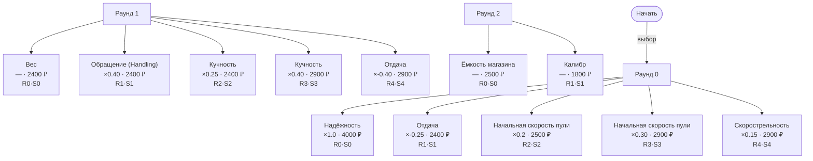

### ak74


### ak74u

```mermaid
graph TD
    Start(["Начать"])
    e_up_sect_firsta_ak74u["Скорострельность<br/>×0.1 · 700 ₽<br/>R0·S0"]
    e_up_sect_secona_ak74u["Отдача<br/>×-0.05 · 700 ₽<br/>R1·S1"]
    e_up_sect_thirda_ak74u["Отдача<br/>×-0.05 · 700 ₽<br/>R2·S2"]
    e_up_sect_fourta_ak74u["Отдача<br/>×-0.05 · 700 ₽<br/>R3·S3"]
    e_up_sect_fiftha_ak74u["Прицельный узел<br/>— · 1300 ₽<br/>R4·S4"]
    e_up_sect_firstc_ak74u["Надёжность<br/>×0.4 · 1800 ₽<br/>R0·S0"]
    e_up_sect_firstd_ak74u["Кучность<br/>×0.1 · 1500 ₽<br/>R1·S1"]
    e_up_sect_seconc_ak74u["Обращение (Handling)<br/>×0.1 · 1100 ₽<br/>R2·S2"]
    e_up_sect_thirdc_ak74u["Скорострельность<br/>×0.1 · 1100 ₽<br/>R3·S3"]
    e_up_sect_thirdd_ak74u["Кучность<br/>×0.1 · 1000 ₽<br/>R4·S4"]
    e_up_sect_fourtc_ak74u["Кучность<br/>×0.15 · 1100 ₽<br/>R5·S5"]
    e_up_sect_fifthc_ak74u["Ёмкость магазина<br/>— · 2300 ₽<br/>R6·S6"]
    e_up_sect_firste_ak74u["Отдача<br/>×-0.10 · 1500 ₽<br/>R0·S0"]
    e_up_sect_secone_ak74u["Отдача<br/>×-0.1 · 1550 ₽<br/>R1·S1"]
    e_up_sect_seconf_ak74u["Обращение (Handling)<br/>×0.15 · 1500 ₽<br/>R2·S2"]
    e_up_sect_thirde_ak74u["Обращение (Handling)<br/>×0.15 · 1500 ₽<br/>R3·S3"]
    e_up_sect_fourte_ak74u["Скорострельность<br/>×0.15 · 1600 ₽<br/>R4·S4"]
    R0["Раунд 0"]
    R0 --> e_up_sect_firsta_ak74u
    R0 --> e_up_sect_secona_ak74u
    R0 --> e_up_sect_thirda_ak74u
    R0 --> e_up_sect_fourta_ak74u
    R0 --> e_up_sect_fiftha_ak74u
    R1["Раунд 1"]
    R1 --> e_up_sect_firstc_ak74u
    R1 --> e_up_sect_firstd_ak74u
    R1 --> e_up_sect_seconc_ak74u
    R1 --> e_up_sect_thirdc_ak74u
    R1 --> e_up_sect_thirdd_ak74u
    R1 --> e_up_sect_fourtc_ak74u
    R1 --> e_up_sect_fifthc_ak74u
    R2["Раунд 2"]
    R2 --> e_up_sect_firste_ak74u
    R2 --> e_up_sect_secone_ak74u
    R2 --> e_up_sect_seconf_ak74u
    R2 --> e_up_sect_thirde_ak74u
    R2 --> e_up_sect_fourte_ak74u
    Start -->|"выбор"| R0
```

### akm

```mermaid
graph TD
    Start(["Начать"])
    e_up_sect_firsta_akm["Отдача<br/>×-0.05 · 980 ₽<br/>R0·S0"]
    e_up_sect_secona_akm["Обращение (Handling)<br/>×0.05 · 980 ₽<br/>R1·S1"]
    e_up_sect_thirda_akm["Кучность<br/>×0.1 · 1000 ₽<br/>R2·S2"]
    e_up_sect_fourta_akm["Вес<br/>— · 900 ₽<br/>R3·S3"]
    e_up_sect_fiftha_akm["Прицельный узел<br/>— · 1300 ₽<br/>R4·S4"]
    e_up_sect_firstc_akm["Надёжность<br/>×1.0 · 2500 ₽<br/>R0·S0"]
    e_up_sect_seconc_akm["Кучность<br/>×0.15 · 1460 ₽<br/>R1·S1"]
    e_up_sect_second_akm["Скорострельность<br/>×0.10 · 1400 ₽<br/>R2·S2"]
    e_up_sect_thirdc_akm["Начальная скорость пули<br/>×0.15 · 1400 ₽<br/>R3·S3"]
    e_up_sect_thirdd_akm["Отдача<br/>×-0.1 · 1460 ₽<br/>R4·S4"]
    e_up_sect_fourtc_akm["Обращение (Handling)<br/>×0.1 · 1290 ₽<br/>R5·S5"]
    e_up_sect_firste_akm["Кучность<br/>×0.15 · 2140 ₽<br/>R0·S0"]
    e_up_sect_firstf_akm["Отдача<br/>×-0.2 · 2070 ₽<br/>R1·S1"]
    e_up_sect_secone_akm["Начальная скорость пули<br/>×0.20 · 2100 ₽<br/>R2·S2"]
    e_up_sect_thirde_akm["Скорострельность<br/>×0.15 · 2140 ₽<br/>R3·S3"]
    e_up_sect_fourte_akm["Обращение (Handling)<br/>×0.2 · 1890 ₽<br/>R4·S4"]
    R0["Раунд 0"]
    R0 --> e_up_sect_firsta_akm
    R0 --> e_up_sect_secona_akm
    R0 --> e_up_sect_thirda_akm
    R0 --> e_up_sect_fourta_akm
    R0 --> e_up_sect_fiftha_akm
    R1["Раунд 1"]
    R1 --> e_up_sect_firstc_akm
    R1 --> e_up_sect_seconc_akm
    R1 --> e_up_sect_second_akm
    R1 --> e_up_sect_thirdc_akm
    R1 --> e_up_sect_thirdd_akm
    R1 --> e_up_sect_fourtc_akm
    R2["Раунд 2"]
    R2 --> e_up_sect_firste_akm
    R2 --> e_up_sect_firstf_akm
    R2 --> e_up_sect_secone_akm
    R2 --> e_up_sect_thirde_akm
    R2 --> e_up_sect_fourte_akm
    Start -->|"выбор"| R0
```

### aps

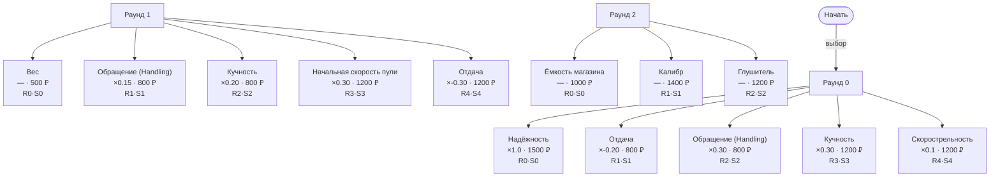

### barrett_m98

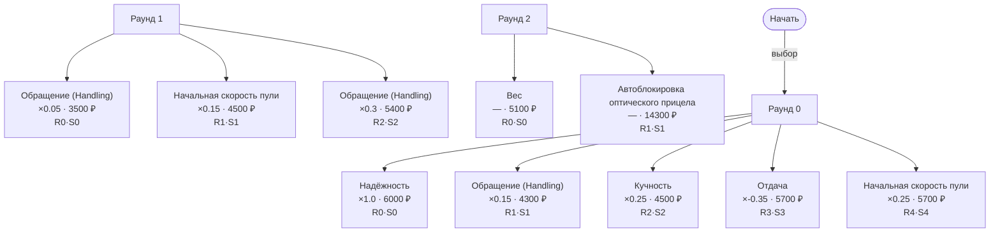

### beretta

```mermaid
graph TD
    Start(["Начать"])
    e_up_sect_firsta_beretta["Скорострельность<br/>×0.15 · 460 ₽<br/>R0·S0"]
    e_up_sect_secona_beretta["Скорострельность<br/>×0.15 · 500 ₽<br/>R1·S1"]
    e_up_sect_thirda_beretta["Надёжность<br/>×0.15 · 450 ₽<br/>R2·S2"]
    e_up_sect_fourta_beretta["Кучность<br/>×0.2 · 450 ₽<br/>R3·S3"]
    e_up_sect_fiftha_beretta["Глушитель<br/>— · 1100 ₽<br/>R4·S4"]
    e_up_sect_firstc_beretta["Надёжность<br/>×0.25 · 900 ₽<br/>R0·S0"]
    e_up_sect_firstd_beretta["Отдача<br/>×-0.25 · 890 ₽<br/>R1·S1"]
    e_up_sect_seconc_beretta["Начальная скорость пули<br/>×0.3 · 850 ₽<br/>R2·S2"]
    e_up_sect_second_beretta["Надёжность<br/>×0.25 · 900 ₽<br/>R3·S3"]
    e_up_sect_thirdc_beretta["Обращение (Handling)<br/>×0.3 · 900 ₽<br/>R4·S4"]
    e_up_sect_thirdd_beretta["Отдача<br/>×-0.25 · 900 ₽<br/>R5·S5"]
    e_up_sect_fourtc_beretta["Надёжность<br/>×0.15 · 900 ₽<br/>R6·S6"]
    e_up_sect_fifthc_beretta["Калибр<br/>— · 2200 ₽<br/>R7·S7"]
    e_up_sect_firste_beretta["Автоматический огонь<br/>— · 2900 ₽<br/>R0·S0"]
    e_up_sect_secone_beretta["Скорострельность<br/>×0.4 · 1300 ₽<br/>R1·S1"]
    R0["Раунд 0"]
    R0 --> e_up_sect_firsta_beretta
    R0 --> e_up_sect_secona_beretta
    R0 --> e_up_sect_thirda_beretta
    R0 --> e_up_sect_fourta_beretta
    R0 --> e_up_sect_fiftha_beretta
    R1["Раунд 1"]
    R1 --> e_up_sect_firstc_beretta
    R1 --> e_up_sect_firstd_beretta
    R1 --> e_up_sect_seconc_beretta
    R1 --> e_up_sect_second_beretta
    R1 --> e_up_sect_thirdc_beretta
    R1 --> e_up_sect_thirdd_beretta
    R1 --> e_up_sect_fourtc_beretta
    R1 --> e_up_sect_fifthc_beretta
    R2["Раунд 2"]
    R2 --> e_up_sect_firste_beretta
    R2 --> e_up_sect_secone_beretta
    Start -->|"выбор"| R0
```

### binoc

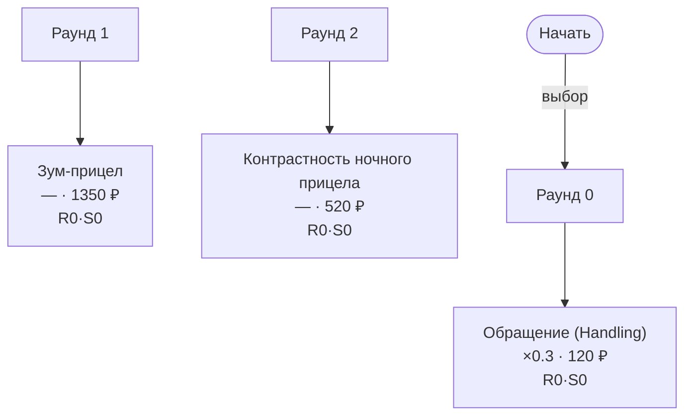

### bizon

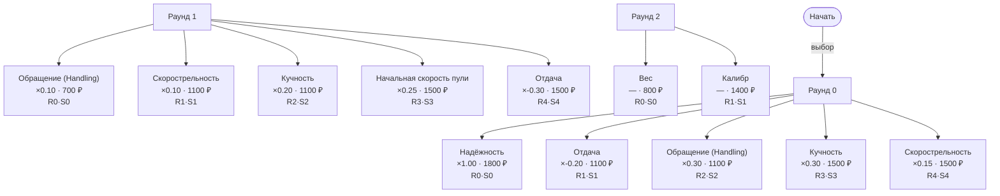

### bm16

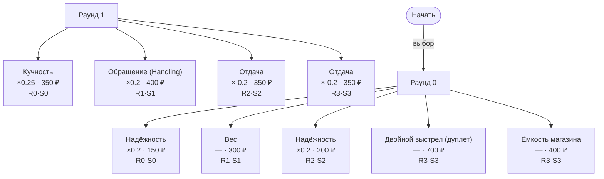

### bm16_long

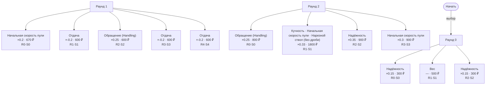

### colt1911

```mermaid
graph TD
    Start(["Начать"])
    e_up_sect_firsta_colt1911["Скорострельность<br/>×0.2 · 450 ₽<br/>R0·S0"]
    e_up_sect_secona_colt1911["Скорострельность<br/>×0.3 · 450 ₽<br/>R1·S1"]
    e_up_sect_thirda_colt1911["Вес<br/>— · 490 ₽<br/>R2·S2"]
    e_up_sect_fourta_colt1911["Кучность<br/>×0.15 · 450 ₽<br/>R3·S3"]
    e_up_sect_fiftha_colt1911["Ёмкость магазина<br/>— · 1100 ₽<br/>R4·S4"]
    e_up_sect_firstc_colt1911["Начальная скорость пули<br/>×0.3 · 900 ₽<br/>R0·S0"]
    e_up_sect_firstd_colt1911["Отдача<br/>×-0.2 · 900 ₽<br/>R1·S1"]
    e_up_sect_seconc_colt1911["Отдача<br/>×-0.2 · 890 ₽<br/>R2·S2"]
    e_up_sect_second_colt1911["Надёжность<br/>×0.25 · 860 ₽<br/>R3·S3"]
    e_up_sect_thirdc_colt1911["Обращение (Handling)<br/>×0.3 · 900 ₽<br/>R4·S4"]
    e_up_sect_thirdd_colt1911["Отдача<br/>×-0.2 · 900 ₽<br/>R5·S5"]
    e_up_sect_fourtc_colt1911["Надёжность<br/>×0.25 · 900 ₽<br/>R6·S6"]
    e_up_sect_firste_colt1911["Кучность<br/>×0.3 · 1400 ₽<br/>R0·S0"]
    e_up_sect_secone_colt1911["Скорострельность<br/>×0.3 · 1270 ₽<br/>R1·S1"]
    R0["Раунд 0"]
    R0 --> e_up_sect_firsta_colt1911
    R0 --> e_up_sect_secona_colt1911
    R0 --> e_up_sect_thirda_colt1911
    R0 --> e_up_sect_fourta_colt1911
    R0 --> e_up_sect_fiftha_colt1911
    R1["Раунд 1"]
    R1 --> e_up_sect_firstc_colt1911
    R1 --> e_up_sect_firstd_colt1911
    R1 --> e_up_sect_seconc_colt1911
    R1 --> e_up_sect_second_colt1911
    R1 --> e_up_sect_thirdc_colt1911
    R1 --> e_up_sect_thirdd_colt1911
    R1 --> e_up_sect_fourtc_colt1911
    R2["Раунд 2"]
    R2 --> e_up_sect_firste_colt1911
    R2 --> e_up_sect_secone_colt1911
    Start -->|"выбор"| R0
```

### common

```mermaid
graph TD
    Start(["Начать"])
    e_up_sect_auto_x1["Обращение (Handling)<br/>×0.10 · 2000 ₽<br/>R0·S0"]
    e_up_sect_auto_x2["Кучность<br/>×0.10 · 2000 ₽<br/>R0·S0"]
    e_up_sect_auto_x3["Надёжность<br/>×0.10 · 2000 ₽<br/>R0·S0"]
    e_up_sect_auto_x4["Начальная скорость пули<br/>×0.10 · 2000 ₽<br/>R0·S0"]
    e_up_sect_auto_x5["Скорострельность<br/>×0.10 · 2000 ₽<br/>R0·S0"]
    e_up_sect_auto_x6["Обращение (Handling)<br/>×0.10 · 2000 ₽<br/>R0·S0"]
    e_up_sect_auto_x7["Отдача<br/>×0.10 · 2000 ₽<br/>R0·S0"]
    e_up_sect_auto_x8["Надёжность<br/>×0.10 · 2000 ₽<br/>R0·S0"]
    e_up_sect_pist_x1["Обращение (Handling)<br/>×0.10 · 1200 ₽<br/>R0·S0"]
    e_up_sect_pist_x2["Кучность<br/>×0.10 · 1200 ₽<br/>R0·S0"]
    e_up_sect_pist_x3["Надёжность<br/>×0.10 · 1200 ₽<br/>R0·S0"]
    e_up_sect_pist_x4["Начальная скорость пули<br/>×0.10 · 1200 ₽<br/>R0·S0"]
    e_up_sect_pist_x5["Скорострельность<br/>×0.10 · 1200 ₽<br/>R0·S0"]
    e_up_sect_pist_x6["Отдача<br/>×0.10 · 1200 ₽<br/>R0·S0"]
    R0["Раунд 0"]
    R0 --> e_up_sect_auto_x1
    R0 --> e_up_sect_auto_x2
    R0 --> e_up_sect_auto_x3
    R0 --> e_up_sect_auto_x4
    R0 --> e_up_sect_auto_x5
    R0 --> e_up_sect_auto_x6
    R0 --> e_up_sect_auto_x7
    R0 --> e_up_sect_auto_x8
    R0 --> e_up_sect_pist_x1
    R0 --> e_up_sect_pist_x2
    R0 --> e_up_sect_pist_x3
    R0 --> e_up_sect_pist_x4
    R0 --> e_up_sect_pist_x5
    R0 --> e_up_sect_pist_x6
    Start -->|"выбор"| R0
```

### desert_eagle

```mermaid
graph TD
    Start(["Начать"])
    e_up_sect_firsta_desert_eagle["Скорострельность<br/>×0.2 · 900 ₽<br/>R0·S0"]
    e_up_sect_secona_desert_eagle["Начальная скорость пули<br/>×0.15 · 900 ₽<br/>R1·S1"]
    e_up_sect_thirda_desert_eagle["Вес<br/>— · 900 ₽<br/>R2·S2"]
    e_up_sect_fourta_desert_eagle["Кучность<br/>×0.2 · 840 ₽<br/>R3·S3"]
    e_up_sect_fiftha_desert_eagle["Ёмкость магазина<br/>— · 1950 ₽<br/>R4·S4"]
    e_up_sect_firstc_desert_eagle["Отдача<br/>×-0.15 · 1200 ₽<br/>R0·S0"]
    e_up_sect_seconc_desert_eagle["Надёжность<br/>×0.25 · 1780 ₽<br/>R1·S1"]
    e_up_sect_thirdc_desert_eagle["Обращение (Handling)<br/>×0.4 · 1730 ₽<br/>R2·S2"]
    e_up_sect_thirdd_desert_eagle["Отдача<br/>×-0.15 · 1430 ₽<br/>R3·S3"]
    e_up_sect_fourtc_desert_eagle["Надёжность<br/>×0.25 · 1790 ₽<br/>R4·S4"]
    e_up_sect_firste_desert_eagle["Кучность<br/>×0.4 · 2700 ₽<br/>R0·S0"]
    e_up_sect_firstf_desert_eagle["Отдача<br/>×-0.2 · 2000 ₽<br/>R1·S1"]
    e_up_sect_secone_desert_eagle["Скорострельность<br/>×0.4 · 2440 ₽<br/>R2·S2"]
    e_up_sect_seconf_desert_eagle["Начальная скорость пули<br/>×0.25 · 2270 ₽<br/>R3·S3"]
    e_up_sect_thirde_desert_eagle["Отдача<br/>×-0.2 · 1890 ₽<br/>R4·S4"]
    R0["Раунд 0"]
    R0 --> e_up_sect_firsta_desert_eagle
    R0 --> e_up_sect_secona_desert_eagle
    R0 --> e_up_sect_thirda_desert_eagle
    R0 --> e_up_sect_fourta_desert_eagle
    R0 --> e_up_sect_fiftha_desert_eagle
    R1["Раунд 1"]
    R1 --> e_up_sect_firstc_desert_eagle
    R1 --> e_up_sect_seconc_desert_eagle
    R1 --> e_up_sect_thirdc_desert_eagle
    R1 --> e_up_sect_thirdd_desert_eagle
    R1 --> e_up_sect_fourtc_desert_eagle
    R2["Раунд 2"]
    R2 --> e_up_sect_firste_desert_eagle
    R2 --> e_up_sect_firstf_desert_eagle
    R2 --> e_up_sect_secone_desert_eagle
    R2 --> e_up_sect_seconf_desert_eagle
    R2 --> e_up_sect_thirde_desert_eagle
    Start -->|"выбор"| R0
```

### el_binoc

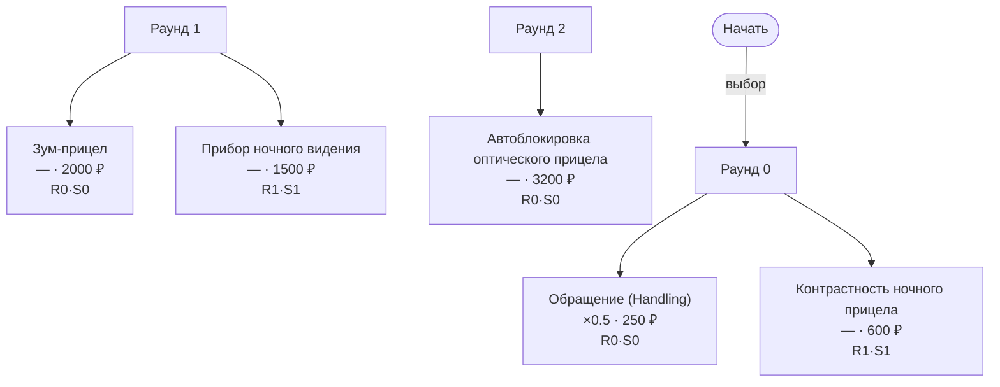

### fn2000

```mermaid
graph TD
    Start(["Начать"])
    e_up_sect_firsta_fn2000["Надёжность<br/>×0.2 · 1500 ₽<br/>R0·S0"]
    e_up_sect_secona_fn2000["Начальная скорость пули<br/>×0.15 · 1500 ₽<br/>R1·S1"]
    e_up_sect_thirda_fn2000["Отдача<br/>×-0.15 · 1500 ₽<br/>R2·S2"]
    e_up_sect_fourta_fn2000["Оптический прицел 4x<br/>— · 2100 ₽<br/>R3·S3"]
    e_up_sect_firstc_fn2000["Надёжность<br/>×0.3 · 2200 ₽<br/>R0·S0"]
    e_up_sect_firstd_fn2000["Начальная скорость пули<br/>×0.2 · 2200 ₽<br/>R1·S1"]
    e_up_sect_seconc_fn2000["Начальная скорость пули<br/>×0.2 · 2200 ₽<br/>R2·S2"]
    e_up_sect_second_fn2000["Скорострельность<br/>×0.15 · 2200 ₽<br/>R3·S3"]
    e_up_sect_thirdc_fn2000["Надёжность<br/>×0.2 · 2200 ₽<br/>R4·S4"]
    e_up_sect_thirdd_fn2000["Кучность<br/>×0.2 · 2200 ₽<br/>R5·S5"]
    e_up_sect_fourtc_fn2000["Контрастность ночного прицела<br/>— · 3500 ₽<br/>R6·S6"]
    e_up_sect_firste_fn2000["Обращение (Handling)<br/>×0.3 · 3000 ₽<br/>R0·S0"]
    e_up_sect_firstf_fn2000["Кучность<br/>×0.45 · 4500 ₽<br/>R1·S1"]
    e_up_sect_secone_fn2000["Кучность<br/>×0.2 · 3000 ₽<br/>R2·S2"]
    e_up_sect_seconf_fn2000["Отдача<br/>×-0.3 · 3000 ₽<br/>R3·S3"]
    e_up_sect_thirde_fn2000["Скорострельность<br/>×0.15 · 3000 ₽<br/>R4·S4"]
    e_up_sect_thirdf_fn2000["Начальная скорость пули<br/>×0.3 · 3000 ₽<br/>R5·S5"]
    e_up_sect_fourte_fn2000["Автоблокировка оптического прицела<br/>— · 9900 ₽<br/>R6·S6"]
    e_up_sect_fourtf_fn2000["Основной оптический прицел<br/>— · 6900 ₽<br/>R7·S7"]
    R0["Раунд 0"]
    R0 --> e_up_sect_firsta_fn2000
    R0 --> e_up_sect_secona_fn2000
    R0 --> e_up_sect_thirda_fn2000
    R0 --> e_up_sect_fourta_fn2000
    R1["Раунд 1"]
    R1 --> e_up_sect_firstc_fn2000
    R1 --> e_up_sect_firstd_fn2000
    R1 --> e_up_sect_seconc_fn2000
    R1 --> e_up_sect_second_fn2000
    R1 --> e_up_sect_thirdc_fn2000
    R1 --> e_up_sect_thirdd_fn2000
    R1 --> e_up_sect_fourtc_fn2000
    R2["Раунд 2"]
    R2 --> e_up_sect_firste_fn2000
    R2 --> e_up_sect_firstf_fn2000
    R2 --> e_up_sect_secone_fn2000
    R2 --> e_up_sect_seconf_fn2000
    R2 --> e_up_sect_thirde_fn2000
    R2 --> e_up_sect_thirdf_fn2000
    R2 --> e_up_sect_fourte_fn2000
    R2 --> e_up_sect_fourtf_fn2000
    Start -->|"выбор"| R0
```

### fn57

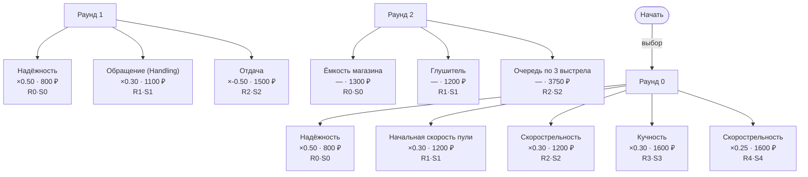

### fort

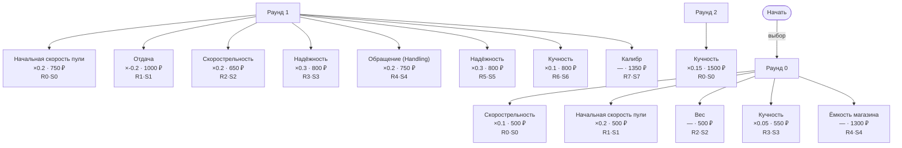

### g36

```mermaid
graph TD
    Start(["Начать"])
    e_up_sect_firsta_g36["Надёжность<br/>×1.0 · 7500 ₽<br/>R0·S0"]
    e_up_sect_secona_g36["Отдача<br/>×-0.15 · 1350 ₽<br/>R1·S1"]
    e_up_sect_thirda_g36["Кучность<br/>×0.1 · 1320 ₽<br/>R2·S2"]
    e_up_sect_fourta_g36["Штурмовой прицел 1.6x<br/>— · 1800 ₽<br/>R3·S3"]
    e_up_sect_fiftha_g36["Кучность<br/>×0.4 · 15000 ₽<br/>R4·S4"]
    e_up_sect_firstc_g36["Кучность<br/>×0.2 · 2050 ₽<br/>R0·S0"]
    e_up_sect_seconc_g36["Обращение (Handling)<br/>×0.15 · 2200 ₽<br/>R1·S1"]
    e_up_sect_second_g36["Отдача<br/>×-0.2 · 2150 ₽<br/>R2·S2"]
    e_up_sect_thirdc_g36["Отдача<br/>×-0.2 · 2000 ₽<br/>R3·S3"]
    e_up_sect_fourtc_g36["Основной оптический прицел<br/>— · 4800 ₽<br/>R4·S4"]
    e_up_sect_firste_g36["Обращение (Handling)<br/>×0.2 · 2800 ₽<br/>R0·S0"]
    e_up_sect_firstf_g36["Кучность<br/>×0.25 · 2750 ₽<br/>R1·S1"]
    e_up_sect_secone_g36["Начальная скорость пули<br/>×0.25 · 3200 ₽<br/>R2·S2"]
    e_up_sect_thirde_g36["Начальная скорость пули<br/>×0.25 · 3100 ₽<br/>R3·S3"]
    e_up_sect_thirdf_g36["Обращение (Handling)<br/>×0.2 · 3100 ₽<br/>R4·S4"]
    e_up_sect_fourte_g36["Прибор ночного видения<br/>— · 6000 ₽<br/>R5·S5"]
    e_up_sect_fourtf_g36["Контрастность ночного прицела<br/>— · 3000 ₽<br/>R6·S6"]
    R0["Раунд 0"]
    R0 --> e_up_sect_firsta_g36
    R0 --> e_up_sect_secona_g36
    R0 --> e_up_sect_thirda_g36
    R0 --> e_up_sect_fourta_g36
    R0 --> e_up_sect_fiftha_g36
    R1["Раунд 1"]
    R1 --> e_up_sect_firstc_g36
    R1 --> e_up_sect_seconc_g36
    R1 --> e_up_sect_second_g36
    R1 --> e_up_sect_thirdc_g36
    R1 --> e_up_sect_fourtc_g36
    R2["Раунд 2"]
    R2 --> e_up_sect_firste_g36
    R2 --> e_up_sect_firstf_g36
    R2 --> e_up_sect_secone_g36
    R2 --> e_up_sect_thirde_g36
    R2 --> e_up_sect_thirdf_g36
    R2 --> e_up_sect_fourte_g36
    R2 --> e_up_sect_fourtf_g36
    Start -->|"выбор"| R0
```

### galil

```mermaid
graph TD
    Start(["Начать"])
    e_up_sect_firsta_galil["Скорострельность<br/>×0.10 · 2200 ₽<br/>R0·S0"]
    e_up_sect_firstc_galil["Отдача<br/>×-0.25 · 3000 ₽<br/>R1·S1"]
    e_up_sect_firstd_galil["Кучность<br/>×0.15 · 3000 ₽<br/>R2·S2"]
    e_up_sect_firste_galil["Надёжность<br/>×1.0 · 6000 ₽<br/>R3·S3"]
    e_up_sect_firstf_galil["Скорострельность<br/>×0.20 · 4200 ₽<br/>R4·S4"]
    e_up_sect_secona_galil["Обращение (Handling)<br/>×0.15 · 2000 ₽<br/>R0·S0"]
    e_up_sect_seconc_galil["Обращение (Handling)<br/>×0.3 · 3000 ₽<br/>R1·S1"]
    e_up_sect_second_galil["Начальная скорость пули<br/>×0.25 · 3000 ₽<br/>R2·S2"]
    e_up_sect_secone_galil["Кучность<br/>×0.3 · 3900 ₽<br/>R3·S3"]
    e_up_sect_seconf_galil["Отдача<br/>×-0.35 · 3900 ₽<br/>R4·S4"]
    e_up_sect_thirda_galil["Вес<br/>— · 2000 ₽<br/>R0·S0"]
    e_up_sect_thirdc_galil["Глушитель<br/>— · 3200 ₽<br/>R1·S1"]
    e_up_sect_thirde_galil["Ёмкость магазина<br/>— · 2400 ₽<br/>R2·S2"]
    e_up_sect_thirde_rpk74m["Ёмкость магазина<br/>— · 3400 ₽<br/>R2·S2"]
    e_up_sect_thirde_rpk["Прицельный узел<br/>— · 3400 ₽<br/>R2·S2"]
    R0["Раунд 0"]
    R0 --> e_up_sect_firsta_galil
    R0 --> e_up_sect_firstc_galil
    R0 --> e_up_sect_firstd_galil
    R0 --> e_up_sect_firste_galil
    R0 --> e_up_sect_firstf_galil
    R1["Раунд 1"]
    R1 --> e_up_sect_secona_galil
    R1 --> e_up_sect_seconc_galil
    R1 --> e_up_sect_second_galil
    R1 --> e_up_sect_secone_galil
    R1 --> e_up_sect_seconf_galil
    R2["Раунд 2"]
    R2 --> e_up_sect_thirda_galil
    R2 --> e_up_sect_thirdc_galil
    R2 --> e_up_sect_thirde_galil
    R2 --> e_up_sect_thirde_rpk74m
    R2 --> e_up_sect_thirde_rpk
    Start -->|"выбор"| R0
```

### gauss

```mermaid
graph TD
    Start(["Начать"])
    e_up_sect_firsta_gauss["Обращение (Handling)<br/>×0.3 · 5000 ₽<br/>R0·S0"]
    e_up_sect_secona_gauss["Оптический прицел 6x<br/>— · 4000 ₽<br/>R1·S1"]
    e_up_sect_thirda_gauss["Контрастность ночного прицела<br/>— · 3500 ₽<br/>R2·S2"]
    e_up_sect_firstc_gauss["Вес<br/>— · 8500 ₽<br/>R0·S0"]
    e_up_sect_seconc_gauss["Основной оптический прицел<br/>— · 6000 ₽<br/>R1·S1"]
    e_up_sect_thirdc_gauss["Прибор ночного видения<br/>— · 7000 ₽<br/>R2·S2"]
    e_up_sect_seconf_gauss["Автоблокировка оптического прицела<br/>— · 11000 ₽<br/>R0·S0"]
    R0["Раунд 0"]
    R0 --> e_up_sect_firsta_gauss
    R0 --> e_up_sect_secona_gauss
    R0 --> e_up_sect_thirda_gauss
    R1["Раунд 1"]
    R1 --> e_up_sect_firstc_gauss
    R1 --> e_up_sect_seconc_gauss
    R1 --> e_up_sect_thirdc_gauss
    R2["Раунд 2"]
    R2 --> e_up_sect_seconf_gauss
    Start -->|"выбор"| R0
```

### groza

```mermaid
graph TD
    Start(["Начать"])
    e_up_sect_firsta_groza["Скорострельность<br/>×0.05 · 2300 ₽<br/>R0·S0"]
    e_up_sect_secona_groza["Отдача<br/>×-0.05 · 2000 ₽<br/>R1·S1"]
    e_up_sect_thirda_groza["Отдача<br/>×-0.05 · 2000 ₽<br/>R2·S2"]
    e_up_sect_fourta_groza["Отдача<br/>×-0.05 · 2000 ₽<br/>R3·S3"]
    e_up_sect_fiftha_groza["Ёмкость магазина<br/>— · 2750 ₽<br/>R4·S4"]
    e_up_sect_firstc_groza["Отдача<br/>×-0.15 · 2400 ₽<br/>R0·S0"]
    e_up_sect_firstd_groza["Обращение (Handling)<br/>×0.2 · 2400 ₽<br/>R1·S1"]
    e_up_sect_seconc_groza["Начальная скорость пули<br/>×0.15 · 2400 ₽<br/>R2·S2"]
    e_up_sect_thirdc_groza["Кучность<br/>×0.1 · 2400 ₽<br/>R3·S3"]
    e_up_sect_thirdd_groza["Скорострельность<br/>×0.1 · 2400 ₽<br/>R4·S4"]
    e_up_sect_fourtc_groza["Обращение (Handling)<br/>×0.25 · 2500 ₽<br/>R5·S5"]
    e_up_sect_firste_groza["Скорострельность<br/>×0.2 · 3200 ₽<br/>R0·S0"]
    e_up_sect_firstf_groza["Кучность<br/>×0.20 · 3300 ₽<br/>R1·S1"]
    e_up_sect_secone_groza["Отдача<br/>×-0.2 · 3400 ₽<br/>R2·S2"]
    e_up_sect_seconf_groza["Кучность<br/>×0.20 · 3400 ₽<br/>R3·S3"]
    e_up_sect_thirde_groza["Начальная скорость пули<br/>×0.25 · 3300 ₽<br/>R4·S4"]
    e_up_sect_fourte_groza["Надёжность<br/>×0.35 · 3400 ₽<br/>R5·S5"]
    e_up_sect_fourtf_groza["Начальная скорость пули<br/>×0.25 · 3300 ₽<br/>R6·S6"]
    R0["Раунд 0"]
    R0 --> e_up_sect_firsta_groza
    R0 --> e_up_sect_secona_groza
    R0 --> e_up_sect_thirda_groza
    R0 --> e_up_sect_fourta_groza
    R0 --> e_up_sect_fiftha_groza
    R1["Раунд 1"]
    R1 --> e_up_sect_firstc_groza
    R1 --> e_up_sect_firstd_groza
    R1 --> e_up_sect_seconc_groza
    R1 --> e_up_sect_thirdc_groza
    R1 --> e_up_sect_thirdd_groza
    R1 --> e_up_sect_fourtc_groza
    R2["Раунд 2"]
    R2 --> e_up_sect_firste_groza
    R2 --> e_up_sect_firstf_groza
    R2 --> e_up_sect_secone_groza
    R2 --> e_up_sect_seconf_groza
    R2 --> e_up_sect_thirde_groza
    R2 --> e_up_sect_fourte_groza
    R2 --> e_up_sect_fourtf_groza
    Start -->|"выбор"| R0
```

### hpsa

```mermaid
graph TD
    Start(["Начать"])
    e_up_sect_firsta_hpsa["Скорострельность<br/>×0.25 · 450 ₽<br/>R0·S0"]
    e_up_sect_secona_hpsa["Начальная скорость пули<br/>×0.15 · 450 ₽<br/>R1·S1"]
    e_up_sect_thirda_hpsa["Вес<br/>— · 480 ₽<br/>R2·S2"]
    e_up_sect_fourta_hpsa["Кучность<br/>×0.1 · 450 ₽<br/>R3·S3"]
    e_up_sect_fiftha_hpsa["Ёмкость магазина<br/>— · 1050 ₽<br/>R4·S4"]
    e_up_sect_firstc_hpsa["Начальная скорость пули<br/>×0.3 · 900 ₽<br/>R0·S0"]
    e_up_sect_firstd_hpsa["Отдача<br/>×-0.2 · 900 ₽<br/>R1·S1"]
    e_up_sect_seconc_hpsa["Надёжность<br/>×0.15 · 980 ₽<br/>R2·S2"]
    e_up_sect_thirdc_hpsa["Обращение (Handling)<br/>×0.2 · 900 ₽<br/>R3·S3"]
    e_up_sect_thirdd_hpsa["Отдача<br/>×-0.2 · 900 ₽<br/>R4·S4"]
    e_up_sect_fourtc_hpsa["Надёжность<br/>×0.15 · 850 ₽<br/>R5·S5"]
    e_up_sect_fifthc_hpsa["Калибр<br/>— · 1300 ₽<br/>R6·S6"]
    e_up_sect_firste_hpsa["Отдача<br/>×-0.3 · 1350 ₽<br/>R0·S0"]
    e_up_sect_secone_hpsa["Скорострельность<br/>×0.4 · 1400 ₽<br/>R1·S1"]
    e_up_sect_seconf_hpsa["Начальная скорость пули<br/>×0.15 · 450 ₽<br/>R2·S2"]
    e_up_sect_fourte_hpsa["Обращение (Handling)<br/>×0.4 · 1050 ₽<br/>R3·S3"]
    R0["Раунд 0"]
    R0 --> e_up_sect_firsta_hpsa
    R0 --> e_up_sect_secona_hpsa
    R0 --> e_up_sect_thirda_hpsa
    R0 --> e_up_sect_fourta_hpsa
    R0 --> e_up_sect_fiftha_hpsa
    R1["Раунд 1"]
    R1 --> e_up_sect_firstc_hpsa
    R1 --> e_up_sect_firstd_hpsa
    R1 --> e_up_sect_seconc_hpsa
    R1 --> e_up_sect_thirdc_hpsa
    R1 --> e_up_sect_thirdd_hpsa
    R1 --> e_up_sect_fourtc_hpsa
    R1 --> e_up_sect_fifthc_hpsa
    R2["Раунд 2"]
    R2 --> e_up_sect_firste_hpsa
    R2 --> e_up_sect_secone_hpsa
    R2 --> e_up_sect_seconf_hpsa
    R2 --> e_up_sect_fourte_hpsa
    Start -->|"выбор"| R0
```

### izh18

```mermaid
graph TD
    Start(["Начать"])
    e_up_sect_firsta_izh18["Надёжность<br/>×0.2 · 150 ₽<br/>R0·S0"]
    e_up_sect_secona_izh18["Вес · Обращение (Handling)<br/>×0.3 · 700 ₽<br/>R1·S1"]
    e_up_sect_thirda_izh18["Надёжность<br/>×0.2 · 200 ₽<br/>R2·S2"]
    e_up_sect_fourta_izh18["Двойной выстрел (дуплет)<br/>— · 700 ₽<br/>R3·S3"]
    e_up_sect_firstc_izh18["Кучность · Подкалиберная пуля<br/>×0.35 · 2300 ₽<br/>R0·S0"]
    e_up_sect_firstd_izh18["Начальная скорость пули · Нарезной ствол (без дроби)<br/>×0.35 · 1800 ₽<br/>R1·S1"]
    e_up_sect_seconc_izh18["Обращение (Handling)<br/>×0.2 · 600 ₽<br/>R2·S2"]
    e_up_sect_second_izh18["Начальная скорость пули<br/>×0.2 · 800 ₽<br/>R3·S3"]
    e_up_sect_thirdc_izh18["Начальная скорость пули<br/>×0.3 · 900 ₽<br/>R4·S4"]
    R0["Раунд 0"]
    R0 --> e_up_sect_firsta_izh18
    R0 --> e_up_sect_secona_izh18
    R0 --> e_up_sect_thirda_izh18
    R0 --> e_up_sect_fourta_izh18
    R1["Раунд 1"]
    R1 --> e_up_sect_firstc_izh18
    R1 --> e_up_sect_firstd_izh18
    R1 --> e_up_sect_seconc_izh18
    R1 --> e_up_sect_second_izh18
    R1 --> e_up_sect_thirdc_izh18
    Start -->|"выбор"| R0
```

### ks23

```mermaid
graph TD
    Start(["Начать"])
    e_up_sect_firsta_ks23["Надёжность<br/>×0.15 · 1600 ₽<br/>R0·S0"]
    e_up_sect_secona_ks23["Вес<br/>— · 1500 ₽<br/>R1·S1"]
    e_up_sect_thirda_ks23["Надёжность<br/>×0.15 · 1600 ₽<br/>R2·S2"]
    e_up_sect_fourta_ks23["Ёмкость магазина<br/>— · 4200 ₽<br/>R3·S3"]
    e_up_sect_firstc_ks23["Начальная скорость пули<br/>×0.30 · 2200 ₽<br/>R0·S0"]
    e_up_sect_firstd_ks23["Отдача<br/>×-0.20 · 2200 ₽<br/>R1·S1"]
    e_up_sect_seconc_ks23["Обращение (Handling)<br/>×0.30 · 2200 ₽<br/>R2·S2"]
    e_up_sect_second_ks23["Надёжность<br/>×0.20 · 2200 ₽<br/>R3·S3"]
    e_up_sect_thirdc_ks23["Кучность<br/>×0.20 · 2200 ₽<br/>R4·S4"]
    e_up_sect_thirdd_ks23["Отдача<br/>×-0.20 · 2200 ₽<br/>R5·S5"]
    e_up_sect_firste_ks23["Кучность<br/>×0.30 · 2600 ₽<br/>R0·S0"]
    e_up_sect_secone_ks23["Отдача<br/>×-0.30 · 2700 ₽<br/>R1·S1"]
    e_up_sect_thirde_ks23["Надёжность<br/>×0.30 · 2800 ₽<br/>R2·S2"]
    e_up_sect_thirdf_ks23["Скорострельность<br/>×0.4 · 4600 ₽<br/>R3·S3"]
    R0["Раунд 0"]
    R0 --> e_up_sect_firsta_ks23
    R0 --> e_up_sect_secona_ks23
    R0 --> e_up_sect_thirda_ks23
    R0 --> e_up_sect_fourta_ks23
    R1["Раунд 1"]
    R1 --> e_up_sect_firstc_ks23
    R1 --> e_up_sect_firstd_ks23
    R1 --> e_up_sect_seconc_ks23
    R1 --> e_up_sect_second_ks23
    R1 --> e_up_sect_thirdc_ks23
    R1 --> e_up_sect_thirdd_ks23
    R2["Раунд 2"]
    R2 --> e_up_sect_firste_ks23
    R2 --> e_up_sect_secone_ks23
    R2 --> e_up_sect_thirde_ks23
    R2 --> e_up_sect_thirdf_ks23
    Start -->|"выбор"| R0
```

### ks23_drozd

```mermaid
graph TD
    Start(["Начать"])
    e_up_sect_firsta_ks23_drozd["Надёжность<br/>×0.15 · 800 ₽<br/>R0·S0"]
    e_up_sect_secona_ks23_drozd["Вес<br/>— · 750 ₽<br/>R1·S1"]
    e_up_sect_thirda_ks23_drozd["Надёжность<br/>×0.15 · 800 ₽<br/>R2·S2"]
    e_up_sect_fourta_ks23_drozd["Ёмкость магазина<br/>— · 3400 ₽<br/>R3·S3"]
    e_up_sect_firstc_ks23_drozd["Начальная скорость пули<br/>×0.30 · 1100 ₽<br/>R0·S0"]
    e_up_sect_firstd_ks23_drozd["Отдача<br/>×-0.20 · 1100 ₽<br/>R1·S1"]
    e_up_sect_seconc_ks23_drozd["Обращение (Handling)<br/>×0.15 · 1100 ₽<br/>R2·S2"]
    e_up_sect_second_ks23_drozd["Надёжность<br/>×0.20 · 1100 ₽<br/>R3·S3"]
    e_up_sect_thirdc_ks23_drozd["Кучность<br/>×0.20 · 1100 ₽<br/>R4·S4"]
    e_up_sect_thirdd_ks23_drozd["Отдача<br/>×-0.2 · 2300 ₽<br/>R5·S5"]
    e_up_sect_firste_ks23_drozd["Обращение (Handling)<br/>×0.25 · 1300 ₽<br/>R0·S0"]
    e_up_sect_secone_ks23_drozd["Скорострельность<br/>×0.40 · 1350 ₽<br/>R1·S1"]
    e_up_sect_thirde_ks23_drozd["Надёжность<br/>×0.30 · 1400 ₽<br/>R2·S2"]
    e_up_sect_thirdf_ks23_drozd["Скорострельность<br/>×0.4 · 2300 ₽<br/>R3·S3"]
    R0["Раунд 0"]
    R0 --> e_up_sect_firsta_ks23_drozd
    R0 --> e_up_sect_secona_ks23_drozd
    R0 --> e_up_sect_thirda_ks23_drozd
    R0 --> e_up_sect_fourta_ks23_drozd
    R1["Раунд 1"]
    R1 --> e_up_sect_firstc_ks23_drozd
    R1 --> e_up_sect_firstd_ks23_drozd
    R1 --> e_up_sect_seconc_ks23_drozd
    R1 --> e_up_sect_second_ks23_drozd
    R1 --> e_up_sect_thirdc_ks23_drozd
    R1 --> e_up_sect_thirdd_ks23_drozd
    R2["Раунд 2"]
    R2 --> e_up_sect_firste_ks23_drozd
    R2 --> e_up_sect_secone_ks23_drozd
    R2 --> e_up_sect_thirde_ks23_drozd
    R2 --> e_up_sect_thirdf_ks23_drozd
    Start -->|"выбор"| R0
```

### l85

```mermaid
graph TD
    Start(["Начать"])
    e_up_sect_firsta_l85["Надёжность<br/>×0.15 · 1350 ₽<br/>R0·S0"]
    e_up_sect_secona_l85["Кучность<br/>×0.1 · 950 ₽<br/>R1·S1"]
    e_up_sect_thirda_l85["Начальная скорость пули<br/>×0.05 · 950 ₽<br/>R2·S2"]
    e_up_sect_fourta_l85["Оптический прицел 2.4x<br/>— · 1500 ₽<br/>R3·S3"]
    e_up_sect_fiftha_l85["Глушитель<br/>— · 1200 ₽<br/>R4·S4"]
    e_up_sect_firstc_l85["Обращение (Handling)<br/>×0.15 · 1350 ₽<br/>R0·S0"]
    e_up_sect_seconc_l85["Обращение (Handling)<br/>×0.15 · 1400 ₽<br/>R1·S1"]
    e_up_sect_second_l85["Надёжность<br/>×0.25 · 1400 ₽<br/>R2·S2"]
    e_up_sect_thirdc_l85["Отдача<br/>×-0.15 · 1250 ₽<br/>R3·S3"]
    e_up_sect_fourtc_l85["Контрастность ночного прицела<br/>— · 2300 ₽<br/>R4·S4"]
    e_up_sect_fifthc_l85["Калибр<br/>— · 3800 ₽<br/>R5·S5"]
    e_up_sect_firste_l85["Надёжность<br/>×0.3 · 1800 ₽<br/>R0·S0"]
    e_up_sect_firstf_l85["Начальная скорость пули<br/>×0.2 · 1700 ₽<br/>R1·S1"]
    e_up_sect_secone_l85["Надёжность<br/>×0.3 · 1800 ₽<br/>R2·S2"]
    e_up_sect_thirde_l85["Начальная скорость пули<br/>×0.2 · 1700 ₽<br/>R3·S3"]
    e_up_sect_thirdf_l85["Кучность<br/>×0.2 · 1750 ₽<br/>R4·S4"]
    e_up_sect_fourte_l85["Основной оптический прицел<br/>— · 4500 ₽<br/>R5·S5"]
    R0["Раунд 0"]
    R0 --> e_up_sect_firsta_l85
    R0 --> e_up_sect_secona_l85
    R0 --> e_up_sect_thirda_l85
    R0 --> e_up_sect_fourta_l85
    R0 --> e_up_sect_fiftha_l85
    R1["Раунд 1"]
    R1 --> e_up_sect_firstc_l85
    R1 --> e_up_sect_seconc_l85
    R1 --> e_up_sect_second_l85
    R1 --> e_up_sect_thirdc_l85
    R1 --> e_up_sect_fourtc_l85
    R1 --> e_up_sect_fifthc_l85
    R2["Раунд 2"]
    R2 --> e_up_sect_firste_l85
    R2 --> e_up_sect_firstf_l85
    R2 --> e_up_sect_secone_l85
    R2 --> e_up_sect_thirde_l85
    R2 --> e_up_sect_thirdf_l85
    R2 --> e_up_sect_fourte_l85
    Start -->|"выбор"| R0
```

### lr300

```mermaid
graph TD
    Start(["Начать"])
    e_up_sect_firsta_lr300["Надёжность<br/>×0.15 · 1050 ₽<br/>R0·S0"]
    e_up_sect_secona_lr300["Отдача<br/>×-0.15 · 1050 ₽<br/>R1·S1"]
    e_up_sect_thirda_lr300["Обращение (Handling)<br/>×0.15 · 1100 ₽<br/>R2·S2"]
    e_up_sect_fourta_lr300["Вес<br/>— · 700 ₽<br/>R3·S3"]
    e_up_sect_fiftha_lr300["Ёмкость магазина<br/>— · 1690 ₽<br/>R4·S4"]
    e_up_sect_firstc_lr300["Начальная скорость пули<br/>×0.15 · 1600 ₽<br/>R0·S0"]
    e_up_sect_firstd_lr300["Скорострельность<br/>×0.1 · 1600 ₽<br/>R1·S1"]
    e_up_sect_seconc_lr300["Надёжность<br/>×0.15 · 1500 ₽<br/>R2·S2"]
    e_up_sect_thirdc_lr300["Кучность<br/>×0.2 · 1600 ₽<br/>R3·S3"]
    e_up_sect_thirdd_lr300["Скорострельность<br/>×0.1 · 1600 ₽<br/>R4·S4"]
    e_up_sect_fourtc_lr300["Обращение (Handling)<br/>×0.15 · 1600 ₽<br/>R5·S5"]
    e_up_sect_firste_lr300["Надёжность<br/>×0.2 · 1860 ₽<br/>R0·S0"]
    e_up_sect_secone_lr300["Отдача<br/>×-0.3 · 1850 ₽<br/>R1·S1"]
    e_up_sect_seconf_lr300["Кучность<br/>×0.2 · 1900 ₽<br/>R2·S2"]
    e_up_sect_thirde_lr300["Скорострельность<br/>×0.2 · 1900 ₽<br/>R3·S3"]
    e_up_sect_fourte_lr300["Обращение (Handling)<br/>×0.25 · 1550 ₽<br/>R4·S4"]
    e_up_sect_fourtf_lr300["Начальная скорость пули<br/>×0.25 · 1860 ₽<br/>R5·S5"]
    R0["Раунд 0"]
    R0 --> e_up_sect_firsta_lr300
    R0 --> e_up_sect_secona_lr300
    R0 --> e_up_sect_thirda_lr300
    R0 --> e_up_sect_fourta_lr300
    R0 --> e_up_sect_fiftha_lr300
    R1["Раунд 1"]
    R1 --> e_up_sect_firstc_lr300
    R1 --> e_up_sect_firstd_lr300
    R1 --> e_up_sect_seconc_lr300
    R1 --> e_up_sect_thirdc_lr300
    R1 --> e_up_sect_thirdd_lr300
    R1 --> e_up_sect_fourtc_lr300
    R2["Раунд 2"]
    R2 --> e_up_sect_firste_lr300
    R2 --> e_up_sect_secone_lr300
    R2 --> e_up_sect_seconf_lr300
    R2 --> e_up_sect_thirde_lr300
    R2 --> e_up_sect_fourte_lr300
    R2 --> e_up_sect_fourtf_lr300
    Start -->|"выбор"| R0
```

### m1891

```mermaid
graph TD
    Start(["Начать"])
    e_up_sect_firsta_m1891["Надёжность<br/>×0.20 · 1000 ₽<br/>R0·S0"]
    e_up_sect_firstc_m1891["Обращение (Handling)<br/>×0.25 · 1450 ₽<br/>R1·S1"]
    e_up_sect_firstd_m1891["Кучность<br/>×0.25 · 1600 ₽<br/>R2·S2"]
    e_up_sect_firste_m1891["Отдача<br/>×-0.35 · 1800 ₽<br/>R3·S3"]
    e_up_sect_firstf_m1891["Начальная скорость пули<br/>×0.25 · 1950 ₽<br/>R4·S4"]
    e_up_sect_secona_m1891["Надёжность<br/>×0.20 · 1000 ₽<br/>R0·S0"]
    e_up_sect_seconc_m1891["Начальная скорость пули<br/>×0.15 · 1500 ₽<br/>R1·S1"]
    e_up_sect_secone_m1891["Обращение (Handling)<br/>×0.40 · 1900 ₽<br/>R2·S2"]
    e_up_sect_thirda_m1891["Ёмкость магазина<br/>— · 1650 ₽<br/>R0·S0"]
    R0["Раунд 0"]
    R0 --> e_up_sect_firsta_m1891
    R0 --> e_up_sect_firstc_m1891
    R0 --> e_up_sect_firstd_m1891
    R0 --> e_up_sect_firste_m1891
    R0 --> e_up_sect_firstf_m1891
    R1["Раунд 1"]
    R1 --> e_up_sect_secona_m1891
    R1 --> e_up_sect_seconc_m1891
    R1 --> e_up_sect_secone_m1891
    R2["Раунд 2"]
    R2 --> e_up_sect_thirda_m1891
    Start -->|"выбор"| R0
```

### m249

```mermaid
graph TD
    Start(["Начать"])
    e_up_sect_firsta_m249["Начальная скорость пули<br/>×0.10 · 3500 ₽<br/>R0·S0"]
    e_up_sect_firstc_m249["Отдача<br/>×-0.2 · 3500 ₽<br/>R1·S1"]
    e_up_sect_firstd_m249["Кучность<br/>×0.15 · 3500 ₽<br/>R2·S2"]
    e_up_sect_firste_m249["Кучность<br/>×0.30 · 4600 ₽<br/>R3·S3"]
    e_up_sect_firstf_m249["Скорострельность<br/>×0.2 · 4700 ₽<br/>R4·S4"]
    e_up_sect_secona_m249["Обращение (Handling)<br/>×0.2 · 2500 ₽<br/>R0·S0"]
    e_up_sect_seconc_m249["Обращение (Handling)<br/>×0.40 · 3600 ₽<br/>R1·S1"]
    e_up_sect_second_m249["Скорострельность<br/>×0.1 · 3700 ₽<br/>R2·S2"]
    e_up_sect_secone_m249["Надёжность<br/>×1.0 · 5000 ₽<br/>R3·S3"]
    e_up_sect_seconf_m249["Отдача<br/>×-0.35 · 4600 ₽<br/>R4·S4"]
    e_up_sect_thirda_m249["Ёмкость магазина<br/>— · 4450 ₽<br/>R0·S0"]
    e_up_sect_thirdc_m249["Вес<br/>— · 10450 ₽<br/>R1·S1"]
    R0["Раунд 0"]
    R0 --> e_up_sect_firsta_m249
    R0 --> e_up_sect_firstc_m249
    R0 --> e_up_sect_firstd_m249
    R0 --> e_up_sect_firste_m249
    R0 --> e_up_sect_firstf_m249
    R1["Раунд 1"]
    R1 --> e_up_sect_secona_m249
    R1 --> e_up_sect_seconc_m249
    R1 --> e_up_sect_second_m249
    R1 --> e_up_sect_secone_m249
    R1 --> e_up_sect_seconf_m249
    R2["Раунд 2"]
    R2 --> e_up_sect_thirda_m249
    R2 --> e_up_sect_thirdc_m249
    Start -->|"выбор"| R0
```

### mp5

```mermaid
graph TD
    Start(["Начать"])
    e_up_sect_firsta_mp5["Отдача<br/>×-0.1 · 500 ₽<br/>R0·S0"]
    e_up_sect_secona_mp5["Скорострельность<br/>×0.1 · 500 ₽<br/>R1·S1"]
    e_up_sect_thirda_mp5["Отдача<br/>×-0.1 · 500 ₽<br/>R2·S2"]
    e_up_sect_fourta_mp5["Надёжность<br/>×0.15 · 500 ₽<br/>R3·S3"]
    e_up_sect_fiftha_mp5["Ёмкость магазина<br/>— · 1000 ₽<br/>R4·S4"]
    e_up_sect_firstc_mp5["Кучность<br/>×0.2 · 800 ₽<br/>R0·S0"]
    e_up_sect_firstd_mp5["Скорострельность<br/>×0.1 · 800 ₽<br/>R1·S1"]
    e_up_sect_seconc_mp5["Надёжность<br/>×0.2 · 800 ₽<br/>R2·S2"]
    e_up_sect_thirdc_mp5["Обращение (Handling)<br/>×0.2 · 800 ₽<br/>R3·S3"]
    e_up_sect_thirdd_mp5["Надёжность<br/>×0.2 · 800 ₽<br/>R4·S4"]
    e_up_sect_fourtc_mp5["Скорострельность<br/>×0.1 · 800 ₽<br/>R5·S5"]
    e_up_sect_fifthc_mp5["Калибр<br/>— · 1500 ₽<br/>R6·S6"]
    e_up_sect_firste_mp5["Надёжность<br/>×0.25 · 1100 ₽<br/>R0·S0"]
    e_up_sect_secone_mp5["Кучность<br/>×0.3 · 1100 ₽<br/>R1·S1"]
    e_up_sect_seconf_mp5["Отдача<br/>×-0.3 · 1100 ₽<br/>R2·S2"]
    e_up_sect_thirde_mp5["Скорострельность<br/>×0.2 · 1100 ₽<br/>R3·S3"]
    e_up_sect_fourte_mp5["Обращение (Handling)<br/>×0.3 · 1100 ₽<br/>R4·S4"]
    e_up_sect_fourtf_mp5["Начальная скорость пули<br/>×0.3 · 1100 ₽<br/>R5·S5"]
    e_up_sect_fifthe_mp5["Очередь по 3 выстрела<br/>— · 800 ₽<br/>R6·S6"]
    R0["Раунд 0"]
    R0 --> e_up_sect_firsta_mp5
    R0 --> e_up_sect_secona_mp5
    R0 --> e_up_sect_thirda_mp5
    R0 --> e_up_sect_fourta_mp5
    R0 --> e_up_sect_fiftha_mp5
    R1["Раунд 1"]
    R1 --> e_up_sect_firstc_mp5
    R1 --> e_up_sect_firstd_mp5
    R1 --> e_up_sect_seconc_mp5
    R1 --> e_up_sect_thirdc_mp5
    R1 --> e_up_sect_thirdd_mp5
    R1 --> e_up_sect_fourtc_mp5
    R1 --> e_up_sect_fifthc_mp5
    R2["Раунд 2"]
    R2 --> e_up_sect_firste_mp5
    R2 --> e_up_sect_secone_mp5
    R2 --> e_up_sect_seconf_mp5
    R2 --> e_up_sect_thirde_mp5
    R2 --> e_up_sect_fourte_mp5
    R2 --> e_up_sect_fourtf_mp5
    R2 --> e_up_sect_fifthe_mp5
    Start -->|"выбор"| R0
```

### mr153

```mermaid
graph TD
    Start(["Начать"])
    e_up_sect_firsta_mp153["Начальная скорость пули<br/>×0.1 · 2100 ₽<br/>R0·S0"]
    e_up_sect_secona_mp153["Вес<br/>— · 2300 ₽<br/>R1·S1"]
    e_up_sect_thirda_mp153["Отдача<br/>×-0.05 · 2000 ₽<br/>R2·S2"]
    e_up_sect_fourta_mp153["Ёмкость магазина<br/>— · 4000 ₽<br/>R3·S3"]
    e_up_sect_firstc_mp153["Начальная скорость пули<br/>×0.2 · 2600 ₽<br/>R0·S0"]
    e_up_sect_firstd_mp153["Обращение (Handling)<br/>×0.2 · 3200 ₽<br/>R1·S1"]
    e_up_sect_seconc_mp153["Обращение (Handling)<br/>×0.2 · 2450 ₽<br/>R2·S2"]
    e_up_sect_second_mp153["Отдача<br/>×-0.1 · 2450 ₽<br/>R3·S3"]
    e_up_sect_thirdc_mp153["Кучность<br/>×0.1 · 2400 ₽<br/>R4·S4"]
    e_up_sect_thirdd_mp153["Скорострельность<br/>×0.15 · 2400 ₽<br/>R5·S5"]
    e_up_sect_firste_mp153["Кучность<br/>×0.2 · 2700 ₽<br/>R0·S0"]
    e_up_sect_firstf_mp153["Скорострельность<br/>×0.3 · 2700 ₽<br/>R1·S1"]
    e_up_sect_thirde_mp153["Надёжность<br/>×1.0 · 4000 ₽<br/>R2·S2"]
    e_up_sect_thirdf_mp153["Отдача<br/>×-0.2 · 2700 ₽<br/>R3·S3"]
    R0["Раунд 0"]
    R0 --> e_up_sect_firsta_mp153
    R0 --> e_up_sect_secona_mp153
    R0 --> e_up_sect_thirda_mp153
    R0 --> e_up_sect_fourta_mp153
    R1["Раунд 1"]
    R1 --> e_up_sect_firstc_mp153
    R1 --> e_up_sect_firstd_mp153
    R1 --> e_up_sect_seconc_mp153
    R1 --> e_up_sect_second_mp153
    R1 --> e_up_sect_thirdc_mp153
    R1 --> e_up_sect_thirdd_mp153
    R2["Раунд 2"]
    R2 --> e_up_sect_firste_mp153
    R2 --> e_up_sect_firstf_mp153
    R2 --> e_up_sect_thirde_mp153
    R2 --> e_up_sect_thirdf_mp153
    Start -->|"выбор"| R0
```

### p90

```mermaid
graph TD
    Start(["Начать"])
    e_up_sect_firsta_p90["Надёжность<br/>×0.20 · 900 ₽<br/>R0·S0"]
    e_up_sect_firstc_p90["Отдача<br/>×-0.20 · 1500 ₽<br/>R1·S1"]
    e_up_sect_firstd_p90["Обращение (Handling)<br/>×0.30 · 1500 ₽<br/>R2·S2"]
    e_up_sect_firste_p90["Кучность<br/>×0.30 · 1900 ₽<br/>R3·S3"]
    e_up_sect_firstf_p90["Скорострельность<br/>×0.15 · 1900 ₽<br/>R4·S4"]
    e_up_sect_secona_p90["Надёжность<br/>×0.20 · 900 ₽<br/>R0·S0"]
    e_up_sect_seconc_p90["Скорострельность<br/>×0.10 · 1500 ₽<br/>R1·S1"]
    e_up_sect_second_p90["Кучность<br/>×0.20 · 1500 ₽<br/>R2·S2"]
    e_up_sect_secone_p90["Начальная скорость пули<br/>×0.25 · 1900 ₽<br/>R3·S3"]
    e_up_sect_seconf_p90["Отдача<br/>×-0.30 · 1900 ₽<br/>R4·S4"]
    e_up_sect_thirda_p90["Вес<br/>— · 1400 ₽<br/>R0·S0"]
    R0["Раунд 0"]
    R0 --> e_up_sect_firsta_p90
    R0 --> e_up_sect_firstc_p90
    R0 --> e_up_sect_firstd_p90
    R0 --> e_up_sect_firste_p90
    R0 --> e_up_sect_firstf_p90
    R1["Раунд 1"]
    R1 --> e_up_sect_secona_p90
    R1 --> e_up_sect_seconc_p90
    R1 --> e_up_sect_second_p90
    R1 --> e_up_sect_secone_p90
    R1 --> e_up_sect_seconf_p90
    R2["Раунд 2"]
    R2 --> e_up_sect_thirda_p90
    Start -->|"выбор"| R0
```

### pb

```mermaid
graph TD
    Start(["Начать"])
    e_up_sect_firsta_pb["Скорострельность<br/>×0.25 · 420 ₽<br/>R0·S0"]
    e_up_sect_secona_pb["Отдача<br/>×-0.15 · 350 ₽<br/>R1·S1"]
    e_up_sect_thirda_pb["Вес<br/>— · 350 ₽<br/>R2·S2"]
    e_up_sect_fourta_pb["Кучность<br/>×0.15 · 350 ₽<br/>R3·S3"]
    e_up_sect_fiftha_pb["Ёмкость магазина<br/>— · 990 ₽<br/>R4·S4"]
    e_up_sect_firstc_pb["Надёжность<br/>×0.3 · 750 ₽<br/>R0·S0"]
    e_up_sect_firstd_pb["Отдача<br/>×-0.2 · 720 ₽<br/>R1·S1"]
    e_up_sect_seconc_pb["Отдача<br/>×-0.25 · 780 ₽<br/>R2·S2"]
    e_up_sect_thirdc_pb["Обращение (Handling)<br/>×0.3 · 750 ₽<br/>R3·S3"]
    e_up_sect_fourtc_pb["Кучность<br/>×0.2 · 750 ₽<br/>R4·S4"]
    e_up_sect_firste_pb["Начальная скорость пули<br/>×0.3 · 720 ₽<br/>R0·S0"]
    e_up_sect_thirde_pb["Кучность<br/>×0.3 · 1200 ₽<br/>R1·S1"]
    R0["Раунд 0"]
    R0 --> e_up_sect_firsta_pb
    R0 --> e_up_sect_secona_pb
    R0 --> e_up_sect_thirda_pb
    R0 --> e_up_sect_fourta_pb
    R0 --> e_up_sect_fiftha_pb
    R1["Раунд 1"]
    R1 --> e_up_sect_firstc_pb
    R1 --> e_up_sect_firstd_pb
    R1 --> e_up_sect_seconc_pb
    R1 --> e_up_sect_thirdc_pb
    R1 --> e_up_sect_fourtc_pb
    R2["Раунд 2"]
    R2 --> e_up_sect_firste_pb
    R2 --> e_up_sect_thirde_pb
    Start -->|"выбор"| R0
```

### pkm

```mermaid
graph TD
    Start(["Начать"])
    e_up_sect_firsta_pkm["Надёжность<br/>×0.15 · 3000 ₽<br/>R0·S0"]
    e_up_sect_secona_pkm["Отдача<br/>×-0.10 · 3000 ₽<br/>R1·S1"]
    e_up_sect_thirda_pkm["Надёжность<br/>×0.15 · 3100 ₽<br/>R2·S2"]
    e_up_sect_fourta_pkm["Кучность<br/>×0.10 · 3000 ₽<br/>R3·S3"]
    e_up_sect_fiftha_pkm["Ёмкость магазина<br/>— · 2700 ₽<br/>R4·S4"]
    e_up_sect_firstc_pkm["Отдача<br/>×-0.15 · 3500 ₽<br/>R0·S0"]
    e_up_sect_firstd_pkm["Начальная скорость пули<br/>×0.20 · 3500 ₽<br/>R1·S1"]
    e_up_sect_seconc_pkm["Отдача<br/>×-0.15 · 3700 ₽<br/>R2·S2"]
    e_up_sect_thirdc_pkm["Надёжность<br/>×0.25 · 3700 ₽<br/>R3·S3"]
    e_up_sect_thirdd_pkm["Скорострельность<br/>×0.07 · 3700 ₽<br/>R4·S4"]
    e_up_sect_fourtc_pkm["Обращение (Handling)<br/>×0.20 · 3800 ₽<br/>R5·S5"]
    e_up_sect_fifthc_pkm["Вес<br/>— · 10450 ₽<br/>R6·S6"]
    e_up_sect_firste_pkm["Скорострельность<br/>×0.10 · 3950 ₽<br/>R0·S0"]
    e_up_sect_secone_pkm["Обращение (Handling)<br/>×0.30 · 4500 ₽<br/>R1·S1"]
    e_up_sect_seconf_pkm["Скорострельность<br/>×0.13 · 4500 ₽<br/>R2·S2"]
    e_up_sect_thirde_pkm["Кучность<br/>×0.30 · 4500 ₽<br/>R3·S3"]
    e_up_sect_fourte_pkm["Отдача<br/>×-0.20 · 4400 ₽<br/>R4·S4"]
    R0["Раунд 0"]
    R0 --> e_up_sect_firsta_pkm
    R0 --> e_up_sect_secona_pkm
    R0 --> e_up_sect_thirda_pkm
    R0 --> e_up_sect_fourta_pkm
    R0 --> e_up_sect_fiftha_pkm
    R1["Раунд 1"]
    R1 --> e_up_sect_firstc_pkm
    R1 --> e_up_sect_firstd_pkm
    R1 --> e_up_sect_seconc_pkm
    R1 --> e_up_sect_thirdc_pkm
    R1 --> e_up_sect_thirdd_pkm
    R1 --> e_up_sect_fourtc_pkm
    R1 --> e_up_sect_fifthc_pkm
    R2["Раунд 2"]
    R2 --> e_up_sect_firste_pkm
    R2 --> e_up_sect_secone_pkm
    R2 --> e_up_sect_seconf_pkm
    R2 --> e_up_sect_thirde_pkm
    R2 --> e_up_sect_fourte_pkm
    Start -->|"выбор"| R0
```

### pm

```mermaid
graph TD
    Start(["Начать"])
    e_up_sect_firsta_pm["Скорострельность<br/>×0.2 · 300 ₽<br/>R0·S0"]
    e_up_sect_secona_pm["Начальная скорость пули<br/>×0.2 · 300 ₽<br/>R1·S1"]
    e_up_sect_thirda_pm["Вес<br/>— · 300 ₽<br/>R2·S2"]
    e_up_sect_fourta_pm["Кучность<br/>×0.25 · 400 ₽<br/>R3·S3"]
    e_up_sect_fiftha_pm["Ёмкость магазина<br/>— · 500 ₽<br/>R4·S4"]
    e_up_sect_firstc_pm["Начальная скорость пули<br/>×0.2 · 500 ₽<br/>R0·S0"]
    e_up_sect_firstd_pm["Отдача<br/>×-0.2 · 600 ₽<br/>R1·S1"]
    e_up_sect_seconc_pm["Надёжность<br/>×0.3 · 600 ₽<br/>R2·S2"]
    e_up_sect_thirdc_pm["Обращение (Handling)<br/>×0.3 · 600 ₽<br/>R3·S3"]
    e_up_sect_thirdd_pm["Отдача<br/>×-0.2 · 600 ₽<br/>R4·S4"]
    e_up_sect_fourtc_pm["Кучность<br/>×0.25 · 500 ₽<br/>R5·S5"]
    e_up_sect_fifthc_pm["Калибр<br/>— · 680 ₽<br/>R6·S6"]
    e_up_sect_firste_pm["Скорострельность<br/>×0.3 · 890 ₽<br/>R0·S0"]
    R0["Раунд 0"]
    R0 --> e_up_sect_firsta_pm
    R0 --> e_up_sect_secona_pm
    R0 --> e_up_sect_thirda_pm
    R0 --> e_up_sect_fourta_pm
    R0 --> e_up_sect_fiftha_pm
    R1["Раунд 1"]
    R1 --> e_up_sect_firstc_pm
    R1 --> e_up_sect_firstd_pm
    R1 --> e_up_sect_seconc_pm
    R1 --> e_up_sect_thirdc_pm
    R1 --> e_up_sect_thirdd_pm
    R1 --> e_up_sect_fourtc_pm
    R1 --> e_up_sect_fifthc_pm
    R2["Раунд 2"]
    R2 --> e_up_sect_firste_pm
    Start -->|"выбор"| R0
```

### protecta

```mermaid
graph TD
    Start(["Начать"])
    e_up_sect_firsta_protecta["Надёжность<br/>×0.1 · 1200 ₽<br/>R0·S0"]
    e_up_sect_secona_protecta["Отдача<br/>×-0.1 · 1200 ₽<br/>R1·S1"]
    e_up_sect_thirda_protecta["Надёжность<br/>×0.1 · 1250 ₽<br/>R2·S2"]
    e_up_sect_fourta_protecta["Отдача<br/>×-0.1 · 1200 ₽<br/>R3·S3"]
    e_up_sect_firstc_protecta["Начальная скорость пули<br/>×0.2 · 1690 ₽<br/>R0·S0"]
    e_up_sect_firstd_protecta["Надёжность<br/>×0.2 · 1700 ₽<br/>R1·S1"]
    e_up_sect_seconc_protecta["Обращение (Handling)<br/>×0.2 · 1780 ₽<br/>R2·S2"]
    e_up_sect_second_protecta["Отдача<br/>×-0.15 · 1780 ₽<br/>R3·S3"]
    e_up_sect_thirdc_protecta["Отдача<br/>×-0.2 · 1900 ₽<br/>R4·S4"]
    e_up_sect_thirdd_protecta["Скорострельность<br/>×0.3 · 3400 ₽<br/>R5·S5"]
    e_up_sect_fourtc_protecta["Скорострельность<br/>×0.2 · 1800 ₽<br/>R6·S6"]
    e_up_sect_firste_protecta["Отдача<br/>×-0.3 · 2600 ₽<br/>R0·S0"]
    e_up_sect_firstf_protecta["Автоматический огонь<br/>— · 3300 ₽<br/>R1·S1"]
    e_up_sect_thirde_protecta["Кучность<br/>×0.3 · 2600 ₽<br/>R2·S2"]
    R0["Раунд 0"]
    R0 --> e_up_sect_firsta_protecta
    R0 --> e_up_sect_secona_protecta
    R0 --> e_up_sect_thirda_protecta
    R0 --> e_up_sect_fourta_protecta
    R1["Раунд 1"]
    R1 --> e_up_sect_firstc_protecta
    R1 --> e_up_sect_firstd_protecta
    R1 --> e_up_sect_seconc_protecta
    R1 --> e_up_sect_second_protecta
    R1 --> e_up_sect_thirdc_protecta
    R1 --> e_up_sect_thirdd_protecta
    R1 --> e_up_sect_fourtc_protecta
    R2["Раунд 2"]
    R2 --> e_up_sect_firste_protecta
    R2 --> e_up_sect_firstf_protecta
    R2 --> e_up_sect_thirde_protecta
    Start -->|"выбор"| R0
```

### pso

```mermaid
graph TD
    Start(["Начать"])
    e_up_sect_firsta_pso["Оптический прицел 5x<br/>— · 6000 ₽<br/>R0·S0"]
    e_up_sect_secona_pso["Контрастность ночного прицела<br/>— · 6500 ₽<br/>R1·S1"]
    e_up_sect_firstc_pso["Основной оптический прицел<br/>— · 10000 ₽<br/>R0·S0"]
    e_up_sect_seconc_pso["Прибор ночного видения<br/>— · 15000 ₽<br/>R1·S1"]
    e_up_sect_firste_pso["Автоблокировка оптического прицела<br/>— · 20000 ₽<br/>R0·S0"]
    R0["Раунд 0"]
    R0 --> e_up_sect_firsta_pso
    R0 --> e_up_sect_secona_pso
    R1["Раунд 1"]
    R1 --> e_up_sect_firstc_pso
    R1 --> e_up_sect_seconc_pso
    R2["Раунд 2"]
    R2 --> e_up_sect_firste_pso
    Start -->|"выбор"| R0
```

### revolver

```mermaid
graph TD
    Start(["Начать"])
    e_up_sect_firsta_revolver["Начальная скорость пули<br/>×0.15 · 1300 ₽<br/>R0·S0"]
    e_up_sect_firsta_stubbymagnum["Начальная скорость пули<br/>×0.2 · 800 ₽<br/>R0·S0"]
    e_up_sect_secona_revolver["Кучность<br/>×0.25 · 1300 ₽<br/>R1·S1"]
    e_up_sect_secona_stubbymagnum["Кучность<br/>×0.25 · 800 ₽<br/>R1·S1"]
    e_up_sect_firstc_revolver["Надёжность<br/>×1.0 · 4200 ₽<br/>R0·S0"]
    e_up_sect_firstc_stubbymagnum["Надёжность<br/>×1.0 · 2800 ₽<br/>R0·S0"]
    e_up_sect_seconc_revolver["Обращение (Handling)<br/>×0.25 · 2000 ₽<br/>R1·S1"]
    e_up_sect_seconc_stubbymagnum["Обращение (Handling)<br/>×0.25 · 1200 ₽<br/>R1·S1"]
    e_up_sect_second_revolver["Отдача<br/>×-0.15 · 2250 ₽<br/>R2·S2"]
    e_up_sect_second_stubbymagnum["Отдача<br/>×-0.15 · 1400 ₽<br/>R2·S2"]
    e_up_sect_firste_revolver["Отдача<br/>×-0.20 · 3050 ₽<br/>R0·S0"]
    e_up_sect_firste_stubbymagnum["Отдача<br/>×-0.25 · 1800 ₽<br/>R0·S0"]
    e_up_sect_firstf_revolver["Начальная скорость пули<br/>×0.30 · 3000 ₽<br/>R1·S1"]
    e_up_sect_firstf_stubbymagnum["Начальная скорость пули<br/>×0.30 · 1600 ₽<br/>R1·S1"]
    e_up_sect_secone_revolver["Отдача<br/>×-0.20 · 3100 ₽<br/>R2·S2"]
    e_up_sect_secone_stubbymagnum["Отдача<br/>×-0.20 · 1600 ₽<br/>R2·S2"]
    R0["Раунд 0"]
    R0 --> e_up_sect_firsta_revolver
    R0 --> e_up_sect_firsta_stubbymagnum
    R0 --> e_up_sect_secona_revolver
    R0 --> e_up_sect_secona_stubbymagnum
    R1["Раунд 1"]
    R1 --> e_up_sect_firstc_revolver
    R1 --> e_up_sect_firstc_stubbymagnum
    R1 --> e_up_sect_seconc_revolver
    R1 --> e_up_sect_seconc_stubbymagnum
    R1 --> e_up_sect_second_revolver
    R1 --> e_up_sect_second_stubbymagnum
    R2["Раунд 2"]
    R2 --> e_up_sect_firste_revolver
    R2 --> e_up_sect_firste_stubbymagnum
    R2 --> e_up_sect_firstf_revolver
    R2 --> e_up_sect_firstf_stubbymagnum
    R2 --> e_up_sect_secone_revolver
    R2 --> e_up_sect_secone_stubbymagnum
    Start -->|"выбор"| R0
```

### rpd

```mermaid
graph TD
    Start(["Начать"])
    e_up_sect_firsta_rpd["Обращение (Handling)<br/>×0.05 · 800 ₽<br/>R0·S0"]
    e_up_sect_firstc_rpd["Отдача<br/>×-0.15 · 1400 ₽<br/>R1·S1"]
    e_up_sect_firstd_rpd["Начальная скорость пули<br/>×0.15 · 1400 ₽<br/>R2·S2"]
    e_up_sect_firste_rpd["Начальная скорость пули<br/>×0.30 · 2200 ₽<br/>R3·S3"]
    e_up_sect_firstf_rpd["Скорострельность<br/>×0.3 · 2200 ₽<br/>R4·S4"]
    e_up_sect_secona_rpd["Скорострельность<br/>×0.1 · 800 ₽<br/>R0·S0"]
    e_up_sect_seconc_rpd["Обращение (Handling)<br/>×0.2 · 1400 ₽<br/>R1·S1"]
    e_up_sect_second_rpd["Кучность<br/>×0.15 · 1400 ₽<br/>R2·S2"]
    e_up_sect_secone_rpd["Кучность<br/>×0.3 · 2200 ₽<br/>R3·S3"]
    e_up_sect_seconf_rpd["Отдача<br/>×-0.30 · 2200 ₽<br/>R4·S4"]
    e_up_sect_thirda_rpd["Вес<br/>— · 1850 ₽<br/>R0·S0"]
    e_up_sect_thirdc_rpd["Надёжность<br/>×1.0 · 4600 ₽<br/>R1·S1"]
    R0["Раунд 0"]
    R0 --> e_up_sect_firsta_rpd
    R0 --> e_up_sect_firstc_rpd
    R0 --> e_up_sect_firstd_rpd
    R0 --> e_up_sect_firste_rpd
    R0 --> e_up_sect_firstf_rpd
    R1["Раунд 1"]
    R1 --> e_up_sect_secona_rpd
    R1 --> e_up_sect_seconc_rpd
    R1 --> e_up_sect_second_rpd
    R1 --> e_up_sect_secone_rpd
    R1 --> e_up_sect_seconf_rpd
    R2["Раунд 2"]
    R2 --> e_up_sect_thirda_rpd
    R2 --> e_up_sect_thirdc_rpd
    Start -->|"выбор"| R0
```

### rpg

```mermaid
graph TD
    Start(["Начать"])
    e_up_sect_firsta_rpg7["Обращение (Handling)<br/>×0.3 · 7000 ₽<br/>R0·S0"]
    e_up_sect_secona_rpg7["Вес<br/>— · 4000 ₽<br/>R1·S1"]
    e_up_sect_thirda_rpg7["Оптический прицел 5x<br/>— · 1500 ₽<br/>R2·S2"]
    e_up_sect_fourta_rpg7["Контрастность ночного прицела<br/>— · 1500 ₽<br/>R3·S3"]
    e_up_sect_firstc_rpg7["Начальная скорость пули<br/>×0.3 · 6000 ₽<br/>R0·S0"]
    e_up_sect_seconc_rpg7["Вес<br/>— · 8000 ₽<br/>R1·S1"]
    e_up_sect_thirdc_rpg7["Основной оптический прицел<br/>— · 3000 ₽<br/>R2·S2"]
    e_up_sect_fourtc_rpg7["Прибор ночного видения<br/>— · 5000 ₽<br/>R3·S3"]
    e_up_sect_firste_rpg7["Начальная скорость пули<br/>×0.6 · 9000 ₽<br/>R0·S0"]
    e_up_sect_thirdf_rpg7["Автоблокировка оптического прицела<br/>— · 7000 ₽<br/>R1·S1"]
    R0["Раунд 0"]
    R0 --> e_up_sect_firsta_rpg7
    R0 --> e_up_sect_secona_rpg7
    R0 --> e_up_sect_thirda_rpg7
    R0 --> e_up_sect_fourta_rpg7
    R1["Раунд 1"]
    R1 --> e_up_sect_firstc_rpg7
    R1 --> e_up_sect_seconc_rpg7
    R1 --> e_up_sect_thirdc_rpg7
    R1 --> e_up_sect_fourtc_rpg7
    R2["Раунд 2"]
    R2 --> e_up_sect_firste_rpg7
    R2 --> e_up_sect_thirdf_rpg7
    Start -->|"выбор"| R0
```

### saiga_m1

```mermaid
graph TD
    Start(["Начать"])
    e_up_sect_firsta_saiga_m1["Надёжность<br/>×1.0 · 4000 ₽<br/>R0·S0"]
    e_up_sect_firstc_saiga_m1["Отдача<br/>×-0.40 · 1800 ₽<br/>R1·S1"]
    e_up_sect_firstd_saiga_m1["Вес · Обращение (Handling)<br/>×0.35 · 1800 ₽<br/>R2·S2"]
    e_up_sect_firste_saiga_m1["Кучность<br/>×0.20 · 2500 ₽<br/>R3·S3"]
    e_up_sect_firstf_saiga_m1["Начальная скорость пули<br/>×0.30 · 2500 ₽<br/>R4·S4"]
    e_up_sect_secona_saiga_m1["Обращение (Handling)<br/>×0.15 · 1100 ₽<br/>R0·S0"]
    e_up_sect_seconc_saiga_m1["Кучность<br/>×0.15 · 1800 ₽<br/>R1·S1"]
    e_up_sect_second_saiga_m1["Скорострельность<br/>×0.20 · 2400 ₽<br/>R2·S2"]
    e_up_sect_secone_saiga_m1["Скорострельность<br/>×0.20 · 3500 ₽<br/>R3·S3"]
    e_up_sect_seconf_saiga_m1["Кучность · Нарезной ствол (без дроби)<br/>×0.35 · 3800 ₽<br/>R4·S4"]
    e_up_sect_thirda_saiga_m1["Ёмкость магазина<br/>— · 1000 ₽<br/>R0·S0"]
    e_up_sect_thirdc_saiga_m1["Автоматический огонь · Скорострельность<br/>×0.30 · 5000 ₽<br/>R1·S1"]
    e_up_sect_thirde_saiga_m1["Кучность · Нарезной ствол (без дроби)<br/>×0.33 · 5000 ₽<br/>R2·S2"]
    R0["Раунд 0"]
    R0 --> e_up_sect_firsta_saiga_m1
    R0 --> e_up_sect_firstc_saiga_m1
    R0 --> e_up_sect_firstd_saiga_m1
    R0 --> e_up_sect_firste_saiga_m1
    R0 --> e_up_sect_firstf_saiga_m1
    R1["Раунд 1"]
    R1 --> e_up_sect_secona_saiga_m1
    R1 --> e_up_sect_seconc_saiga_m1
    R1 --> e_up_sect_second_saiga_m1
    R1 --> e_up_sect_secone_saiga_m1
    R1 --> e_up_sect_seconf_saiga_m1
    R2["Раунд 2"]
    R2 --> e_up_sect_thirda_saiga_m1
    R2 --> e_up_sect_thirdc_saiga_m1
    R2 --> e_up_sect_thirde_saiga_m1
    Start -->|"выбор"| R0
```

### sig220

```mermaid
graph TD
    Start(["Начать"])
    e_up_sect_firsta_sig220["Скорострельность<br/>×0.2 · 750 ₽<br/>R0·S0"]
    e_up_sect_secona_sig220["Начальная скорость пули<br/>×0.15 · 750 ₽<br/>R1·S1"]
    e_up_sect_thirda_sig220["Вес<br/>— · 750 ₽<br/>R2·S2"]
    e_up_sect_fourta_sig220["Кучность<br/>×0.2 · 750 ₽<br/>R3·S3"]
    e_up_sect_fiftha_sig220["Ёмкость магазина<br/>— · 1800 ₽<br/>R4·S4"]
    e_up_sect_firstc_sig220["Надёжность<br/>×0.25 · 1350 ₽<br/>R0·S0"]
    e_up_sect_firstd_sig220["Начальная скорость пули<br/>×0.2 · 1350 ₽<br/>R1·S1"]
    e_up_sect_seconc_sig220["Надёжность<br/>×0.25 · 1350 ₽<br/>R2·S2"]
    e_up_sect_thirdc_sig220["Обращение (Handling)<br/>×0.3 · 1300 ₽<br/>R3·S3"]
    e_up_sect_thirdd_sig220["Отдача<br/>×-0.3 · 1300 ₽<br/>R4·S4"]
    e_up_sect_fourtc_sig220["Надёжность<br/>×0.25 · 750 ₽<br/>R5·S5"]
    e_up_sect_firste_sig220["Очередь по 3 выстрела<br/>— · 3300 ₽<br/>R0·S0"]
    e_up_sect_secone_sig220["Скорострельность<br/>×0.3 · 1900 ₽<br/>R1·S1"]
    e_up_sect_seconf_sig220["Начальная скорость пули<br/>×0.25 · 2000 ₽<br/>R2·S2"]
    e_up_sect_fourte_sig220["Скорострельность<br/>×0.3 · 2000 ₽<br/>R3·S3"]
    R0["Раунд 0"]
    R0 --> e_up_sect_firsta_sig220
    R0 --> e_up_sect_secona_sig220
    R0 --> e_up_sect_thirda_sig220
    R0 --> e_up_sect_fourta_sig220
    R0 --> e_up_sect_fiftha_sig220
    R1["Раунд 1"]
    R1 --> e_up_sect_firstc_sig220
    R1 --> e_up_sect_firstd_sig220
    R1 --> e_up_sect_seconc_sig220
    R1 --> e_up_sect_thirdc_sig220
    R1 --> e_up_sect_thirdd_sig220
    R1 --> e_up_sect_fourtc_sig220
    R2["Раунд 2"]
    R2 --> e_up_sect_firste_sig220
    R2 --> e_up_sect_secone_sig220
    R2 --> e_up_sect_seconf_sig220
    R2 --> e_up_sect_fourte_sig220
    Start -->|"выбор"| R0
```

### sig550

```mermaid
graph TD
    Start(["Начать"])
    e_up_sect_firsta_sig550["Скорострельность<br/>×0.1 · 1400 ₽<br/>R0·S0"]
    e_up_sect_secona_sig550["Отдача<br/>×-0.15 · 1300 ₽<br/>R1·S1"]
    e_up_sect_thirda_sig550["Надёжность<br/>×0.15 · 1400 ₽<br/>R2·S2"]
    e_up_sect_fourta_sig550["Вес<br/>— · 1800 ₽<br/>R3·S3"]
    e_up_sect_fiftha_sig550["Ёмкость магазина<br/>— · 2350 ₽<br/>R4·S4"]
    e_up_sect_firstc_sig550["Надёжность<br/>×0.35 · 2200 ₽<br/>R0·S0"]
    e_up_sect_firstd_sig550["Отдача<br/>×-0.2 · 2200 ₽<br/>R1·S1"]
    e_up_sect_seconc_sig550["Кучность<br/>×0.2 · 2200 ₽<br/>R2·S2"]
    e_up_sect_thirdc_sig550["Скорострельность<br/>×0.1 · 2200 ₽<br/>R3·S3"]
    e_up_sect_thirdd_sig550["Начальная скорость пули<br/>×0.15 · 2200 ₽<br/>R4·S4"]
    e_up_sect_fourtc_sig550["Обращение (Handling)<br/>×0.25 · 2200 ₽<br/>R5·S5"]
    e_up_sect_fifthc_sig550["Очередь по 3 выстрела<br/>— · 2300 ₽<br/>R6·S6"]
    e_up_sect_firste_sig550["Надёжность<br/>×0.5 · 2900 ₽<br/>R0·S0"]
    e_up_sect_secone_sig550["Отдача<br/>×-0.25 · 2900 ₽<br/>R1·S1"]
    e_up_sect_seconf_sig550["Кучность<br/>×0.3 · 2900 ₽<br/>R2·S2"]
    e_up_sect_thirde_sig550["Скорострельность<br/>×0.1 · 2900 ₽<br/>R3·S3"]
    e_up_sect_fourte_sig550["Обращение (Handling)<br/>×0.3 · 2900 ₽<br/>R4·S4"]
    e_up_sect_fourtf_sig550["Начальная скорость пули<br/>×0.3 · 2900 ₽<br/>R5·S5"]
    R0["Раунд 0"]
    R0 --> e_up_sect_firsta_sig550
    R0 --> e_up_sect_secona_sig550
    R0 --> e_up_sect_thirda_sig550
    R0 --> e_up_sect_fourta_sig550
    R0 --> e_up_sect_fiftha_sig550
    R1["Раунд 1"]
    R1 --> e_up_sect_firstc_sig550
    R1 --> e_up_sect_firstd_sig550
    R1 --> e_up_sect_seconc_sig550
    R1 --> e_up_sect_thirdc_sig550
    R1 --> e_up_sect_thirdd_sig550
    R1 --> e_up_sect_fourtc_sig550
    R1 --> e_up_sect_fifthc_sig550
    R2["Раунд 2"]
    R2 --> e_up_sect_firste_sig550
    R2 --> e_up_sect_secone_sig550
    R2 --> e_up_sect_seconf_sig550
    R2 --> e_up_sect_thirde_sig550
    R2 --> e_up_sect_fourte_sig550
    R2 --> e_up_sect_fourtf_sig550
    Start -->|"выбор"| R0
```

### sks

```mermaid
graph TD
    Start(["Начать"])
    e_up_sect_firsta_sks["Надёжность<br/>×0.20 · 800 ₽<br/>R0·S0"]
    e_up_sect_firstc_sks["Отдача<br/>×-0.40 · 1100 ₽<br/>R1·S1"]
    e_up_sect_firstd_sks["Кучность<br/>×0.25 · 1100 ₽<br/>R2·S2"]
    e_up_sect_firste_sks["Начальная скорость пули<br/>×0.30 · 1500 ₽<br/>R3·S3"]
    e_up_sect_firstf_sks["Скорострельность<br/>×0.40 · 1500 ₽<br/>R4·S4"]
    e_up_sect_secona_sks["Вес<br/>— · 750 ₽<br/>R0·S0"]
    e_up_sect_seconc_sks["Обращение (Handling)<br/>×0.40 · 1100 ₽<br/>R1·S1"]
    e_up_sect_second_sks["Скорострельность<br/>×0.25 · 1100 ₽<br/>R2·S2"]
    e_up_sect_secone_sks["Кучность<br/>×0.40 · 1500 ₽<br/>R3·S3"]
    e_up_sect_seconf_sks["Надёжность<br/>×0.50 · 1500 ₽<br/>R4·S4"]
    e_up_sect_thirda_sks["Ёмкость магазина<br/>— · 1100 ₽<br/>R0·S0"]
    e_up_sect_thirdc_sks["Калибр<br/>— · 1350 ₽<br/>R1·S1"]
    R0["Раунд 0"]
    R0 --> e_up_sect_firsta_sks
    R0 --> e_up_sect_firstc_sks
    R0 --> e_up_sect_firstd_sks
    R0 --> e_up_sect_firste_sks
    R0 --> e_up_sect_firstf_sks
    R1["Раунд 1"]
    R1 --> e_up_sect_secona_sks
    R1 --> e_up_sect_seconc_sks
    R1 --> e_up_sect_second_sks
    R1 --> e_up_sect_secone_sks
    R1 --> e_up_sect_seconf_sks
    R2["Раунд 2"]
    R2 --> e_up_sect_thirda_sks
    R2 --> e_up_sect_thirdc_sks
    Start -->|"выбор"| R0
```

### spas12

```mermaid
graph TD
    Start(["Начать"])
    e_up_sect_firsta_spas12["Начальная скорость пули<br/>×0.1 · 2100 ₽<br/>R0·S0"]
    e_up_sect_secona_spas12["Вес<br/>— · 2300 ₽<br/>R1·S1"]
    e_up_sect_thirda_spas12["Отдача<br/>×-0.05 · 2000 ₽<br/>R2·S2"]
    e_up_sect_fourta_spas12["Ёмкость магазина<br/>— · 4000 ₽<br/>R3·S3"]
    e_up_sect_firstc_spas12["Начальная скорость пули<br/>×0.2 · 2600 ₽<br/>R0·S0"]
    e_up_sect_firstd_spas12["Обращение (Handling)<br/>×0.2 · 3200 ₽<br/>R1·S1"]
    e_up_sect_seconc_spas12["Обращение (Handling)<br/>×0.2 · 2450 ₽<br/>R2·S2"]
    e_up_sect_second_spas12["Отдача<br/>×-0.1 · 2450 ₽<br/>R3·S3"]
    e_up_sect_thirdc_spas12["Кучность<br/>×0.1 · 2400 ₽<br/>R4·S4"]
    e_up_sect_thirdd_spas12["Скорострельность<br/>×0.15 · 2400 ₽<br/>R5·S5"]
    e_up_sect_firste_spas12["Кучность<br/>×0.2 · 2700 ₽<br/>R0·S0"]
    e_up_sect_firstf_spas12["Скорострельность<br/>×0.3 · 2700 ₽<br/>R1·S1"]
    e_up_sect_thirde_spas12["Надёжность<br/>×1.0 · 4000 ₽<br/>R2·S2"]
    e_up_sect_thirdf_spas12["Отдача<br/>×-0.2 · 2700 ₽<br/>R3·S3"]
    R0["Раунд 0"]
    R0 --> e_up_sect_firsta_spas12
    R0 --> e_up_sect_secona_spas12
    R0 --> e_up_sect_thirda_spas12
    R0 --> e_up_sect_fourta_spas12
    R1["Раунд 1"]
    R1 --> e_up_sect_firstc_spas12
    R1 --> e_up_sect_firstd_spas12
    R1 --> e_up_sect_seconc_spas12
    R1 --> e_up_sect_second_spas12
    R1 --> e_up_sect_thirdc_spas12
    R1 --> e_up_sect_thirdd_spas12
    R2["Раунд 2"]
    R2 --> e_up_sect_firste_spas12
    R2 --> e_up_sect_firstf_spas12
    R2 --> e_up_sect_thirde_spas12
    R2 --> e_up_sect_thirdf_spas12
    Start -->|"выбор"| R0
```

### sr25

```mermaid
graph TD
    Start(["Начать"])
    e_up_sect_firsta_sr25["Надёжность<br/>×1.0 · 2500 ₽<br/>R0·S0"]
    e_up_sect_firstc_sr25["Отдача<br/>×-0.25 · 3200 ₽<br/>R1·S1"]
    e_up_sect_firstd_sr25["Кучность<br/>×0.25 · 3200 ₽<br/>R2·S2"]
    e_up_sect_firste_sr25["Кучность<br/>×0.30 · 4200 ₽<br/>R3·S3"]
    e_up_sect_firstf_sr25["Скорострельность<br/>×0.30 · 4200 ₽<br/>R4·S4"]
    e_up_sect_secona_sr25["Обращение (Handling)<br/>×0.10 · 2500 ₽<br/>R0·S0"]
    e_up_sect_seconc_sr25["Обращение (Handling)<br/>×0.30 · 3000 ₽<br/>R1·S1"]
    e_up_sect_second_sr25["Начальная скорость пули<br/>×0.15 · 3400 ₽<br/>R2·S2"]
    e_up_sect_secone_sr25["Начальная скорость пули<br/>×0.20 · 3900 ₽<br/>R3·S3"]
    e_up_sect_seconf_sr25["Отдача<br/>×-0.30 · 3900 ₽<br/>R4·S4"]
    e_up_sect_thirda_sr25["Ёмкость магазина<br/>— · 2950 ₽<br/>R0·S0"]
    e_up_sect_thirdc_sr25["Вес<br/>— · 3450 ₽<br/>R1·S1"]
    e_up_sect_thirde_sr25["Автоблокировка оптического прицела<br/>— · 11000 ₽<br/>R2·S2"]
    R0["Раунд 0"]
    R0 --> e_up_sect_firsta_sr25
    R0 --> e_up_sect_firstc_sr25
    R0 --> e_up_sect_firstd_sr25
    R0 --> e_up_sect_firste_sr25
    R0 --> e_up_sect_firstf_sr25
    R1["Раунд 1"]
    R1 --> e_up_sect_secona_sr25
    R1 --> e_up_sect_seconc_sr25
    R1 --> e_up_sect_second_sr25
    R1 --> e_up_sect_secone_sr25
    R1 --> e_up_sect_seconf_sr25
    R2["Раунд 2"]
    R2 --> e_up_sect_thirda_sr25
    R2 --> e_up_sect_thirdc_sr25
    R2 --> e_up_sect_thirde_sr25
    Start -->|"выбор"| R0
```

### svd

```mermaid
graph TD
    Start(["Начать"])
    e_up_sect_firsta_svd["Обращение (Handling)<br/>×0.2 · 2800 ₽<br/>R0·S0"]
    e_up_sect_secona_svd["Надёжность<br/>×0.25 · 2800 ₽<br/>R1·S1"]
    e_up_sect_thirda_svd["Отдача<br/>×-0.15 · 2800 ₽<br/>R2·S2"]
    e_up_sect_fourta_svd["Оптический прицел 6x<br/>— · 4000 ₽<br/>R3·S3"]
    e_up_sect_firstc_svd["Кучность<br/>×0.25 · 4000 ₽<br/>R0·S0"]
    e_up_sect_firstd_svd["Обращение (Handling)<br/>×0.25 · 4000 ₽<br/>R1·S1"]
    e_up_sect_seconc_svd["Отдача<br/>×-0.2 · 4000 ₽<br/>R2·S2"]
    e_up_sect_second_svd["Кучность<br/>×0.25 · 4000 ₽<br/>R3·S3"]
    e_up_sect_thirdc_svd["Обращение (Handling)<br/>×0.25 · 4000 ₽<br/>R4·S4"]
    e_up_sect_fourtc_svd["Автоблокировка оптического прицела<br/>— · 10300 ₽<br/>R5·S5"]
    e_up_sect_fourtd_svd["Основной оптический прицел<br/>— · 4000 ₽<br/>R6·S6"]
    e_up_sect_firste_svd["Начальная скорость пули<br/>×0.25 · 4500 ₽<br/>R0·S0"]
    e_up_sect_firstf_svd["Скорострельность<br/>×0.25 · 2200 ₽<br/>R1·S1"]
    e_up_sect_thirde_svd["Отдача<br/>×-0.25 · 4000 ₽<br/>R2·S2"]
    e_up_sect_fourte_svd["Прибор ночного видения<br/>— · 8500 ₽<br/>R3·S3"]
    e_up_sect_fourtf_svd["Контрастность ночного прицела<br/>— · 6500 ₽<br/>R4·S4"]
    R0["Раунд 0"]
    R0 --> e_up_sect_firsta_svd
    R0 --> e_up_sect_secona_svd
    R0 --> e_up_sect_thirda_svd
    R0 --> e_up_sect_fourta_svd
    R1["Раунд 1"]
    R1 --> e_up_sect_firstc_svd
    R1 --> e_up_sect_firstd_svd
    R1 --> e_up_sect_seconc_svd
    R1 --> e_up_sect_second_svd
    R1 --> e_up_sect_thirdc_svd
    R1 --> e_up_sect_fourtc_svd
    R1 --> e_up_sect_fourtd_svd
    R2["Раунд 2"]
    R2 --> e_up_sect_firste_svd
    R2 --> e_up_sect_firstf_svd
    R2 --> e_up_sect_thirde_svd
    R2 --> e_up_sect_fourte_svd
    R2 --> e_up_sect_fourtf_svd
    Start -->|"выбор"| R0
```

### svu

```mermaid
graph TD
    Start(["Начать"])
    e_up_sect_firsta_svu["Кучность<br/>×0.2 · 3700 ₽<br/>R0·S0"]
    e_up_sect_secona_svu["Надёжность<br/>×0.15 · 3700 ₽<br/>R1·S1"]
    e_up_sect_thirda_svu["Отдача<br/>×-0.2 · 3700 ₽<br/>R2·S2"]
    e_up_sect_fourta_svu["Оптический прицел 5x<br/>— · 4600 ₽<br/>R3·S3"]
    e_up_sect_fiftha_svu["Ёмкость магазина<br/>— · 4600 ₽<br/>R4·S4"]
    e_up_sect_firstc_svu["Надёжность<br/>×0.2 · 4200 ₽<br/>R0·S0"]
    e_up_sect_seconc_svu["Отдача<br/>×-0.3 · 4200 ₽<br/>R1·S1"]
    e_up_sect_second_svu["Надёжность<br/>×0.2 · 4200 ₽<br/>R2·S2"]
    e_up_sect_thirdc_svu["Обращение (Handling)<br/>×0.4 · 4200 ₽<br/>R3·S3"]
    e_up_sect_fourtc_svu["Основной оптический прицел<br/>— · 3900 ₽<br/>R4·S4"]
    e_up_sect_fourtd_svu["Автоблокировка оптического прицела<br/>— · 7400 ₽<br/>R5·S5"]
    e_up_sect_firste_svu["Начальная скорость пули<br/>×0.3 · 5400 ₽<br/>R0·S0"]
    e_up_sect_firstf_svu["Кучность<br/>×0.4 · 5400 ₽<br/>R1·S1"]
    e_up_sect_secone_svu["Глушитель<br/>— · 5500 ₽<br/>R2·S2"]
    e_up_sect_seconf_svu["Скорострельность<br/>×0.2 · 4500 ₽<br/>R2·S2"]
    e_up_sect_thirde_svu["Надёжность<br/>×0.45 · 10200 ₽<br/>R3·S3"]
    e_up_sect_fourte_svu["Прибор ночного видения<br/>— · 5900 ₽<br/>R4·S4"]
    e_up_sect_fourtf_svu["Контрастность ночного прицела<br/>— · 3400 ₽<br/>R5·S5"]
    R0["Раунд 0"]
    R0 --> e_up_sect_firsta_svu
    R0 --> e_up_sect_secona_svu
    R0 --> e_up_sect_thirda_svu
    R0 --> e_up_sect_fourta_svu
    R0 --> e_up_sect_fiftha_svu
    R1["Раунд 1"]
    R1 --> e_up_sect_firstc_svu
    R1 --> e_up_sect_seconc_svu
    R1 --> e_up_sect_second_svu
    R1 --> e_up_sect_thirdc_svu
    R1 --> e_up_sect_fourtc_svu
    R1 --> e_up_sect_fourtd_svu
    R2["Раунд 2"]
    R2 --> e_up_sect_firste_svu
    R2 --> e_up_sect_firstf_svu
    R2 --> e_up_sect_secone_svu
    R2 --> e_up_sect_seconf_svu
    R2 --> e_up_sect_thirde_svu
    R2 --> e_up_sect_fourte_svu
    R2 --> e_up_sect_fourtf_svu
    Start -->|"выбор"| R0
```

### toz34

```mermaid
graph TD
    Start(["Начать"])
    e_up_sect_firsta_toz34["Надёжность<br/>×0.15 · 300 ₽<br/>R0·S0"]
    e_up_sect_secona_toz34["Вес<br/>— · 500 ₽<br/>R1·S1"]
    e_up_sect_thirda_toz34["Надёжность<br/>×0.15 · 300 ₽<br/>R2·S2"]
    e_up_sect_fourta_toz34["Двойной выстрел (дуплет)<br/>— · 1000 ₽<br/>R3·S3"]
    e_up_sect_firstc_toz34["Начальная скорость пули<br/>×0.20 · 600 ₽<br/>R0·S0"]
    e_up_sect_firstd_toz34["Отдача<br/>×-0.20 · 600 ₽<br/>R1·S1"]
    e_up_sect_seconc_toz34["Обращение (Handling)<br/>×0.25 · 600 ₽<br/>R2·S2"]
    e_up_sect_second_toz34["Отдача<br/>×-0.20 · 600 ₽<br/>R3·S3"]
    e_up_sect_thirdc_toz34["Отдача<br/>×-0.20 · 600 ₽<br/>R4·S4"]
    e_up_sect_firste_toz34["Обращение (Handling)<br/>×0.25 · 900 ₽<br/>R0·S0"]
    e_up_sect_firstf_toz34["Кучность · Начальная скорость пули · Нарезной ствол (без дроби)<br/>×0.33 · 2000 ₽<br/>R1·S1"]
    e_up_sect_thirde_toz34["Надёжность<br/>×0.30 · 900 ₽<br/>R2·S2"]
    e_up_sect_thirdf_toz34["Начальная скорость пули<br/>×0.30 · 900 ₽<br/>R3·S3"]
    R0["Раунд 0"]
    R0 --> e_up_sect_firsta_toz34
    R0 --> e_up_sect_secona_toz34
    R0 --> e_up_sect_thirda_toz34
    R0 --> e_up_sect_fourta_toz34
    R1["Раунд 1"]
    R1 --> e_up_sect_firstc_toz34
    R1 --> e_up_sect_firstd_toz34
    R1 --> e_up_sect_seconc_toz34
    R1 --> e_up_sect_second_toz34
    R1 --> e_up_sect_thirdc_toz34
    R2["Раунд 2"]
    R2 --> e_up_sect_firste_toz34
    R2 --> e_up_sect_firstf_toz34
    R2 --> e_up_sect_thirde_toz34
    R2 --> e_up_sect_thirdf_toz34
    Start -->|"выбор"| R0
```

### toz34_black

```mermaid
graph TD
    Start(["Начать"])
    e_up_sect_firsta_toz34_black["Надёжность<br/>×0.55 · 2600 ₽<br/>R0·S0"]
    e_up_sect_secona_toz34_black["Вес<br/>— · 900 ₽<br/>R1·S1"]
    e_up_sect_thirda_toz34_black["Обращение (Handling)<br/>×0.20 · 1500 ₽<br/>R2·S2"]
    e_up_sect_fourta_toz34_black["Двойной выстрел (дуплет)<br/>— · 3000 ₽<br/>R3·S3"]
    e_up_sect_firstc_toz34_black["Начальная скорость пули<br/>×0.15 · 1500 ₽<br/>R0·S0"]
    e_up_sect_firstd_toz34_black["Отдача<br/>×-0.15 · 1200 ₽<br/>R1·S1"]
    e_up_sect_seconc_toz34_black["Обращение (Handling)<br/>×0.20 · 1000 ₽<br/>R2·S2"]
    e_up_sect_second_toz34_black["Отдача<br/>×-0.35 · 2400 ₽<br/>R3·S3"]
    e_up_sect_thirdc_toz34_black["Надёжность<br/>×0.15 · 1000 ₽<br/>R4·S4"]
    e_up_sect_thirdd_toz34_black["Кучность<br/>×0.15 · 1800 ₽<br/>R5·S5"]
    e_up_sect_firste_toz34_black["Кучность<br/>×0.3 · 2000 ₽<br/>R0·S0"]
    e_up_sect_firstf_toz34_black["Кучность · Начальная скорость пули · Нарезной ствол (без дроби)<br/>×0.3 · 2500 ₽<br/>R1·S1"]
    e_up_sect_secone_toz34_black["Отдача<br/>×-0.35 · 3100 ₽<br/>R2·S2"]
    e_up_sect_thirde_toz34_black["Надёжность<br/>×0.30 · 1000 ₽<br/>R3·S3"]
    e_up_sect_thirdf_toz34_black["Начальная скорость пули<br/>×0.15 · 1300 ₽<br/>R4·S4"]
    R0["Раунд 0"]
    R0 --> e_up_sect_firsta_toz34_black
    R0 --> e_up_sect_secona_toz34_black
    R0 --> e_up_sect_thirda_toz34_black
    R0 --> e_up_sect_fourta_toz34_black
    R1["Раунд 1"]
    R1 --> e_up_sect_firstc_toz34_black
    R1 --> e_up_sect_firstd_toz34_black
    R1 --> e_up_sect_seconc_toz34_black
    R1 --> e_up_sect_second_toz34_black
    R1 --> e_up_sect_thirdc_toz34_black
    R1 --> e_up_sect_thirdd_toz34_black
    R2["Раунд 2"]
    R2 --> e_up_sect_firste_toz34_black
    R2 --> e_up_sect_firstf_toz34_black
    R2 --> e_up_sect_secone_toz34_black
    R2 --> e_up_sect_thirde_toz34_black
    R2 --> e_up_sect_thirdf_toz34_black
    Start -->|"выбор"| R0
```

### toz34_obrez

```mermaid
graph TD
    Start(["Начать"])
    e_up_sect_firsta_toz34_obrez["Надёжность<br/>×0.2 · 300 ₽<br/>R0·S0"]
    e_up_sect_secona_toz34_obrez["Вес<br/>— · 600 ₽<br/>R1·S1"]
    e_up_sect_thirda_toz34_obrez["Надёжность<br/>×0.3 · 600 ₽<br/>R2·S2"]
    e_up_sect_firstc_toz34_obrez["Кучность<br/>×0.25 · 700 ₽<br/>R0·S0"]
    e_up_sect_seconc_toz34_obrez["Обращение (Handling)<br/>×0.2 · 800 ₽<br/>R1·S1"]
    e_up_sect_second_toz34_obrez["Отдача<br/>×-0.2 · 700 ₽<br/>R2·S2"]
    e_up_sect_thirdc_toz34_obrez["Отдача<br/>×-0.2 · 700 ₽<br/>R3·S3"]
    R0["Раунд 0"]
    R0 --> e_up_sect_firsta_toz34_obrez
    R0 --> e_up_sect_secona_toz34_obrez
    R0 --> e_up_sect_thirda_toz34_obrez
    R1["Раунд 1"]
    R1 --> e_up_sect_firstc_toz34_obrez
    R1 --> e_up_sect_seconc_toz34_obrez
    R1 --> e_up_sect_second_toz34_obrez
    R1 --> e_up_sect_thirdc_toz34_obrez
    Start -->|"выбор"| R0
```

### ump45

```mermaid
graph TD
    Start(["Начать"])
    e_up_sect_firsta_ump45["Отдача<br/>×-0.1 · 800 ₽<br/>R0·S0"]
    e_up_sect_secona_ump45["Скорострельность<br/>×0.1 · 800 ₽<br/>R1·S1"]
    e_up_sect_thirda_ump45["Отдача<br/>×-0.1 · 800 ₽<br/>R2·S2"]
    e_up_sect_fourta_ump45["Надёжность<br/>×0.1 · 800 ₽<br/>R3·S3"]
    e_up_sect_fiftha_ump45["Ёмкость магазина<br/>— · 2000 ₽<br/>R4·S4"]
    e_up_sect_firstc_ump45["Кучность<br/>×0.2 · 1200 ₽<br/>R0·S0"]
    e_up_sect_firstd_ump45["Скорострельность<br/>×0.15 · 1200 ₽<br/>R1·S1"]
    e_up_sect_seconc_ump45["Надёжность<br/>×0.20 · 1200 ₽<br/>R2·S2"]
    e_up_sect_thirdc_ump45["Обращение (Handling)<br/>×0.2 · 1200 ₽<br/>R3·S3"]
    e_up_sect_thirdd_ump45["Надёжность<br/>×0.20 · 1200 ₽<br/>R4·S4"]
    e_up_sect_fourtc_ump45["Скорострельность<br/>×0.15 · 1200 ₽<br/>R5·S5"]
    e_up_sect_fifthc_ump45["Очередь по 3 выстрела<br/>— · 1400 ₽<br/>R6·S6"]
    e_up_sect_firste_ump45["Надёжность<br/>×0.3 · 1800 ₽<br/>R0·S0"]
    e_up_sect_secone_ump45["Кучность<br/>×0.3 · 1800 ₽<br/>R1·S1"]
    e_up_sect_seconf_ump45["Отдача<br/>×-0.3 · 1800 ₽<br/>R2·S2"]
    e_up_sect_thirde_ump45["Скорострельность<br/>×0.2 · 1800 ₽<br/>R3·S3"]
    e_up_sect_fourte_ump45["Обращение (Handling)<br/>×0.35 · 2000 ₽<br/>R4·S4"]
    e_up_sect_fourtf_ump45["Начальная скорость пули<br/>×0.35 · 2000 ₽<br/>R5·S5"]
    R0["Раунд 0"]
    R0 --> e_up_sect_firsta_ump45
    R0 --> e_up_sect_secona_ump45
    R0 --> e_up_sect_thirda_ump45
    R0 --> e_up_sect_fourta_ump45
    R0 --> e_up_sect_fiftha_ump45
    R1["Раунд 1"]
    R1 --> e_up_sect_firstc_ump45
    R1 --> e_up_sect_firstd_ump45
    R1 --> e_up_sect_seconc_ump45
    R1 --> e_up_sect_thirdc_ump45
    R1 --> e_up_sect_thirdd_ump45
    R1 --> e_up_sect_fourtc_ump45
    R1 --> e_up_sect_fifthc_ump45
    R2["Раунд 2"]
    R2 --> e_up_sect_firste_ump45
    R2 --> e_up_sect_secone_ump45
    R2 --> e_up_sect_seconf_ump45
    R2 --> e_up_sect_thirde_ump45
    R2 --> e_up_sect_fourte_ump45
    R2 --> e_up_sect_fourtf_ump45
    Start -->|"выбор"| R0
```

### usp45

```mermaid
graph TD
    Start(["Начать"])
    e_up_sect_firsta_usp["Скорострельность<br/>×0.2 · 900 ₽<br/>R0·S0"]
    e_up_sect_secona_usp["Начальная скорость пули<br/>×0.2 · 900 ₽<br/>R1·S1"]
    e_up_sect_thirda_usp["Надёжность<br/>×0.2 · 1000 ₽<br/>R2·S2"]
    e_up_sect_fourta_usp["Кучность<br/>×0.2 · 900 ₽<br/>R3·S3"]
    e_up_sect_fiftha_usp["Ёмкость магазина<br/>— · 1900 ₽<br/>R4·S4"]
    e_up_sect_firstc_usp["Отдача<br/>×-0.2 · 1600 ₽<br/>R0·S0"]
    e_up_sect_firstd_usp["Начальная скорость пули<br/>×0.2 · 1600 ₽<br/>R1·S1"]
    e_up_sect_seconc_usp["Скорострельность<br/>×0.2 · 1600 ₽<br/>R2·S2"]
    e_up_sect_second_usp["Надёжность<br/>×0.2 · 1600 ₽<br/>R3·S3"]
    e_up_sect_thirdc_usp["Обращение (Handling)<br/>×0.4 · 1650 ₽<br/>R4·S4"]
    e_up_sect_thirdd_usp["Отдача<br/>×-0.2 · 1650 ₽<br/>R5·S5"]
    e_up_sect_fourtc_usp["Надёжность<br/>×0.15 · 1600 ₽<br/>R6·S6"]
    e_up_sect_firste_usp["Автоматический огонь<br/>— · 3300 ₽<br/>R0·S0"]
    e_up_sect_secone_usp["Кучность<br/>×0.3 · 2200 ₽<br/>R1·S1"]
    e_up_sect_seconf_usp["Надёжность<br/>×0.3 · 2500 ₽<br/>R2·S2"]
    e_up_sect_thirde_usp["Отдача<br/>×-0.3 · 2200 ₽<br/>R3·S3"]
    e_up_sect_fourte_usp["Кучность<br/>×0.4 · 2200 ₽<br/>R4·S4"]
    R0["Раунд 0"]
    R0 --> e_up_sect_firsta_usp
    R0 --> e_up_sect_secona_usp
    R0 --> e_up_sect_thirda_usp
    R0 --> e_up_sect_fourta_usp
    R0 --> e_up_sect_fiftha_usp
    R1["Раунд 1"]
    R1 --> e_up_sect_firstc_usp
    R1 --> e_up_sect_firstd_usp
    R1 --> e_up_sect_seconc_usp
    R1 --> e_up_sect_second_usp
    R1 --> e_up_sect_thirdc_usp
    R1 --> e_up_sect_thirdd_usp
    R1 --> e_up_sect_fourtc_usp
    R2["Раунд 2"]
    R2 --> e_up_sect_firste_usp
    R2 --> e_up_sect_secone_usp
    R2 --> e_up_sect_seconf_usp
    R2 --> e_up_sect_thirde_usp
    R2 --> e_up_sect_fourte_usp
    Start -->|"выбор"| R0
```

### val

```mermaid
graph TD
    Start(["Начать"])
    e_up_sect_firsta_val["Надёжность<br/>×0.15 · 2000 ₽<br/>R0·S0"]
    e_up_sect_secona_val["Отдача<br/>×-0.1 · 2200 ₽<br/>R1·S1"]
    e_up_sect_thirda_val["Начальная скорость пули<br/>×0.05 · 2000 ₽<br/>R2·S2"]
    e_up_sect_fourta_val["Скорострельность<br/>×0.1 · 2200 ₽<br/>R3·S3"]
    e_up_sect_fiftha_val["Ёмкость магазина<br/>— · 3300 ₽<br/>R4·S4"]
    e_up_sect_firstc_val["Отдача<br/>×-0.2 · 2800 ₽<br/>R0·S0"]
    e_up_sect_firstd_val["Начальная скорость пули<br/>×0.2 · 2800 ₽<br/>R1·S1"]
    e_up_sect_seconc_val["Обращение (Handling)<br/>×0.2 · 2800 ₽<br/>R2·S2"]
    e_up_sect_thirdc_val["Надёжность<br/>×0.25 · 2800 ₽<br/>R3·S3"]
    e_up_sect_thirdd_val["Кучность<br/>×0.15 · 2800 ₽<br/>R4·S4"]
    e_up_sect_fourtc_val["Надёжность<br/>×0.25 · 2800 ₽<br/>R5·S5"]
    e_up_sect_firste_val["Скорострельность<br/>×0.2 · 3600 ₽<br/>R0·S0"]
    e_up_sect_firstf_val["Кучность<br/>×0.2 · 3600 ₽<br/>R1·S1"]
    e_up_sect_secone_val["Обращение (Handling)<br/>×0.3 · 3700 ₽<br/>R2·S2"]
    e_up_sect_seconf_val["Отдача<br/>×-0.3 · 3700 ₽<br/>R3·S3"]
    e_up_sect_thirde_val["Скорострельность<br/>×0.15 · 3600 ₽<br/>R4·S4"]
    e_up_sect_thirdf_val["Начальная скорость пули<br/>×0.15 · 3600 ₽<br/>R5·S5"]
    e_up_sect_fourte_val["Кучность<br/>×0.2 · 3600 ₽<br/>R6·S6"]
    e_up_sect_fourtf_val["Отдача<br/>×-0.3 · 3300 ₽<br/>R7·S7"]
    R0["Раунд 0"]
    R0 --> e_up_sect_firsta_val
    R0 --> e_up_sect_secona_val
    R0 --> e_up_sect_thirda_val
    R0 --> e_up_sect_fourta_val
    R0 --> e_up_sect_fiftha_val
    R1["Раунд 1"]
    R1 --> e_up_sect_firstc_val
    R1 --> e_up_sect_firstd_val
    R1 --> e_up_sect_seconc_val
    R1 --> e_up_sect_thirdc_val
    R1 --> e_up_sect_thirdd_val
    R1 --> e_up_sect_fourtc_val
    R2["Раунд 2"]
    R2 --> e_up_sect_firste_val
    R2 --> e_up_sect_firstf_val
    R2 --> e_up_sect_secone_val
    R2 --> e_up_sect_seconf_val
    R2 --> e_up_sect_thirde_val
    R2 --> e_up_sect_thirdf_val
    R2 --> e_up_sect_fourte_val
    R2 --> e_up_sect_fourtf_val
    Start -->|"выбор"| R0
```

### vepr

```mermaid
graph TD
    Start(["Начать"])
    e_up_sect_firsta_vepr["Надёжность<br/>×1.0 · 4000 ₽<br/>R0·S0"]
    e_up_sect_firstc_vepr["Отдача<br/>×-0.40 · 1800 ₽<br/>R1·S1"]
    e_up_sect_firstd_vepr["Вес<br/>— · 1800 ₽<br/>R2·S2"]
    e_up_sect_firste_vepr["Кучность<br/>×0.30 · 2500 ₽<br/>R3·S3"]
    e_up_sect_firstf_vepr["Обращение (Handling)<br/>×0.40 · 2500 ₽<br/>R4·S4"]
    e_up_sect_secona_vepr["Обращение (Handling)<br/>×0.1 · 1100 ₽<br/>R0·S0"]
    e_up_sect_seconc_vepr["Кучность<br/>×0.20 · 1800 ₽<br/>R1·S1"]
    e_up_sect_second_vepr["Скорострельность<br/>×0.20 · 2400 ₽<br/>R2·S2"]
    e_up_sect_secone_vepr["Скорострельность<br/>×0.20 · 3500 ₽<br/>R3·S3"]
    e_up_sect_seconf_vepr["Начальная скорость пули<br/>×0.30 · 2500 ₽<br/>R4·S4"]
    e_up_sect_thirda_vepr["Ёмкость магазина<br/>— · 1000 ₽<br/>R0·S0"]
    e_up_sect_thirda_saiga["Ёмкость магазина<br/>— · 1000 ₽<br/>R0·S0"]
    R0["Раунд 0"]
    R0 --> e_up_sect_firsta_vepr
    R0 --> e_up_sect_firstc_vepr
    R0 --> e_up_sect_firstd_vepr
    R0 --> e_up_sect_firste_vepr
    R0 --> e_up_sect_firstf_vepr
    R1["Раунд 1"]
    R1 --> e_up_sect_secona_vepr
    R1 --> e_up_sect_seconc_vepr
    R1 --> e_up_sect_second_vepr
    R1 --> e_up_sect_secone_vepr
    R1 --> e_up_sect_seconf_vepr
    R2["Раунд 2"]
    R2 --> e_up_sect_thirda_vepr
    R2 --> e_up_sect_thirda_saiga
    Start -->|"выбор"| R0
```

### vintorez

```mermaid
graph TD
    Start(["Начать"])
    e_up_sect_firsta_vintorez["Надёжность<br/>×0.15 · 2000 ₽<br/>R0·S0"]
    e_up_sect_secona_vintorez["Начальная скорость пули<br/>×0.1 · 2200 ₽<br/>R1·S1"]
    e_up_sect_thirda_vintorez["Отдача<br/>×-0.15 · 1900 ₽<br/>R2·S2"]
    e_up_sect_fourta_vintorez["Оптический прицел 5x<br/>— · 3000 ₽<br/>R3·S3"]
    e_up_sect_fiftha_vintorez["Контрастность ночного прицела<br/>— · 5500 ₽<br/>R4·S4"]
    e_up_sect_sixtha_vintorez["Ёмкость магазина<br/>— · 3000 ₽<br/>R5·S5"]
    e_up_sect_firstc_vintorez["Отдача<br/>×-0.2 · 2700 ₽<br/>R0·S0"]
    e_up_sect_firstd_vintorez["Начальная скорость пули<br/>×0.2 · 2700 ₽<br/>R1·S1"]
    e_up_sect_seconc_vintorez["Надёжность<br/>×0.2 · 2500 ₽<br/>R2·S2"]
    e_up_sect_second_vintorez["Кучность<br/>×0.15 · 2700 ₽<br/>R3·S3"]
    e_up_sect_thirdc_vintorez["Обращение (Handling)<br/>×0.2 · 2300 ₽<br/>R4·S4"]
    e_up_sect_fourtc_vintorez["Основной оптический прицел<br/>— · 4500 ₽<br/>R5·S5"]
    e_up_sect_fifthc_vintorez["Прибор ночного видения<br/>— · 9000 ₽<br/>R6·S6"]
    e_up_sect_firste_vintorez["Надёжность<br/>×0.3 · 3400 ₽<br/>R0·S0"]
    e_up_sect_firstf_vintorez["Кучность<br/>×0.25 · 3400 ₽<br/>R1·S1"]
    e_up_sect_secone_vintorez["Начальная скорость пули<br/>×0.2 · 3900 ₽<br/>R2·S2"]
    e_up_sect_thirde_vintorez["Обращение (Handling)<br/>×0.35 · 3100 ₽<br/>R3·S3"]
    e_up_sect_thirdf_vintorez["Отдача<br/>×-0.25 · 3400 ₽<br/>R4·S4"]
    e_up_sect_fourtf_vintorez["Автоблокировка оптического прицела<br/>— · 12000 ₽<br/>R5·S5"]
    R0["Раунд 0"]
    R0 --> e_up_sect_firsta_vintorez
    R0 --> e_up_sect_secona_vintorez
    R0 --> e_up_sect_thirda_vintorez
    R0 --> e_up_sect_fourta_vintorez
    R0 --> e_up_sect_fiftha_vintorez
    R0 --> e_up_sect_sixtha_vintorez
    R1["Раунд 1"]
    R1 --> e_up_sect_firstc_vintorez
    R1 --> e_up_sect_firstd_vintorez
    R1 --> e_up_sect_seconc_vintorez
    R1 --> e_up_sect_second_vintorez
    R1 --> e_up_sect_thirdc_vintorez
    R1 --> e_up_sect_fourtc_vintorez
    R1 --> e_up_sect_fifthc_vintorez
    R2["Раунд 2"]
    R2 --> e_up_sect_firste_vintorez
    R2 --> e_up_sect_firstf_vintorez
    R2 --> e_up_sect_secone_vintorez
    R2 --> e_up_sect_thirde_vintorez
    R2 --> e_up_sect_thirdf_vintorez
    R2 --> e_up_sect_fourtf_vintorez
    Start -->|"выбор"| R0
```

### vityaz

```mermaid
graph TD
    Start(["Начать"])
    e_up_sect_firsta_vityaz["Отдача<br/>×-0.1 · 800 ₽<br/>R0·S0"]
    e_up_sect_secona_vityaz["Скорострельность<br/>×0.1 · 700 ₽<br/>R1·S1"]
    e_up_sect_thirda_vityaz["Отдача<br/>×-0.1 · 700 ₽<br/>R2·S2"]
    e_up_sect_fourta_vityaz["Надёжность<br/>×0.15 · 800 ₽<br/>R3·S3"]
    e_up_sect_fiftha_vityaz["Ёмкость магазина<br/>— · 1500 ₽<br/>R4·S4"]
    e_up_sect_firstc_vityaz["Кучность<br/>×0.2 · 1200 ₽<br/>R0·S0"]
    e_up_sect_firstd_vityaz["Скорострельность<br/>×0.1 · 1200 ₽<br/>R1·S1"]
    e_up_sect_seconc_vityaz["Надёжность<br/>×0.2 · 1200 ₽<br/>R2·S2"]
    e_up_sect_thirdc_vityaz["Обращение (Handling)<br/>×0.2 · 1200 ₽<br/>R3·S3"]
    e_up_sect_thirdd_vityaz["Надёжность<br/>×0.2 · 1200 ₽<br/>R4·S4"]
    e_up_sect_fourtc_vityaz["Скорострельность<br/>×0.1 · 1200 ₽<br/>R5·S5"]
    e_up_sect_fifthc_vityaz["Калибр<br/>— · 2500 ₽<br/>R6·S6"]
    e_up_sect_firste_vityaz["Надёжность<br/>×0.25 · 1800 ₽<br/>R0·S0"]
    e_up_sect_secone_vityaz["Кучность<br/>×0.3 · 1700 ₽<br/>R1·S1"]
    e_up_sect_seconf_vityaz["Отдача<br/>×-0.3 · 1700 ₽<br/>R2·S2"]
    e_up_sect_thirde_vityaz["Скорострельность<br/>×0.2 · 1800 ₽<br/>R3·S3"]
    e_up_sect_fourte_vityaz["Обращение (Handling)<br/>×0.3 · 1800 ₽<br/>R4·S4"]
    e_up_sect_fourtf_vityaz["Начальная скорость пули<br/>×0.3 · 1800 ₽<br/>R5·S5"]
    e_up_sect_fifthe_vityaz["Очередь по 3 выстрела<br/>— · 1200 ₽<br/>R6·S6"]
    R0["Раунд 0"]
    R0 --> e_up_sect_firsta_vityaz
    R0 --> e_up_sect_secona_vityaz
    R0 --> e_up_sect_thirda_vityaz
    R0 --> e_up_sect_fourta_vityaz
    R0 --> e_up_sect_fiftha_vityaz
    R1["Раунд 1"]
    R1 --> e_up_sect_firstc_vityaz
    R1 --> e_up_sect_firstd_vityaz
    R1 --> e_up_sect_seconc_vityaz
    R1 --> e_up_sect_thirdc_vityaz
    R1 --> e_up_sect_thirdd_vityaz
    R1 --> e_up_sect_fourtc_vityaz
    R1 --> e_up_sect_fifthc_vityaz
    R2["Раунд 2"]
    R2 --> e_up_sect_firste_vityaz
    R2 --> e_up_sect_secone_vityaz
    R2 --> e_up_sect_seconf_vityaz
    R2 --> e_up_sect_thirde_vityaz
    R2 --> e_up_sect_fourte_vityaz
    R2 --> e_up_sect_fourtf_vityaz
    R2 --> e_up_sect_fifthe_vityaz
    Start -->|"выбор"| R0
```

### walther

```mermaid
graph TD
    Start(["Начать"])
    e_up_sect_firsta_walther["Скорострельность<br/>×0.2 · 600 ₽<br/>R0·S0"]
    e_up_sect_secona_walther["Начальная скорость пули<br/>×0.1 · 650 ₽<br/>R1·S1"]
    e_up_sect_thirda_walther["Обращение (Handling)<br/>×0.1 · 600 ₽<br/>R2·S2"]
    e_up_sect_fourta_walther["Кучность<br/>×0.25 · 650 ₽<br/>R3·S3"]
    e_up_sect_fiftha_walther["Глушитель<br/>— · 1500 ₽<br/>R4·S4"]
    e_up_sect_firstc_walther["Отдача<br/>×-0.25 · 1300 ₽<br/>R0·S0"]
    e_up_sect_firstd_walther["Начальная скорость пули<br/>×0.2 · 1300 ₽<br/>R1·S1"]
    e_up_sect_seconc_walther["Надёжность<br/>×0.3 · 1250 ₽<br/>R2·S2"]
    e_up_sect_thirdc_walther["Обращение (Handling)<br/>×0.3 · 1350 ₽<br/>R3·S3"]
    e_up_sect_thirdd_walther["Отдача<br/>×-0.25 · 1350 ₽<br/>R4·S4"]
    e_up_sect_fourtc_walther["Надёжность<br/>×0.3 · 1350 ₽<br/>R5·S5"]
    e_up_sect_fifthc_walther["Ёмкость магазина<br/>— · 1800 ₽<br/>R6·S6"]
    e_up_sect_firste_walther["Очередь по 3 выстрела<br/>— · 3750 ₽<br/>R0·S0"]
    e_up_sect_secone_walther["Скорострельность<br/>×0.4 · 1900 ₽<br/>R1·S1"]
    e_up_sect_seconf_walther["Начальная скорость пули<br/>×0.3 · 1900 ₽<br/>R2·S2"]
    R0["Раунд 0"]
    R0 --> e_up_sect_firsta_walther
    R0 --> e_up_sect_secona_walther
    R0 --> e_up_sect_thirda_walther
    R0 --> e_up_sect_fourta_walther
    R0 --> e_up_sect_fiftha_walther
    R1["Раунд 1"]
    R1 --> e_up_sect_firstc_walther
    R1 --> e_up_sect_firstd_walther
    R1 --> e_up_sect_seconc_walther
    R1 --> e_up_sect_thirdc_walther
    R1 --> e_up_sect_thirdd_walther
    R1 --> e_up_sect_fourtc_walther
    R1 --> e_up_sect_fifthc_walther
    R2["Раунд 2"]
    R2 --> e_up_sect_firste_walther
    R2 --> e_up_sect_secone_walther
    R2 --> e_up_sect_seconf_walther
    Start -->|"выбор"| R0
```

### wincheaster1300

```mermaid
graph TD
    Start(["Начать"])
    e_up_sect_firsta_wincheaster1300["Надёжность<br/>×0.15 · 800 ₽<br/>R0·S0"]
    e_up_sect_firsta_wincheaster1300["Надёжность<br/>×0.15 · 800 ₽<br/>R0·S0"]
    e_up_sect_secona_wincheaster1300["Вес<br/>— · 750 ₽<br/>R1·S1"]
    e_up_sect_seconc_wincheaster1300["Обращение (Handling)<br/>×0.30 · 1100 ₽<br/>R1·S1"]
    e_up_sect_thirda_wincheaster1300["Надёжность<br/>×0.15 · 800 ₽<br/>R2·S2"]
    e_up_sect_thirda_wincheaster1300["Надёжность<br/>×0.15 · 800 ₽<br/>R2·S2"]
    e_up_sect_fourta_wincheaster1300["Ёмкость магазина<br/>— · 1800 ₽<br/>R3·S3"]
    e_up_sect_firstc_wincheaster1300["Начальная скорость пули<br/>×0.30 · 1100 ₽<br/>R0·S0"]
    e_up_sect_firstd_wincheaster_new["Обращение (Handling)<br/>×0.20 · 1100 ₽<br/>R0·S0"]
    e_up_sect_firstd_wincheaster1300["Отдача<br/>×-0.20 · 1100 ₽<br/>R1·S1"]
    e_up_sect_firstd_wincheaster1300["Отдача<br/>×-0.20 · 1100 ₽<br/>R1·S1"]
    e_up_sect_seconc_wincheaster1300["Обращение (Handling)<br/>×0.30 · 1100 ₽<br/>R2·S2"]
    e_up_sect_secona_wincheaster1300["Вес<br/>— · 750 ₽<br/>R2·S2"]
    e_up_sect_second_wincheaster1300["Надёжность<br/>×0.20 · 1100 ₽<br/>R3·S3"]
    e_up_sect_second_wincheaster1300["Надёжность<br/>×0.20 · 1100 ₽<br/>R3·S3"]
    e_up_sect_thirdc_wincheaster1300["Кучность<br/>×0.20 · 1100 ₽<br/>R4·S4"]
    e_up_sect_thirdc_wincheaster1300["Кучность<br/>×0.20 · 1100 ₽<br/>R4·S4"]
    e_up_sect_thirdd_wincheaster1300["Отдача<br/>×-0.20 · 1100 ₽<br/>R5·S5"]
    e_up_sect_thirdd_wincheaster1300["Отдача<br/>×-0.20 · 1100 ₽<br/>R5·S5"]
    e_up_sect_firste_wincheaster1300["Кучность<br/>×0.30 · 1300 ₽<br/>R0·S0"]
    e_up_sect_firste_wincheaster_new["Кучность · Дробь/картечь (без пули) · Урон от выстрела<br/>×0.60 · 1750 ₽<br/>R0·S0"]
    e_up_sect_secone_wincheaster1300["Отдача<br/>×-0.30 · 1350 ₽<br/>R1·S1"]
    e_up_sect_secone_wincheaster_new["Отдача<br/>×-0.30 · 1350 ₽<br/>R1·S1"]
    e_up_sect_thirde_wincheaster1300["Надёжность<br/>×0.30 · 1400 ₽<br/>R2·S2"]
    e_up_sect_thirde_wincheaster_new["Надёжность<br/>×0.30 · 1400 ₽<br/>R2·S2"]
    e_up_sect_thirdf_wincheaster1300["Скорострельность<br/>×0.4 · 2300 ₽<br/>R3·S3"]
    R0["Раунд 0"]
    R0 --> e_up_sect_firsta_wincheaster1300
    R0 --> e_up_sect_firsta_wincheaster1300
    R0 --> e_up_sect_secona_wincheaster1300
    R0 --> e_up_sect_seconc_wincheaster1300
    R0 --> e_up_sect_thirda_wincheaster1300
    R0 --> e_up_sect_thirda_wincheaster1300
    R0 --> e_up_sect_fourta_wincheaster1300
    R1["Раунд 1"]
    R1 --> e_up_sect_firstc_wincheaster1300
    R1 --> e_up_sect_firstd_wincheaster_new
    R1 --> e_up_sect_firstd_wincheaster1300
    R1 --> e_up_sect_firstd_wincheaster1300
    R1 --> e_up_sect_seconc_wincheaster1300
    R1 --> e_up_sect_secona_wincheaster1300
    R1 --> e_up_sect_second_wincheaster1300
    R1 --> e_up_sect_second_wincheaster1300
    R1 --> e_up_sect_thirdc_wincheaster1300
    R1 --> e_up_sect_thirdc_wincheaster1300
    R1 --> e_up_sect_thirdd_wincheaster1300
    R1 --> e_up_sect_thirdd_wincheaster1300
    R2["Раунд 2"]
    R2 --> e_up_sect_firste_wincheaster1300
    R2 --> e_up_sect_firste_wincheaster_new
    R2 --> e_up_sect_secone_wincheaster1300
    R2 --> e_up_sect_secone_wincheaster_new
    R2 --> e_up_sect_thirde_wincheaster1300
    R2 --> e_up_sect_thirde_wincheaster_new
    R2 --> e_up_sect_thirdf_wincheaster1300
    Start -->|"выбор"| R0
```

### wincheaster1300_trapper

```mermaid
graph TD
    Start(["Начать"])
    e_up_sect_firsta_wincheaster1300_trapper["Надёжность<br/>×0.15 · 800 ₽<br/>R0·S0"]
    e_up_sect_secona_wincheaster1300_trapper["Вес<br/>— · 750 ₽<br/>R1·S1"]
    e_up_sect_thirda_wincheaster1300_trapper["Надёжность<br/>×0.15 · 800 ₽<br/>R2·S2"]
    e_up_sect_fourta_wincheaster1300_trapper["Ёмкость магазина<br/>— · 1800 ₽<br/>R3·S3"]
    e_up_sect_firstc_wincheaster1300_trapper["Начальная скорость пули<br/>×0.30 · 1100 ₽<br/>R0·S0"]
    e_up_sect_firstd_wincheaster1300_trapper["Отдача<br/>×-0.20 · 1100 ₽<br/>R1·S1"]
    e_up_sect_seconc_wincheaster1300_trapper["Обращение (Handling)<br/>×0.30 · 1100 ₽<br/>R2·S2"]
    e_up_sect_second_wincheaster1300_trapper["Надёжность<br/>×0.20 · 1100 ₽<br/>R3·S3"]
    e_up_sect_thirdc_wincheaster1300_trapper["Кучность<br/>×0.20 · 1100 ₽<br/>R4·S4"]
    e_up_sect_thirdd_wincheaster1300_trapper["Отдача<br/>×-0.20 · 1100 ₽<br/>R5·S5"]
    e_up_sect_firste_wincheaster1300_trapper["Кучность<br/>×0.30 · 1300 ₽<br/>R0·S0"]
    e_up_sect_secone_wincheaster1300_trapper["Отдача<br/>×-0.30 · 1350 ₽<br/>R1·S1"]
    e_up_sect_thirde_wincheaster1300_trapper["Надёжность<br/>×0.30 · 1400 ₽<br/>R2·S2"]
    e_up_sect_thirdf_wincheaster1300_trapper["Скорострельность<br/>×0.4 · 2300 ₽<br/>R3·S3"]
    R0["Раунд 0"]
    R0 --> e_up_sect_firsta_wincheaster1300_trapper
    R0 --> e_up_sect_secona_wincheaster1300_trapper
    R0 --> e_up_sect_thirda_wincheaster1300_trapper
    R0 --> e_up_sect_fourta_wincheaster1300_trapper
    R1["Раунд 1"]
    R1 --> e_up_sect_firstc_wincheaster1300_trapper
    R1 --> e_up_sect_firstd_wincheaster1300_trapper
    R1 --> e_up_sect_seconc_wincheaster1300_trapper
    R1 --> e_up_sect_second_wincheaster1300_trapper
    R1 --> e_up_sect_thirdc_wincheaster1300_trapper
    R1 --> e_up_sect_thirdd_wincheaster1300_trapper
    R2["Раунд 2"]
    R2 --> e_up_sect_firste_wincheaster1300_trapper
    R2 --> e_up_sect_secone_wincheaster1300_trapper
    R2 --> e_up_sect_thirde_wincheaster1300_trapper
    R2 --> e_up_sect_thirdf_wincheaster1300_trapper
    Start -->|"выбор"| R0
```

## Notes & caveats

### Parsing notes
- The upgrade directory uses **two section kinds** that must both be parsed:
  - `up_sect_<group><letter>_<weapon>` — property definition (inherits from a `_base` section, carries `mult` + `cost`).
  - `up_<group><letter>_<weapon>` — the purchasable element itself (`scheme_index`, `effects=up_gr_*`, `section`, `property`, UI `name`/`description`/`icon`).
- The parser reads all files under `config/weapons/upgrades/` (95 files). Weapon IDs may contain underscores (`bm16_long`) and the group prefix is abbreviated (`secona` = second round), which are handled explicitly.
- Base sections define the sign convention: most stats improve with a **positive** mult; **recoil** improves with a **negative** mult (its base section uses positive internal values like `cam_dispersion`). Dispersion uses an inverted convention (`fire_dispersion_base = -1`), so a positive upgrade mult reduces spread.

### Reference integrity (verified)
- Every element's `section=` and `effects=up_gr_*` resolve to existing sections. **No dangling references found.**
- The `precondition_functor` / `effect_functor` / `prereq_functor` hooks (`inventory_upgrades.*_a`) are defined and used across the mod, so the application machinery exists.

### Known issues — upgrades that may not display / behave correctly in-game

- Descriptions shown below are the **Russian** strings (`string_table_upgrades.xml` rus); English keys are not substituted.

### Missing Russian descriptions (9 elements)
- `st_up_auto_x1` (element `up_auto_x1`, weapon `common`)
- `st_up_auto_x2` (element `up_auto_x2`, weapon `common`)
- `st_up_auto_x3` (element `up_auto_x3`, weapon `common`)
- `st_up_auto_x4` (element `up_auto_x4`, weapon `common`)
- `st_up_auto_x5` (element `up_auto_x5`, weapon `common`)
- `st_up_auto_x6` (element `up_auto_x6`, weapon `common`)
- `st_up_auto_x7` (element `up_auto_x7`, weapon `common`)
- `st_up_auto_x8` (element `up_auto_x8`, weapon `common`)
- `st_up_shotgun_auto_dscr` (element `up_thirdc_saiga_m1`, weapon `saiga_m1`)

  These are cosmetic (missing tooltip text) and do **not** break the stat effect, which is driven by `mult`/`section`. They would only show blank descriptions until the English strings are added.

- Attachment-slot elements (`scope_attach`, `underbarrel_slot`, etc.) legitimately have **no `mult`** — they add an attachment point rather than changing a stat. This is expected, not a bug.
- Descriptions are **shared/reused** across weapons (e.g. `st_up_zat_a1_descr`, `st_up_arm_a1_descr`) and match each element's `property`; no description/property mismatch was detected.

